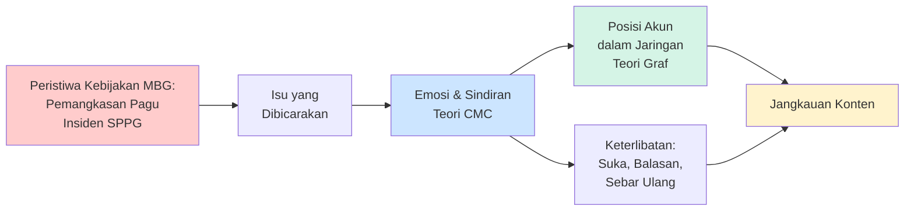

<!-- hlm. 10 -->

# BAB II
# TINJAUAN PUSTAKA

Bab ini terdiri atas penelitian terdahulu, tinjauan pustaka yang bertumpu pada teori Computer-Mediated Communication (CMC) dan teori graf, serta kerangka pemikiran.

## 2.1 Penelitian Terdahulu

Subbab ini membahas lima penelitian terdahulu dari jurnal internasional terindeks Scopus kuartil Q1 dan satu penelitian tentang MBG. Kelimanya berkaitan dengan bagian-bagian penelitian ini, yaitu emosi dan penyebaran pesan, pemantauan opini kebijakan, makna emoji, emoji sebagai penanda ironi, dan struktur jaringan percakapan di Twitter (Tabel 2.1).

<!-- hlm. 11 -->

**Tabel 2.1** Penelitian Terdahulu: Penulis, Judul, Metode, dan Celah Penelitian

| No | Penulis (Tahun) | Judul | Metode | Celah Penelitian | Jurnal |
|---|---|---|---|---|---|
| 1 | Stieglitz & Dang-Xuan (2013) | Emotions and Information Diffusion in Social Media—Sentiment of Microblogs and Sharing Behavior | Analisis sentimen dan analisis regresi atas lebih dari 165.000 cuitan politik di Twitter | Membuktikan cuitan bermuatan emosi lebih sering dan lebih cepat disebarkan ulang, tetapi sentimen dibaca dari kata saja; sindiran, emoji, dan jaringan aktor tidak dikaji | Journal of Management Information Systems, 29(4), 217–248 (Scopus Q1) |
| 2 | Ceron & Negri (2016) | The "Social Side" of Public Policy: Monitoring Online Public Opinion and Its Mobilization During the Policy Cycle | Supervised Aggregated Sentiment Analysis atas cuitan tentang dua reformasi kebijakan di Italia | Menunjukkan opini di Twitter berguna untuk memantau kebijakan, tetapi hanya sentimen agregat; sindiran, isu rinci, dan struktur jaringan tidak dianalisis | Policy & Internet, 8(2), 131–147 (Scopus Q1) |
| 3 | Kralj Novak dkk. (2015) | Sentiment of Emojis | Pelabelan manual oleh 83 penilai atas 1,6 juta cuitan dalam 13 bahasa Eropa; Emoji Sentiment Ranking | Mengukur sentimen 751 emoji, tetapi pada bahasa Eropa dan tidak membahas emoji sebagai penanda sindiran dalam isu kebijakan | PLoS ONE, 10(12), e0144296 (Scopus Q1) |
| 4 | Weissman & Tanner (2018) | A Strong Wink between Verbal and Emoji-Based Irony: How the Brain Processes Ironic Emojis during Language Comprehension | Tiga eksperimen ERP (event-related potentials) di laboratorium | Membuktikan emoji ironis diproses seperti ironi verbal, tetapi berupa eksperimen kalimat bahasa Inggris, bukan data percakapan nyata di media sosial | PLoS ONE, 13(8), e0201727 (Scopus Q1) |
| 5 | Himelboim dkk. (2017) | Classifying Twitter Topic-Networks Using Social Network Analysis | Analisis jaringan sosial (NodeXL) atas 60 jaringan topik Twitter: kepadatan, modularitas, sentralisasi, akun terisolasi | Mengklasifikasikan bentuk jaringan percakapan, tetapi hanya struktur; isi pesan (sindiran, emoji, isu) tidak dikaitkan dengan posisi akun | Social Media + Society, 3(1) (Scopus Q1) |
| 6 | Sianturi dkk. (2025) | Politics on a Plate: Equivocal Communication in Indonesian Presidential Nutrition Policy | Analisis sentimen atas 4.041 laporan berita di media sosial menggunakan Talkwalker Analytics (6-12 Januari 2025) | Sentimen negatif dominan (41,2%), positif 13,1%, netral 45,7%; fokus pada komunikasi pemerintah yang ambigu, tidak menganalisis sindiran, emoji, atau struktur jaringan penyebar | Frontiers in Communication (Scopus Q2) |
| 7 | Penelitian ini (2026) | Analisis Jaringan Komunikasi Triliunan Rupiah Program Makan Bergizi Gratis di Media Sosial Twitter | Kuantitatif deskriptif: analisis isi (sindiran, emoji, dan isu), analisis perilaku keterlibatan, dan analisis struktur jaringan komunikasi | Menggabungkan isi pesan (sindiran dan emoji) dengan struktur jaringan penyebarnya pada percakapan kebijakan berbahasa Indonesia, periode Maret–Mei 2026, ditafsirkan dengan teori CMC dan teori graf | Tesis (Magister Ilmu Komunikasi UPN "Veteran" Jawa Timur) |

Sumber: diolah peneliti dari masing-masing studi.

<!-- hlm. 12 -->

Selain kelima studi internasional yang telah dipaparkan di atas, penelusuran juga menemukan satu studi tentang MBG yang diterbitkan dalam jurnal terindeks Scopus. Sianturi, Lestari, Purba, Karim, dan Mulyani (2025) melakukan analisis sentimen terhadap 4.041 laporan berita di media sosial tentang MBG menggunakan alat analitik Talkwalker pada periode 6–12 Januari 2025. Hasil penelitian mereka menunjukkan bahwa sentimen negatif mendominasi dengan proporsi 41,2%, diikuti oleh sentimen netral sebesar 45,7%, dan sentimen positif sebesar 13,1%. Studi tersebut secara khusus mengkaji fenomena komunikasi pemerintah yang bersifat ambigu (equivocal communication) dalam konteks kebijakan gizi kepresidenan. Meskipun demikian, penelitian tersebut belum melakukan analisis mendalam terhadap fenomena sindiran, penggunaan emoji sebagai penanda makna, maupun struktur jaringan yang menyebarkan informasi dan opini.

<!-- hlm. 13 -->

### 2.1.1 Gap Penelitian

1. Pertama, penelitian tentang isi pesan masih membaca sentimen dari kata-kata saja (Stieglitz & Dang-Xuan, 2013; Ceron & Negri, 2016; Sianturi dkk., 2025). Kritik yang disampaikan melalui sindiran berisiko terbaca sebagai pujian. Penelitian ini mencatat sindiran dari ketidaksesuaian teks dan emoji pada setiap unggahan (rumusan masalah pertama).

2. Kedua, penelitian tentang emoji telah membuktikan bahwa emoji membawa arti sentimen (Kralj Novak dkk., 2015) dan dapat menandai ironi (Weissman & Tanner, 2018), tetapi belum diterapkan pada percakapan kebijakan publik berbahasa Indonesia. Penelitian ini menghitung emoji yang paling sering digunakan warganet dan kaitannya dengan sindiran (rumusan masalah pertama).

3. Ketiga, penelitian jaringan menggambarkan bentuk percakapan tanpa membaca isi pesannya (Himelboim dkk., 2017), sedangkan penelitian isi tidak menganalisis jaringan. Penelitian ini mengaitkan isu dan sindiran dengan perilaku keterlibatan (rumusan masalah kedua) serta dengan posisi akun dan komunitas dalam jaringan (rumusan masalah ketiga).

4. Keempat, belum ada penelitian yang memusatkan perhatian pada percakapan MBG di Twitter pada Maret–Mei 2026, ketika pagu anggaran dipangkas dan berbagai insiden SPPG terjadi hampir bersamaan. Penelitian ini mengamati periode tersebut sehingga keterkaitan antara peristiwa kebijakan dan reaksi warganet dapat dilihat lebih jelas.

<!-- hlm. 14 -->

Orisinalitas penelitian ini terletak pada penggunaan penilaian 9 Emoji, instrumen yang dikembangkan peneliti untuk membaca emosi warganet Indonesia dan mengenali sindiran dari ketidaksesuaian teks dan emoji. Hasil penilaian itu dipadukan dengan analisis jaringan komunikasi menggunakan NodeXL dan metode Louvain, sehingga emosi, sindiran, dan isu dapat dilihat menurut posisi akun dan komunitasnya. Keduanya diterapkan pada percakapan tentang Program MBG pada masa pemangkasan pagu dan insiden SPPG, yang belum dikaji oleh penelitian terdahulu.

## 2.2 Tinjauan Pustaka

Tinjauan pustaka disusun dari yang paling umum ke yang paling spesifik. Bagian ini dimulai dari teori CMC sebagai teori tentang komunikasi melalui media digital (subbagian 2.2.1), dilanjutkan dengan teori graf sebagai dasar analisis jaringan komunikasi (subbagian 2.2.2), lalu konteks media sosial Twitter di Indonesia (subbagian 2.2.3) dan kategori isu MBG (subbagian 2.2.4). Bagian ini ditutup dengan dialog kedua teori yang menghasilkan sintesis penelitian (subbagian 2.2.5).

### 2.2.1 Teori Computer-Mediated Communication (CMC)

Computer-Mediated Communication (CMC) adalah komunikasi antarmanusia melalui perangkat dan jaringan digital, termasuk media sosial seperti Twitter. Pada mulanya, para peneliti menganggap komunikasi daring "miskin makna" (Culnan & Markus, 1987). Anggapan ini muncul karena saat berkomunikasi melalui layar, seseorang tidak dapat melihat wajah, mendengar nada suara, atau melihat gerak tubuh lawan bicaranya. Akibatnya, komunikasi daring dipandang kurang mampu menyampaikan perasaan dan membangun kedekatan.

<!-- hlm. 15 -->

Pandangan tersebut kemudian dikoreksi oleh Walther (1992) melalui Social Information Processing Theory (SIP). Menurut teori ini, orang yang berkomunikasi melalui internet tetap dapat menyampaikan dan menangkap kesan, perasaan, dan maksud lawan bicaranya. Caranya, tanda-tanda yang hilang (seperti nada suara dan ekspresi wajah) digantikan oleh tanda lain yang tersedia, yaitu pilihan kata, gaya bahasa, tanda baca, dan simbol gambar (emoji). Dengan kata lain, emosi tetap dapat dikomunikasikan dalam komunikasi daring melalui tulisan dan simbol.

Walther dan D'Addario (2001) menemukan bahwa emotikon, terutama yang bernada negatif, memengaruhi cara pembaca menangkap maksud pesan. Derks, Fischer, dan Bos (2008) menunjukkan bahwa emoji dapat memperjelas, memperkuat, bahkan membalik makna, misalnya kalimat yang tampak serius menjadi sindiran.

Meski emoji membawa muatan perasaan yang relatif stabil (Kralj Novak dkk., 2015), satu emoji dapat dipahami berbeda oleh orang yang berbeda (Miller dkk., 2016). Atas dasar itu, emoji tetap harus dibaca bersama kalimat dan topik yang dibicarakan, terutama dalam percakapan MBG yang banyak menggunakan bahasa gaul, campuran bahasa, dan plesetan.

Camp (2012) menjelaskan bahwa sindiran bekerja melalui ketidaksesuaian (incongruity), yaitu ketika arti kata-kata yang diucapkan berbeda dengan keadaan sebenarnya. Sindiran berbeda dari ironi biasa karena penilaiannya lebih tajam. Sindiran sering sengaja digunakan untuk menyampaikan kekecewaan atau kemarahan secara tersirat. Sindiran juga berbeda dari satire. Satire biasanya berupa karya atau tulisan panjang yang jelas menyasar lembaga atau tokoh tertentu. Sindiran dalam penelitian ini berupa unggahan singkat yang sasarannya tidak selalu disebutkan.

<!-- hlm. 16 -->

Berdasarkan konsep ketidaksesuaian dari Camp (2012) dan fungsi emoji dalam CMC, penelitian ini mendefinisikan inkongruensi teks-emoji sebagai kondisi ketika muatan perasaan dari kata-kata dalam sebuah unggahan (positif, negatif, atau netral) jelas berbeda dengan muatan yang ditunjukkan emojinya. Contohnya pada Tabel 1.1: kalimat yang terdengar positif atau sekadar memberi informasi, tetapi diberi emoji badut, wajah terbalik, atau deretan emoji malaikat, maknanya berbalik menjadi sindiran atau ejekan. Konsep ini digunakan untuk mencatat sindiran dalam analisis isi (subbagian 3.8.1).

Emoji tertentu, misalnya wajah mengedip, dipahami pembaca sebagai penanda ironi dan diproses otak seperti ironi verbal (Weissman & Tanner, 2018). Berangkat dari temuan itu dan contoh pada Tabel 1.1, peneliti merumuskan tiga jenis penanda emoji sindiran: (1) "pembalik harapan", seperti wajah terbalik, ketika penulis menyadari pernyataannya sendiri tidak masuk akal; (2) "penghina halus", seperti wajah badut, untuk menyiratkan bahwa suatu pihak dipandang konyol; dan (3) "pujian palsu", seperti wajah malaikat atau senyum lebar, untuk menyindir klaim kebaikan yang dinilai tidak tulus.

Teori SIP bertumpu pada asumsi bahwa pengguna akan menyesuaikan diri dengan keterbatasan media dan memindahkan isyarat nonverbal ke dalam teks serta simbol. Kekuatannya terletak pada kemampuan menjelaskan mengapa emoji dan pilihan kata dapat dibaca sebagai penanda emosi dan sindiran. Namun, teori ini memiliki dua keterbatasan. Pertama, SIP semula dikembangkan untuk menjelaskan pembentukan kesan dalam hubungan antarpribadi yang berlangsung lama (Walther, 1992), bukan percakapan publik yang singkat dan melibatkan ribuan akun yang tidak saling kenal. Kedua, makna emoji tidak seragam antarbudaya dan antarpengguna (Miller dkk., 2016), sehingga isyarat yang sama dapat ditafsirkan berbeda. Dengan demikian, SIP digunakan untuk membaca isyarat di tingkat pesan, tetapi dibutuhkan teori lain untuk menjelaskan bagaimana pesan itu bergerak di antara ribuan akun.

<!-- hlm. 17 -->

#### Penilaian 9 Emoji

Penilaian 9 Emoji merupakan instrumen yang dikembangkan oleh peneliti dalam penelitian ini. Instrumen ini berpijak pada dua karya. Pertama, roda emosi (wheel of emotions) yang dikemukakan psikolog Robert Plutchik (1980), yang membagi emosi dasar manusia menjadi delapan: gembira, percaya, takut, terkejut, sedih, jijik, marah, dan antisipasi. Kedua, Emoji Sentiment Ranking yang disusun Petra Kralj Novak dan rekan-rekannya di Jožef Stefan Institute, Slovenia (Kralj Novak dkk., 2015), yang membuktikan bahwa emoji membawa muatan perasaan yang relatif stabil. Peneliti memadukan keduanya: delapan emosi Plutchik ditambah satu kategori netral, lalu setiap kategori diwakili satu emoji acuan. Setiap unggahan diberi satu kategori emosi yang paling menonjol dengan membaca teks, emoji, dan isu sebagai satu kesatuan. Emoji acuan hanya penanda; emoji di unggahan tidak harus sama persis, karena yang dinilai adalah perasaan yang ingin disampaikan (Tabel 2.2).

<!-- hlm. 18 -->

**Tabel 2.2** Sembilan Emosi yang Dinilai melalui Emoji

| Ikon | Kategori | Definisi | Interpretasi Komunikasi |
|---|---|---|---|
| 😡 | Marah | Perasaan kesal yang muncul karena merasa diperlakukan tidak adil atau janji tidak ditepati | Unggahan yang terang-terangan menolak kebijakan atau tindakan pemerintah |
| 😊 | Bahagia | Perasaan senang karena sesuatu berhasil atau harapan terwujud | Menunjukkan dukungan dan rasa terima kasih yang tulus terhadap program MBG |
| 😢 | Sedih | Perasaan sedih karena kehilangan sesuatu atau kecewa | Menandai unggahan yang menunjukkan rasa prihatin terhadap dampak buruk program di lapangan |
| 🤔 | Tertarik | Perasaan penasaran atau ingin tahu saat menemukan informasi baru | Menandai orang yang mau menyimak dan memikirkan informasinya, tanpa jelas menyatakan suka atau tidak suka |
| 😐 | Netral | Unggahan tidak menunjukkan perasaan yang kuat, baik senang maupun marah | Menandai unggahan yang hanya menyampaikan fakta apa adanya, tanpa menilai bagus atau buruk |
| 🤝 | Percaya | Perasaan yakin bahwa sumber informasi itu dapat dipercaya | Pengguna menganggap institusi atau pernyataan resmi itu sah dan layak dipercaya |
| 🤢 | Jijik | Perasaan muak atau menolak terhadap sesuatu yang dianggap tidak pantas | Sering muncul bersama sindiran terkait kualitas, kebersihan, atau keamanan makanan |
| 😲 | Kaget | Reaksi emosi saat menerima informasi yang tidak disangka-sangka | Menandai unggahan yang bereaksi terhadap kejadian atau fakta baru |
| 😨 | Takut | Perasaan khawatir atau cemas karena merasa ada bahaya atau risiko | Dipakai untuk unggahan yang menunjukkan kecemasan terhadap risiko kesehatan atau risiko keuangan negara |

Kategori antisipasi pada model Plutchik dioperasionalkan sebagai "tertarik", karena minat (interest) adalah bentuk antisipasi berintensitas rendah yang sering muncul dalam unggahan yang bertanya tentang MBG, sedangkan kategori gembira disebut "bahagia". Kategori percaya mendapat perhatian khusus untuk melihat kepercayaan masyarakat terhadap kebijakan.

<!-- hlm. 19 -->

### 2.2.2 Teori Graf dan Analisis Jaringan Komunikasi

#### Dasar-Dasar Teori Graf

Analisis jaringan komunikasi berangkat dari gagasan bahwa manusia berkomunikasi dalam jalinan hubungan dengan orang lain. Rogers dan Kincaid (1981) memperkenalkannya sebagai cara membaca pola komunikasi dalam sebuah kelompok, yaitu dengan menelusuri siapa berkomunikasi dengan siapa. Eriyanto (2014) menjelaskan bahwa jaringan adalah kumpulan orang (aktor) yang saling terhubung. Posisi seseorang di dalamnya menentukan seberapa mudah ia mendapat informasi dan seberapa besar pengaruhnya. Wasserman dan Faust (1994) menambahkan bahwa sikap dan perilaku seseorang tidak dapat dipahami tanpa melihat posisinya dalam hubungan sosial tersebut.

Jaringan komunikasi digambarkan secara matematis sebagai graf G = (V, E), dengan V adalah kumpulan akun (simpul) dan E kumpulan hubungan antarakun (sisi). Dalam penelitian ini, setiap akun Twitter yang membicarakan MBG adalah satu simpul, dan setiap kali satu akun menyebut akun lain dengan tanda @ dibuat satu sisi berarah dari akun yang menyebut ke akun yang disebut. Sisi diberi bobot sesuai jumlah sebutan antara dua akun yang sama (weighted graph).

Ukuran paling dasar dari sebuah jaringan adalah kepadatan (density), yaitu perbandingan antara jumlah hubungan yang benar-benar terjadi dan jumlah hubungan terbanyak yang mungkin terjadi. Nilainya berkisar 0 sampai 1; semakin mendekati 0, semakin renggang jaringannya. Nilai rendah wajar pada jaringan besar karena setiap orang hanya berinteraksi dengan sebagian kecil anggota jaringan (Wasserman & Faust, 1994).

<!-- hlm. 20 -->

#### Sentralitas dalam Jaringan

Sentralitas (centrality) adalah ukuran untuk mengenali akun yang memiliki posisi penting di dalam jaringan. Freeman (1979) merumuskan tiga ukuran klasik: degree (seberapa banyak hubungan yang dimiliki sebuah akun), betweenness (seberapa sering sebuah akun menjadi perantara antara akun-akun lain), dan closeness (seberapa dekat sebuah akun dengan semua akun lain). Ukuran ini kemudian dilengkapi oleh Bonacich (1987) dengan eigenvector centrality, yaitu ukuran yang menilai pentingnya akun dari seberapa penting akun-akun yang terhubung dengannya.

Pertama, sentralitas derajat (degree centrality), yaitu jumlah hubungan langsung yang dimiliki sebuah akun. Karena jaringan ini berarah, derajat dibedakan menjadi in-degree (berapa kali akun disebut akun lain, menandai akun yang banyak diperhatikan) dan out-degree (berapa kali akun menyebut akun lain, menandai akun yang paling aktif).

Kedua, sentralitas keperantaraan (betweenness centrality), yaitu seberapa sering sebuah akun berada di jalur terpendek yang menghubungkan dua akun lain (Freeman, 1979). Akun dengan nilai tinggi berperan sebagai jembatan antarkelompok.

Ketiga, sentralitas kedekatan (closeness centrality), yaitu seberapa dekat sebuah akun dengan akun lain berdasarkan rata-rata panjang jalur terpendeknya (Freeman, 1979). Karena jaringan sebutan biasanya terpecah, nilai ini dihitung di dalam komponen tempat akun berada.

Keempat, sentralitas eigenvector (Bonacich, 1987) menilai pentingnya sebuah akun dari pentingnya akun-akun yang terhubung dengannya. Akun berpengaruh menurut ukuran ini belum tentu akun dengan pengikut terbanyak, karena yang dinilai adalah posisinya dalam pola interaksi.

<!-- hlm. 21 -->

Selain ukuran per akun, Freeman (1979) merumuskan sentralisasi (centralization), yaitu seberapa besar hubungan menumpuk pada segelintir akun. Nilainya 0 sampai 1; nilai mendekati 1 berarti jaringan berbentuk bintang yang bertumpu pada satu akun pusat, sedangkan nilai mendekati 0 berarti hubungan tersebar merata.

Analisis jaringan juga mengenal keterjangkauan (reachability), yaitu berapa banyak akun yang dapat dicapai dari sebuah akun melalui rangkaian hubungan (Wasserman & Faust, 1994). Bersama jumlah tayangan dan sebar ulang (Bonsón & Ratkai, 2013), ukuran ini digunakan untuk menjawab rumusan masalah ketiga tentang jangkauan konten.

#### Komunitas dan Metode Louvain

Untuk menemukan kelompok akun yang lebih sering berinteraksi satu sama lain (komunitas), penelitian ini menggunakan metode Louvain. Metode ini dikembangkan oleh Vincent D. Blondel, Jean-Loup Guillaume, Renaud Lambiotte, dan Etienne Lefebvre (2008) di Université catholique de Louvain, Belgia; nama "Louvain" diambil dari universitas tempat metode ini lahir. Pada awalnya, setiap akun dianggap sebagai kelompok sendiri. Akun kemudian digabung satu per satu selama penggabungan itu menaikkan modularitas, dan proses ini diulang sampai tidak ada lagi penggabungan yang memperjelas pembagian. Metode ini dipilih karena cepat dan cocok untuk jaringan besar berisi ribuan akun.

Jaringan sebutan biasanya renggang dan terpecah menjadi banyak kelompok kecil, sehingga hasil pengelompokannya perlu dibaca hati-hati. Karena metode Louvain bekerja pada jaringan tak berarah, arah sebutan diabaikan pada tahap ini.

<!-- hlm. 22 -->

#### Polarisasi

Modularitas (Newman & Girvan, 2004) membandingkan jumlah hubungan di dalam kelompok dengan jumlah yang diperkirakan muncul bila akun terhubung secara acak. Nilai di atas 0,3 lazim dianggap tanda bahwa kelompok tidak terbentuk secara kebetulan. Dalam pembahasan kebijakan, modularitas tinggi dapat menandai ruang gema (echo chamber). Namun, pada jaringan yang sangat terpecah, nilai yang tinggi dapat juga hanya berarti percakapan tersebar dalam banyak kelompok kecil yang tidak saling terhubung.

Teori graf berasumsi bahwa hubungan sosial dapat disederhanakan menjadi simpul dan sisi yang terukur. Kekuatannya adalah ketepatan dalam menghitung struktur percakapan dan posisi aktor secara objektif (Wasserman & Faust, 1994). Keterbatasannya, teori graf hanya membaca bentuk hubungan. Sebuah sebutan dapat berisi dukungan, kritik, atau sindiran, tetapi semuanya tercatat sebagai sisi yang sama. Selain itu, jaringan sebutan hanya menangkap sebagian interaksi, karena sebar ulang dan suka tidak membentuk sisi. Oleh karena itu, teori graf perlu dipadukan dengan analisis isi berbasis teori CMC.

#### NodeXL sebagai Alat Analisis Jaringan

Pengolahan jaringan dalam penelitian ini menggunakan NodeXL (Network Overview, Discovery and Exploration for Excel), yaitu aplikasi tambahan untuk Microsoft Excel yang dikembangkan oleh Marc A. Smith, Ben Shneiderman, Natasa Milic-Frayling, dan rekan-rekan (Smith dkk., 2010), dan kini dikelola oleh Social Media Research Foundation. NodeXL dapat menghimpun data percakapan media sosial, menghitung kepadatan, sentralitas, dan modularitas, serta menyajikan visualisasi jaringan lengkap dengan pengelompokan komunitas metode Louvain. Panduan penggunaannya untuk analisis media sosial disusun oleh Hansen, Shneiderman, Smith, dan Himelboim (2020), dan aplikasi ini juga digunakan Himelboim dkk. (2017) untuk mengklasifikasikan 60 jaringan topik Twitter (Tabel 2.1).

<!-- hlm. 23 -->

### 2.2.3 Media Sosial Twitter sebagai Ruang Percakapan Publik

Fitur platform (affordance) adalah hal-hal yang dapat atau tidak dapat dilakukan pengguna, sesuai dengan cara platform itu dirancang (boyd, 2010). Twitter memiliki sejumlah fitur khas. Pertama, batas jumlah karakter yang membuat pesan harus singkat dan padat. Kedua, utas balasan (reply-thread) yang membuat percakapan dapat bersambung dan dibaca siapa saja. Ketiga, fitur sebar ulang (repost) yang membuat pesan dapat langsung disebarkan tanpa perantara. Keempat, anonimitas yang lebih longgar dibanding platform yang mewajibkan identitas asli, seperti Facebook.

Pengguna Twitter tidak mewakili seluruh masyarakat Indonesia, baik dari segi demografi maupun keterlibatan politik (Mellon & Prosser, 2017). Atas dasar itu, kata "publik" dalam penelitian ini berarti warganet yang aktif dan vokal di Twitter, yaitu kelompok yang banyak membuat dan menyebarkan kritik terhadap kebijakan (Ceron & Negri, 2016).

Percakapan tentang MBG di Twitter tidak ditulis dalam bahasa Indonesia baku. Warganet menggunakan bahasa gaul, singkatan, dan plesetan, serta sering mencampur bahasa Indonesia dengan bahasa Inggris atau bahasa daerah dalam satu unggahan.

<!-- hlm. 24 -->

Dalam konteks sosial-budaya Indonesia, kecenderungan mengkritik secara tidak langsung juga berkaitan dengan budaya komunikasi konteks tinggi, yaitu budaya yang lebih banyak menitipkan makna pada konteks daripada pada kata-kata yang diucapkan (Hall, 1976). Kritik terhadap penguasa kerap disampaikan secara halus melalui sindiran agar tidak terdengar konfrontatif. Di Twitter, kebiasaan ini bertemu dengan budaya warganet yang akrab dengan humor, plesetan, dan emoji, sehingga sindiran menjadi bentuk kritik yang lazim dalam percakapan tentang kebijakan seperti MBG.

Perilaku pengguna dapat dibaca dari keterlibatan (engagement), yang menurut Bonsón dan Ratkai (2013) terdiri atas popularitas (jumlah suka), komitmen (jumlah balasan), dan viralitas (jumlah sebar ulang). Memberi suka adalah tanggapan paling ringan, membalas berarti ikut dalam percakapan, dan menyebarkan ulang berarti membantu pesan menjangkau lebih banyak orang.

Unggahan politik di Twitter yang bermuatan emosi lebih sering dan lebih cepat disebarkan ulang daripada unggahan netral (Stieglitz & Dang-Xuan, 2013). Dengan demikian, keterlibatan dalam penelitian ini disajikan menurut emosi, ada tidaknya sindiran, dan isu.

<!-- hlm. 25 -->

### 2.2.4 Isu yang Dibicarakan Publik tentang Kebijakan

Satu unggahan dapat mendukung tujuan program sekaligus mengkritik pelaksanaannya. Karena itu, selain emosi, setiap unggahan juga diberi isu, yaitu pokok persoalan yang paling ditonjolkannya.

Lima kelompok isu ditetapkan dari penelusuran awal terhadap studi-studi sentimen MBG di Indonesia dan pemberitaan program selama periode penelitian, yaitu: (1) manfaat gizi dan sosial; (2) pelaksanaan program, pembagian makanan, dan pemerataan akses; (3) keamanan dan mutu makanan; (4) anggaran, keterbukaan, dan pertanggungjawaban; serta (5) pandangan politik dan ekonomi. Kelima isu ini sejalan dengan tiga sumber kontroversi di latar belakang: perubahan batas anggaran, penghentian sementara SPPG (dapur penyedia makanan) disertai dugaan pengadaan fiktif, dan kasus keracunan massal.

Kata kunci untuk mengenali tiap isu disusun dalam kamus isu dari kata-kata yang benar-benar digunakan warganet, bukan hanya dari daftar kata baku. Misalnya, "tempe separo" tidak memuat kata "distribusi" atau "porsi", padahal maksudnya berkaitan dengan porsi makanan. Dengan demikian, kelima kategori isu ditetapkan lebih dulu, sedangkan kata kuncinya disusun dari data.

<!-- hlm. 26 -->

### 2.2.5 Dialog Teori CMC dan Teori Graf: Model Sindiran Berjaringan

Teori CMC dan teori graf digunakan bersama karena keterbatasan teori yang satu dapat ditutup oleh teori yang lain. Teori CMC menjelaskan bagaimana emosi dan sindiran disampaikan melalui teks dan emoji, tetapi tidak menjelaskan ke mana pesan itu menyebar. Teori graf menjelaskan siapa terhubung dengan siapa dan akun mana yang berada di posisi pusat, tetapi tidak membaca isi pesannya. Analisis isi saja hanya menghasilkan sebaran emosi tanpa keterangan tentang akun penyebarnya, sedangkan analisis jaringan saja hanya menghasilkan visualisasi akun tanpa keterangan tentang isi pesan.

Berdasarkan hal tersebut, peneliti menyusun model sindiran berjaringan. Dalam model ini, setiap unggahan dilihat dari dua sisi, yaitu isinya (emosi dan sindiran yang disampaikan melalui teks dan emoji, sesuai teori CMC) dan posisi akun penulisnya dalam jaringan sebutan (sesuai teori graf). Dengan cara ini, sindiran dipahami sebagai pesan yang daya sebarnya ikut dipengaruhi oleh posisi pengirimnya. Model ini menjadi dasar kerangka berpikir pada subbagian 2.3.

<!-- hlm. 27 -->

## 2.3 Kerangka Pemikiran

Kerangka berpikir penelitian ini dibangun dari model sindiran berjaringan (subbagian 2.2.5) dan dijalankan dengan metode kuantitatif deskriptif. Kerangka ini menghubungkan enam variabel secara berurutan, yaitu peristiwa kebijakan, isu, emosi dan sindiran, keterlibatan, posisi akun dalam jaringan, serta jangkauan konten, sebagaimana divisualisasikan pada Gambar 2.1.

Hubungan pertama adalah dari peristiwa kebijakan ke isu, emosi, dan sindiran. Pemangkasan pagu dan insiden SPPG menjadi pemicu yang dibicarakan warganet sebagai isu tertentu, misalnya anggaran atau keamanan makanan. Menurut teori CMC, emosi atas isu tersebut tidak hilang karena ketiadaan isyarat nonverbal, tetapi dipindahkan ke pilihan kata dan emoji (Walther, 1992); ketika teks dan emoji tidak sejalan, emosi itu muncul sebagai sindiran (Camp, 2012). Hubungan ini menjawab rumusan masalah pertama.

Hubungan kedua adalah dari emosi dan sindiran ke keterlibatan. Pesan bermuatan emosi lebih sering dan lebih cepat disebarkan ulang daripada pesan netral (Stieglitz & Dang-Xuan, 2013), sehingga unggahan bersindiran diduga memperoleh suka, balasan, dan sebar ulang yang berbeda dari unggahan yang lugas. Hubungan ini menjawab rumusan masalah kedua.

Hubungan ketiga adalah dari posisi akun ke jangkauan konten. Menurut teori graf, akun dengan sentralitas tinggi dan akun penghubung antarkomunitas berada di jalur yang dilalui banyak pesan, sehingga sindiran dari akun tersebut berpeluang menjangkau lebih banyak akun (Freeman, 1979; Wasserman & Faust, 1994). Hubungan ini menjawab rumusan masalah ketiga. Karena penelitian ini deskriptif, ketiga hubungan tersebut hanya digambarkan polanya dan tidak diuji secara kausal.

<!-- hlm. 28 -->

**Gambar 2.1** Kerangka Berpikir Penelitian

Sumber: diolah peneliti (2026).

## 2.4 Fokus Analitis

Penelitian ini bersifat kuantitatif deskriptif sehingga tidak menguji hubungan sebab-akibat antarvariabel dan tidak merumuskan hipotesis statistik yang akan diuji. Sebagai gantinya, berdasarkan model sindiran berjaringan yang telah dipaparkan pada subbagian 2.2.5, dirumuskan tiga fokus analitis yang akan diperiksa secara deskriptif pada Bab IV.

<!-- hlm. 29 -->

**Fokus analitis pertama (pola konten):** Unggahan yang membahas isu anggaran serta isu keamanan dan mutu makanan diduga akan didominasi oleh emosi marah, jijik, dan takut, serta lebih banyak disampaikan melalui sindiran dibandingkan dengan isu-isu lainnya. Fokus ini berpijak pada teori Computer-Mediated Communication (CMC), yang menjelaskan bahwa emosi terkait isu yang menyentuh rasa keadilan dan keselamatan dikodekan melalui emoji dan ketidaksesuaian antara teks dan emoji. Fokus ini akan diperiksa melalui tabulasi silang antara kategori isu dengan kategori emosi (isu × emosi) serta antara kategori isu dengan status sindiran (isu × sindiran).

**Fokus analitis kedua (pola perilaku):** Unggahan yang mengandung sindiran diduga akan memperoleh tingkat keterlibatan—khususnya dalam bentuk sebar ulang—yang lebih tinggi dibandingkan dengan unggahan tanpa sindiran. Hal ini sejalan dengan temuan Stieglitz & Dang-Xuan (2013) yang menunjukkan bahwa unggahan bermuatan emosi cenderung lebih sering disebarkan ulang. Fokus ini akan diperiksa dengan membandingkan median nilai suka, balasan, dan sebar ulang menurut status sindiran (ya/tidak).

**Fokus analitis ketiga (pola jaringan):** Akun resmi pemerintah diduga tidak akan menempati posisi sentral dalam jaringan komunikasi, sementara akun tokoh publik dan akun warganet tertentu akan menjadi pusat perhatian serta berperan sebagai penghubung antarkelompok. Fokus ini berpijak pada teori graf dan akan diperiksa melalui pengukuran sentralitas (in-degree, out-degree, betweenness, closeness, eigenvector) serta identifikasi komunitas dengan metode Louvain.
