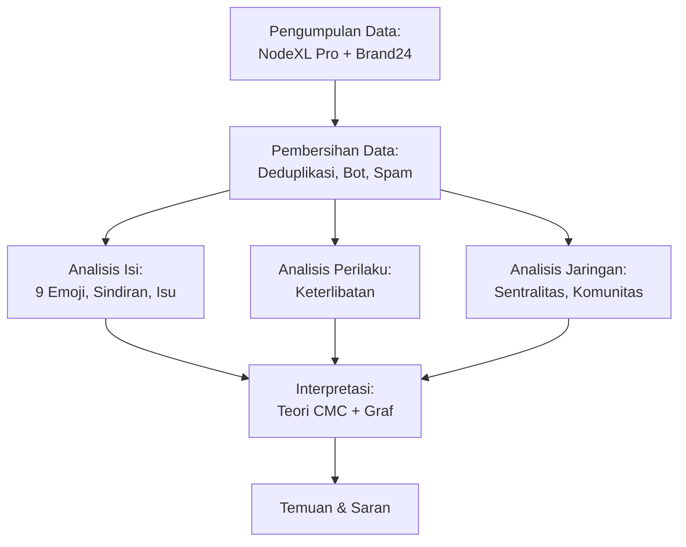

<!-- hlm. 30 -->

# BAB III
# METODE PENELITIAN

Bab ini menjelaskan pendekatan, variabel, lokasi dan waktu, populasi, sumber data, teknik pengumpulan data, dan teknik analisis data.

## 3.1 Pendekatan Penelitian

Objek penelitian ini adalah percakapan publik tentang Program MBG di media sosial Twitter selama Maret–Mei 2026, dengan subjek berupa akun-akun yang mengunggah dan saling menyebut dalam percakapan tersebut. Penelitian ini berpijak pada paradigma positivistik, yang memandang gejala komunikasi dapat diamati, diukur, dan dijelaskan secara objektif melalui data (Creswell & Creswell, 2018). Perspektif yang digunakan adalah perspektif ilmu komunikasi, khususnya komunikasi termediasi komputer dan jaringan komunikasi, sehingga teori CMC dan teori graf digunakan sebagai lensa untuk membaca data.

Penelitian ini menggunakan metode kuantitatif deskriptif. Metode kuantitatif digunakan karena gejala yang diteliti, yaitu sindiran, penggunaan emoji, isu, keterlibatan, dan hubungan antarakun, diubah menjadi kategori dan angka yang dapat dihitung (Creswell & Creswell, 2018; Kriyantono, 2014). Sifatnya deskriptif karena penelitian ini bertujuan menggambarkan pola percakapan tentang MBG di media sosial Twitter apa adanya, tanpa menguji hipotesis atau hubungan sebab-akibat.

<!-- hlm. 31 -->

Metode ini diterapkan dalam tiga analisis. Pertama, analisis isi: emosi setiap unggahan dinilai dengan penilaian 9 Emoji, sedangkan sindiran, emoji, dan isu dicatat menggunakan buku panduan penilaian, lalu dihitung jumlah dan persentasenya (Krippendorff, 2018; Neuendorf, 2017). Kedua, analisis perilaku: keterlibatan diringkas dengan jumlah, rata-rata, dan median. Ketiga, analisis jaringan komunikasi dengan NodeXL: hubungan antarakun diukur dengan kepadatan, sentralitas, dan modularitas Louvain. Rumusan masalah pertama dijawab dengan analisis isi, rumusan masalah kedua dengan analisis perilaku, dan rumusan masalah ketiga dengan analisis jaringan.

Alur penelitian terdiri atas tiga tahap, yaitu persiapan data, analisis deskriptif, dan interpretasi, seperti ditunjukkan pada Gambar 3.1.

**Gambar 3.1** Alur Penelitian

Sumber: diolah peneliti (2026).

<!-- hlm. 32 -->

## 3.2 Definisi dan Operasionalisasi

Tabel 3.1 menjelaskan definisi operasional, indikator, dan alat ukur setiap variabel.

**Tabel 3.1** Definisi Operasional Variabel

| Variabel | Definisi Operasional | Indikator/Alat Ukur |
|---|---|---|
| **Emosi** | Jenis emosi yang paling menonjol di setiap unggahan, menurut penilaian para penilai | Lembar penilaian emoji: setiap emoji dikelompokkan ke dalam salah satu dari sembilan kategori (Tabel 2.2) |
| **Sindiran** | Apakah isi teks bertentangan dengan emoji atau konteksnya? | Lembar penilaian: Apakah unggahan ini mengandung sindiran (sarkasme)? Jawab Ya atau Tidak. Jika Ya, pilih jenis cirinya: (a) membalik harapan, (b) menghina secara halus, atau (c) memuji dengan maksud mengejek. |
| **Kemunculan Emoji** | Berapa kali setiap emoji muncul di unggahan | (1) Frekuensi kemunculan tiap emoji dan (2) jumlah unggahan yang memuatnya, beserta persentase; 10 emoji teratas |
| **Isu Publik** | Masalah utama yang dibahas dalam unggahan | Lembar penilaian: lima kelompok isu ditambah kategori "lainnya", ditentukan dengan bantuan kamus isu (Lampiran 3) |

<!-- hlm. 33 -->

| Variabel | Definisi Operasional | Indikator/Alat Ukur |
|---|---|---|
| **Perilaku Komunikasi** | Seberapa sering orang mengunggah, seberapa banyak yang menanggapi, dan seberapa aktif akunnya | Berapa banyak unggahan yang muncul setiap hari dan selama periode tertentu; seberapa banyak yang menyukai (like); seberapa banyak yang membalas; seberapa banyak yang membagikan ulang (repost) atau mengutip; dan berapa banyak unggahan yang ditulis tiap akun. |
| **Aktor Dominan (Perilaku)** | Akun yang paling sering mengunggah dan paling banyak memperoleh keterlibatan | Sepuluh akun teratas, lengkap dengan jumlah unggahannya dan total suka, balasan, sebar ulang, serta kutipan yang diterima masing-masing akun. |
| **Struktur Jaringan** | Bentuk umum jaringan komunikasi | Jumlah akun (simpul) dan interaksi antarakun (ikatan), jumlah kelompok terpisah, ukuran kelompok terbesar, akun paling berpengaruh (sentralitas), serta jumlah komunitas yang terbentuk (Louvain) dan seberapa jelas pemisahannya (modularitas, batas 0,3). |
| **Kepadatan Jaringan** | Perbandingan ikatan yang terjadi dengan ikatan maksimum yang mungkin | Densitas (D) = hubungan yang ada ÷ hubungan yang mungkin ada. Nilai 0 berarti tidak ada akun yang saling terhubung, nilai 1 berarti semua akun saling terhubung. |
| **Sentralitas Aktor** | Posisi strategis setiap akun dalam jaringan | Lima ukuran sentralitas (in-degree, out-degree, betweenness, closeness, eigenvector) yang diskalakan 0-1 untuk menilai pengaruh tiap akun dalam jaringan. |
| **Pola Interaksi** | Bentuk hubungan antarakun | Akun mana yang menyebut akun lain (arah), seberapa sering disebut (bobot), dan apakah saling menyebut (timbal balik). |
| **Jangkauan Konten** | Luas penyebaran dan keterlihatan unggahan | Berapa kali sebuah unggahan dilihat dan dibagikan ulang, berapa banyak akun yang dapat dijangkau olehnya, dan seberapa besar kelompok akun yang saling terhubung. |

<!-- hlm. 34 -->

Setiap unggahan dinilai dengan lima aturan. Pertama, teks, emoji, dan topik dibaca sebagai satu kesatuan pesan. Kedua, emosi dinilai ke dalam satu dari sembilan kategori penilaian 9 Emoji (Tabel 2.2) yang paling kuat terasa. Ketiga, apabila arti teks bertentangan dengan emoji atau topiknya, unggahan dicatat sebagai sindiran dan emosinya dinilai dari maksud yang sebenarnya; misalnya kalimat memuji yang diakhiri emoji badut atau wajah terbalik. Keempat, unggahan tanpa emoji dinilai dari teks dan topiknya saja. Kelima, setiap unggahan diberi satu isu yang paling menonjol.

Status sindiran dicatat dengan jawaban ya atau tidak; jika ya, penilai mencatat jenis penandanya, yaitu pembalik harapan, penghinaan halus, atau pujian palsu (subbagian 2.2.1). Emoji yang sama tetapi berbeda warna kulit dianggap satu emoji.

## 3.3 Pengukuran Variabel

Skala pengukuran setiap variabel mengikuti jenis datanya. Kategori emosi (9 Emoji), status sindiran, jenis penanda sindiran, dan kelompok isu diukur dengan skala nominal. Jumlah emoji, unggahan, suka, balasan, sebar ulang, kutipan, dan tayangan diukur dengan skala rasio. Ukuran jaringan, yaitu kepadatan, sentralitas, sentralisasi, dan modularitas, juga berskala rasio dengan rentang 0–1.

<!-- hlm. 35 -->

### 3.3.1 Validitas dan Reliabilitas Pengukuran

#### Validitas Konstruk

Untuk memastikan bahwa penelitian ini benar-benar mengukur konsep yang dimaksudkan, seluruh kategori yang digunakan didasarkan pada teori yang telah mapan. Sembilan kategori emosi mengacu pada model emosi dasar Plutchik (1980). Lima kelompok isu ditetapkan berdasarkan penelusuran awal terhadap studi-studi sentimen MBG di Indonesia serta pemberitaan program selama periode penelitian. Ukuran sentralitas dalam analisis jaringan mengikuti konseptualisasi Freeman (1979) dan Bonacich (1987). Batas nilai modularitas untuk menentukan kekuatan pengelompokan komunitas mengacu pada standar Newman dan Girvan (2004).

#### Reliabilitas Penilaian

Untuk menjamin konsistensi penilaian terhadap variabel emosi, sindiran, dan isu, peneliti menyusun buku panduan penilaian (Lampiran 2) yang memuat:

1. Definisi operasional untuk setiap kategori emosi dalam penilaian 9 Emoji
2. Kriteria penanda sindiran berdasarkan ketidaksesuaian teks-emoji
3. Kamus isu yang berisi kata kunci untuk mengidentifikasi setiap kelompok isu
4. Contoh-contoh unggahan untuk masing-masing kategori sebagai panduan

<!-- hlm. 36 -->

Peneliti menilai seluruh korpus sejumlah 5.263 unggahan dengan berpedoman pada buku panduan tersebut. Untuk menjaga konsistensi penilaian, peneliti melakukan penilaian ulang terhadap 150 unggahan yang dipilih secara acak setelah jeda waktu 2 minggu (reliabilitas intra-penilai). Tingkat konsistensi penilaian diri sendiri akan dilaporkan di Bab IV menggunakan persentase kesepakatan dan Cohen's Kappa.

#### Keterbatasan Metodologis

Mengingat seluruh proses penilaian dilakukan oleh peneliti tunggal, hasil penilaian—khususnya untuk variabel sindiran dan isu—masih mengandung unsur interpretasi subjektif peneliti. Hal ini diakui sebagai salah satu batasan penelitian yang diuraikan pada subbagian 3.8.5 poin 7.

## 3.4 Lokasi dan Waktu Penelitian

Penelitian ini dilakukan di ruang digital, yaitu media sosial Twitter (kini bernama X), karena yang diteliti adalah percakapan publik di internet. Twitter dipilih karena cara kerjanya (subbagian 2.2.3), terutama unggahan yang hanya boleh singkat sehingga mendorong orang menulis sindiran.

<!-- hlm. 37 -->

Data yang dikumpulkan adalah unggahan yang terbit pada 2 Maret sampai 24 Mei 2026. Unggahan paling awal tercatat pada 2 Maret 2026 pukul 16.27 WIB, dan yang paling akhir pada 24 Mei 2026 pukul 16.22 WIB. Rentang waktu ini dibagi menjadi dua periode:

1. **Periode 1 (sebelum memanas):** 2 Maret sampai 30 April 2026.
2. **Periode 2 (puncak krisis):** 1 sampai 24 Mei 2026.

Periode 1 mencakup klarifikasi BGN pada 31 Maret tentang besaran anggaran MBG 2026 (Bloomberg Technoz, 2026), penghentian sementara 1.256 SPPG di Indonesia Timur per 1 April (ANTARA, 2026a), serta rapat koordinasi BGN–Komdigi pada 6 April (Badan Gizi Nasional, 2026). Periode 2 mencakup pengumuman resmi pemangkasan pagu MBG pada 19 Mei (ANTARA, 2026b) dan laporan BGN bahwa 1.152 SPPG masih ditangguhkan (ANTARA, 2026c). Batas 1 Mei ditetapkan berdasarkan lonjakan volume unggahan: 4.361 unggahan pada 1–24 Mei, jauh melampaui 688 unggahan sepanjang April (Tabel 3.2).

**Tabel 3.2** Linimasa Peristiwa Kebijakan MBG, Maret–Mei 2026

| Tanggal | Peristiwa | Sumber | Periode |
|---|---|---|---|
| 31 Mar 2026 | Klarifikasi BGN: anggaran yang dikelola Rp268 triliun, bukan Rp335 triliun | Bloomberg Technoz | Periode 1 |
| 1 Apr 2026 | Penghentian sementara 1.256 SPPG di Indonesia Timur yang belum memiliki IPAL dan SLHS | ANTARA | Periode 1 |
| 6 Apr 2026 | Rapat koordinasi komunikasi publik BGN–Komdigi | BGN | Periode 1 |
| 19 Mei 2026 | Pagu MBG 2026 dipangkas dari Rp335 triliun menjadi Rp268 triliun; realisasi hingga 30 April Rp75 triliun melalui 27.952 SPPG | ANTARA | Periode 2 |
| 25 Mei 2026 | BGN mencatat 4.581 SPPG pernah dihentikan sementara; 1.152 unit masih ditangguhkan | ANTARA | Periode 2 |

Sumber: diolah peneliti dari data sekunder (2026).

<!-- hlm. 38 -->

Kedua periode berbeda panjang (60 dan 24 hari) dan berbeda volume data (109 akun pada Periode 1 dan 871 akun pada Periode 2). Sebaran unggahan juga timpang: Periode 1 berisi 902 unggahan (Maret 214; April 688), sedangkan Periode 2 berisi 4.361 unggahan (±83% dari korpus). Karena itu, perbandingan antarperiode dilakukan dalam bentuk rata-rata per hari dan proporsi, dan ditafsirkan secara hati-hati.

## 3.5 Populasi, Sampel, dan Cara Pengambilan Sampel

Populasi penelitian adalah semua unggahan, balasan, dan kutipan berbahasa Indonesia tentang MBG di Twitter selama Maret sampai Mei 2026. Karena seluruh unggahan tersebut tidak dapat didaftar, populasi dibatasi secara operasional sebagai unggahan publik berbahasa Indonesia yang memuat kata kunci penelitian ("Makan Bergizi Gratis", "MBG", "Makan Siang Gratis", dan tagar terkait; Lampiran 1) selama periode penelitian. Seluruh unggahan yang berhasil dikumpulkan dan lolos pembersihan dianalisis (sensus atas korpus terkumpul). Teknik ini termasuk non-probabilitas berbasis kata kunci, sehingga hasilnya menggambarkan pola percakapan warganet yang aktif membahas MBG di Twitter, bukan seluruh masyarakat Indonesia.

Unit analisis pada tingkat isi dan perilaku adalah unggahan, yang mencakup posting asli, balasan, dan kutipan. Sebar ulang murni tidak dihitung sebagai unggahan tersendiri karena teksnya identik dengan unggahan asal; jumlahnya dicatat sebagai ukuran viralitas. Unit analisis pada tingkat jaringan adalah akun dan relasi sebutan antarakun.

<!-- hlm. 39 -->

Setelah pembersihan data (subbagian 3.7.2), data penelitian terdiri atas dua kelompok. Pertama, data teks berupa 5.263 unggahan yang seluruhnya dinilai emosi, sindiran, emoji, dan isunya. Kedua, data jaringan berupa 971 akun yang terhubung melalui 692 sebutan atau 666 hubungan unik dalam 341 komponen, disusun dari 748 unggahan yang mengandung sebutan (@). Periode 1 berisi 109 akun dan 65 hubungan unik, sedangkan Periode 2 berisi 871 akun dan 601 hubungan unik; 9 akun muncul pada kedua periode.

Data mentah yang berhasil dihimpun melalui pencarian berdasarkan kata kunci penelitian berjumlah 5.272 unggahan. Dari jumlah tersebut, sebanyak 9 unggahan bertanggal November 2025 (berada di luar rentang periode penelitian) dikeluarkan dari korpus, sehingga diperoleh korpus final sebanyak 5.263 unggahan yang seluruhnya menjadi subjek analisis dalam penelitian ini. Proses deduplikasi, normalisasi teks, dan penyaringan akun bot/spam telah dilaksanakan pada tahap pra-penelitian dengan mengikuti kriteria yang dirinci pada subbagian 3.7.2. Dengan demikian, korpus sejumlah 5.263 unggahan ini merupakan data yang telah melalui tahap pembersihan dan siap untuk dianalisis pada tiga tingkat: analisis konten, analisis perilaku keterlibatan, dan analisis struktur jaringan komunikasi.

Alur penyaringan data dari unggahan yang terkumpul sampai korpus akhir disajikan pada Tabel 3.3.

**Tabel 3.3** Alur Penyaringan Data

| Tahap | Jumlah |
|---|---|
| Data mentah terkumpul dari kata kunci | 5.272 |
| Dikeluarkan: unggahan di luar periode penelitian (November 2025) | −9 |
| Korpus setelah penyaringan periode | 5.263 |
| **Catatan:** Proses deduplikasi, normalisasi, dan penyaringan bot/spam telah dilakukan pada tahap pra-penelitian sesuai kriteria yang diuraikan pada subbagian 3.7.2 | |
| **KORPUS AKHIR** | **5.263** |

Sumber: diolah peneliti (2026).

<!-- hlm. 40 -->

## 3.6 Jenis dan Sumber Data

Penelitian ini menggunakan dua jenis data. Data primer adalah unggahan publik berbahasa Indonesia tentang MBG di media sosial Twitter beserta atributnya (waktu unggah, akun, sebutan, dan angka keterlibatan) yang dikumpulkan langsung oleh peneliti pada periode 2 Maret–24 Mei 2026. Data primer ini menjadi dasar analisis isi, analisis perilaku, dan analisis jaringan.

Data sekunder terdiri atas dokumen resmi pemerintah (rilis dan pernyataan Badan Gizi Nasional, dokumen APBN, dan pernyataan Kementerian Keuangan), berita media daring yang digunakan untuk menyusun linimasa peristiwa kebijakan selama periode penelitian (Tabel 3.2), serta artikel jurnal penelitian terdahulu. Data sekunder tidak ikut dinilai, tetapi digunakan untuk menetapkan batas periode dan menafsirkan temuan.

<!-- hlm. 41 -->

## 3.7 Teknik Pengumpulan Data

Data dikumpulkan dengan teknik dokumentasi daring, yaitu menghimpun pesan yang telah dipublikasikan di media sosial tanpa keterlibatan peneliti dalam percakapan (Kriyantono, 2014). Peneliti tidak berinteraksi dengan pengguna dan hanya mengunduh unggahan publik yang sudah ada.

Penelitian ini menggunakan kombinasi dua alat untuk memaksimalkan kualitas analisis pada tiga tingkat yang berbeda:

### 1. NodeXL Pro untuk Pengumpulan Data dan Visualisasi Jaringan

NodeXL Pro (Network Overview, Discovery and Exploration for Excel) adalah aplikasi tambahan untuk Microsoft Excel yang dikembangkan oleh Social Media Research Foundation (Smith dkk., 2010; Hansen dkk., 2020). NodeXL Pro digunakan untuk:

a) **Pengumpulan data Twitter:** Mengunduh unggahan publik dari Twitter beserta metadata lengkap (waktu unggah, akun penulis, akun yang disebut dengan mention, jumlah suka, balasan, retweet, kutipan, dan tayangan) melalui Twitter API dengan mekanisme pencarian berdasarkan kata kunci.

b) **Visualisasi jaringan komunikasi:** Menghasilkan grafik jaringan dengan pewarnaan otomatis berdasarkan komunitas yang terdeteksi, ukuran simpul yang disesuaikan dengan nilai sentralitas, serta berbagai pilihan tata letak (layout) seperti Fruchterman-Reingold dan Harel-Koren Fast Multiscale.

<!-- hlm. 42 -->

### 2. Brand24 untuk Analisis Engagement dan Identifikasi Influencer

Brand24 (https://brand24.com) adalah platform pemantauan media sosial berbasis web yang menyediakan analitik lanjutan untuk mengukur keterlibatan dan memetakan aktor berpengaruh (Kuć, 2017). Brand24 digunakan untuk:

a) **Analisis engagement metrics:** Menghitung metrik keterlibatan seperti interaction rate, virality score, dan reach estimation secara otomatis berdasarkan data like, reply, retweet, dan quote tweet yang dikumpulkan oleh NodeXL Pro.

b) **Identifikasi influencer:** Mendeteksi akun-akun yang memiliki pengaruh tinggi dalam menyebarkan wacana MBG berdasarkan kombinasi jumlah pengikut, frekuensi mention oleh akun lain, dan tingkat respons yang diterima.

c) **Pelacakan tren temporal:** Memvisualisasikan dinamika volume unggahan dan pola engagement dari waktu ke waktu dalam bentuk grafik timeline interaktif.

Kombinasi NodeXL Pro dan Brand24 memungkinkan peneliti untuk memanfaatkan kelebihan masing-masing alat: NodeXL Pro unggul dalam visualisasi struktur jaringan dan deteksi komunitas, sementara Brand24 unggul dalam analisis engagement dan identifikasi influencer secara otomatis. Data yang terkumpul melalui NodeXL Pro diekspor dalam format CSV kemudian diimpor ke Brand24 untuk analisis lanjutan, sebelum akhirnya memasuki tahap pembersihan (subbagian 3.7.2) dan analisis multilevel (subbagian 3.8).

<!-- hlm. 43 -->

Pencarian dilakukan melalui fitur **"Import from Twitter Search Network"** di NodeXL Pro dengan string pencarian: **"Makan Bergizi Gratis" OR "MBG" OR "Makan Siang Gratis" OR #MakanBergizisGratis OR #MBG**. Operator Boolean OR digunakan sehingga unggahan yang memuat salah satu dari kata kunci atau tagar tersebut ikut terjaring dalam hasil pencarian.

NodeXL Pro secara otomatis mengekstrak dan menyimpan atribut-atribut berikut untuk setiap unggahan:

- Teks unggahan lengkap beserta emoji yang menyertainya
- Tanggal dan waktu unggah dalam format timestamp
- Nama akun penulis (username dengan tanda @)
- Jenis unggahan (tweet asli, reply, atau quote tweet)
- Daftar akun yang disebut melalui mention (@)
- Metrik keterlibatan berupa jumlah like, reply count, retweet count, quote count, dan views (apabila tersedia)

Seluruh data ini langsung tersimpan dalam format tabel Excel dengan struktur satu baris untuk setiap unggahan dan satu kolom untuk setiap atribut. Selanjutnya, data diekspor dalam format CSV dan diimpor ke platform Brand24 untuk analisis engagement lanjutan dan identifikasi influencer secara otomatis. Brand24 menghasilkan laporan yang mencakup: (a) daftar akun berpengaruh berdasarkan reach dan interaction rate; (b) grafik tren volume unggahan dan engagement dari waktu ke waktu; serta (c) profil demografis akun yang berpartisipasi dalam diskusi MBG.

Setelah analisis engagement di Brand24 selesai, data digabungkan kembali dengan data NodeXL Pro untuk memasuki tahap pembersihan data (subbagian 3.7.2) dan tahap analisis multilevel (subbagian 3.8). Rincian lengkap string pencarian dan parameter yang digunakan di kedua platform disajikan pada Lampiran 1.

<!-- hlm. 44 -->

### 3.7.1 Prinsip Etis Penelitian

Penelitian ini memegang empat prinsip etis.

Pertama, nama akun pada visualisasi dan grafik jaringan ditampilkan sebagaimana tertulis di Twitter karena merupakan data publik dan menjadi bagian dari temuan struktur jaringan. Namun, isi unggahan warganet yang dikutip sebagai contoh tidak dikaitkan dengan nama akunnya, karena adanya context collapse, yaitu keadaan ketika unggahan yang ditulis untuk lingkaran kecil dibaca oleh audiens yang jauh lebih luas (Marwick & boyd, 2011; boyd & Crawford, 2012).

Kedua, akun bot dan akun yang bergerak secara terkoordinasi disaring dari data dengan kriteria yang diuraikan pada subbagian 3.7.2.

Ketiga, hanya data publik yang digunakan. Akun privat dan pesan langsung tidak disentuh, sehingga penelitian ini tidak memerlukan persetujuan dari partisipan (informed consent).

Keempat, data mentah disimpan di perangkat peneliti yang dilindungi kata sandi dan hanya digunakan untuk penelitian ini. Kutipan unggahan dalam naskah diparafrasekan seperlunya agar tidak mudah dilacak kembali ke akunnya.

<!-- hlm. 45 -->

### 3.7.2 Tahapan Pembersihan Data

Pembersihan data dilakukan melalui lima tahap berurutan sebagai berikut.

**Tahap pertama: Penghapusan duplikat dan retweet murni**

Unggahan yang identik dari akun yang sama pada waktu yang sama dianggap sebagai duplikat dan hanya diambil satu entri. Retweet murni (tanpa penambahan komentar) tidak dihitung sebagai unggahan tersendiri karena teksnya identik dengan unggahan asal; jumlah retweet dicatat sebagai indikator viralitas.

**Tahap kedua: Penyaringan bot, spam, dan promosi**

Akun diidentifikasi sebagai bot atau spam apabila memenuhi **≥2 dari 4 kriteria** berikut (Ferrara dkk., 2016; Pacheco dkk., 2021):

a) **Frekuensi unggah abnormal:** Lebih dari 120 unggahan per hari (setara ~5 unggahan/jam selama 24 jam penuh), atau lebih dari 20 unggahan dalam rentang waktu 1 jam.

b) **Pola teks repetitif:** Teks yang identik (setelah normalisasi whitespace dan konversi ke huruf kecil) diunggah ≥5 kali oleh akun yang sama.

c) **Keteraturan mekanis:** Jeda waktu antarunggahan yang terlalu teratur dengan standar deviasi <30 detik untuk ≥10 unggahan berurutan, yang mengindikasikan penggunaan bot penjadwal otomatis.

<!-- hlm. 46 -->

d) **Konten promosi/spam:** Unggahan memuat salah satu atau lebih dari:
   - Tautan shortened URL yang mengarah ke situs e-commerce (shopee.co.id, tokopedia.com, dll.) tanpa relevansi dengan topik MBG
   - Kata kunci spam seperti "joki tugas", "jasa tulis", "voucher", "diskon"
   - Mention lebih dari 5 akun dalam satu unggahan (indikasi mention spam)

**Catatan:** Akun media berita, akun dengan status verified, dan akun pejabat publik dikecualikan dari kriteria (a) dan (b) mengingat frekuensi unggah yang tinggi merupakan bagian dari aktivitas profesional mereka.

**Tahap ketiga: Penyaringan relevansi konten**

Unggahan yang memuat kata kunci "MBG" tetapi tidak membahas Program Makan Bergizi Gratis (misalnya menggunakan singkatan tersebut untuk konteks lain seperti "Main Bola Guys") dieliminasi melalui pemeriksaan manual pada sampel acak dan pattern matching dengan kata kunci konteks seperti "stunting", "SPPG", "gizi", dan "BGN".

**Tahap keempat: Normalisasi teknis**

Proses normalisasi meliputi: (a) penghapusan URL yang tidak relevan; (b) penghapusan karakter kontrol dan whitespace berlebih; (c) penghapusan mention ganda yang identik dalam satu unggahan. Emoji dan teks asli tetap dipertahankan utuh untuk keperluan analisis makna.

**Tahap kelima: Pembentukan jaringan**

Setiap akun diperlakukan sebagai satu simpul (node), dan setiap mention (@) membentuk satu sisi berarah (directed edge) dari akun penulis menuju akun yang disebut. Bobot sisi dihitung berdasarkan frekuensi mention: semakin sering akun A menyebut akun B, semakin besar bobot relasi di antara keduanya.

Rangkaian proses di atas menghasilkan korpus final sebanyak **5.263 unggahan** yang melibatkan **971 akun** dengan **666 relasi berarah unik** (692 mention dalam bentuk mentah).

<!-- hlm. 47 -->

## 3.8 Teknik Analisis Data

Data dianalisis secara kuantitatif deskriptif dalam tiga bagian yang saling melengkapi, yaitu isi unggahan, perilaku pengguna, dan pola hubungan antarakun (Hansen dkk., 2020). Setelah itu, hasilnya ditafsirkan dengan teori CMC dan teori graf serta ditampilkan dalam bentuk visual.

### 3.8.1 Analisis Isi: Penilaian 9 Emoji, Sindiran, dan Isu

Untuk menjawab rumusan masalah pertama, analisis isi dilakukan dalam empat langkah: (1) menyusun buku panduan penilaian yang berisi arti sembilan kategori emosi beserta emoji acuannya (Tabel 2.2), definisi sindiran dan jenis penandanya, serta kamus isu; (2) mencoba penilaian pada sejumlah kecil unggahan; (3) menilai setiap unggahan ke dalam satu kategori emosi penilaian 9 Emoji, status sindiran, dan isu yang paling menonjol; dan (4) menghitung jumlah dan persentase setiap kategori dari seluruh unggahan yang dinilai.

Hasilnya ditampilkan dalam tabel dan grafik batang, dan disajikan terpisah untuk Periode 1 dan Periode 2.

Semua emoji dalam data penelitian juga dihitung berapa kali muncul. Sepuluh emoji yang paling sering digunakan ditampilkan dalam tabel, lengkap dengan persentasenya dan proporsi kemunculannya pada unggahan bersindiran.

Untuk isu, setiap unggahan dikelompokkan ke dalam lima kelompok isu (subbagian 2.2.4) dengan bantuan kamus isu; unggahan di luar kelima kelompok itu dimasukkan ke kategori "lainnya". Hasilnya disilangkan dengan emosi dan status sindiran (isu × emosi dan isu × sindiran) sehingga terlihat isu mana yang paling banyak memicu emosi marah, jijik, atau takut, dan isu mana yang paling banyak disindir.

<!-- hlm. 48 -->

### 3.8.2 Analisis Perilaku

Analisis perilaku menjawab rumusan masalah kedua dan mencakup tiga hal. Pertama, jumlah unggahan per hari dan per periode, untuk melihat kapan percakapan tentang MBG meningkat dan apakah waktunya bertepatan dengan peristiwa kebijakan. Kedua, tingkat keterlibatan pengguna menurut Bonsón dan Ratkai (2013), yaitu popularitas (jumlah suka), komitmen (jumlah balasan), dan daya sebar (jumlah sebar ulang dan kutipan). Ketiga, keaktifan akun, yaitu jumlah unggahan setiap akun, untuk membedakan akun yang hanya sesekali ikut berbicara dari akun yang sangat aktif.

Setiap indikator diringkas dengan jumlah, rata-rata, dan median, karena keterlibatan di media sosial biasanya tidak merata. Hanya sedikit unggahan yang mendapat keterlibatan sangat tinggi, sedangkan sebagian besar unggahan lainnya hanya memperoleh sedikit tanggapan. Median keterlibatan disajikan menurut status sindiran, isu, dan periode untuk melihat apakah unggahan bersindiran lebih banyak ditanggapi dan disebarkan. Hasilnya disajikan dalam tabel, grafik garis, dan grafik batang.

Untuk mengetahui akun mana yang paling menonjol, akun diurutkan menurut jumlah unggahan dan total keterlibatannya. Sepuluh akun teratas pada tiap ukuran ditampilkan dalam tabel beserta jenis akunnya (media, tokoh publik, lembaga, atau warganet). Nama akun ditampilkan sesuai prinsip etis pada subbagian 3.7.1. Hasilnya lalu dibandingkan dengan akun-akun yang paling berperan di analisis jaringan, untuk melihat apakah akun yang paling aktif juga yang paling berpengaruh.

<!-- hlm. 49 -->

### 3.8.3 Analisis Struktur Jaringan

Analisis struktur jaringan untuk menjawab rumusan masalah ketiga dilakukan di NodeXL dalam tujuh langkah.

Pertama, data hubungan antarakun disusun menjadi jaringan berarah dan berbobot sebagaimana diuraikan pada subbagian 3.7.2.

Kedua, dihitung karakteristik makro jaringan, yaitu jumlah akun dan hubungan, tingkat kepadatan hubungan (kepadatan), jumlah kelompok yang terpisah satu sama lain (komponen), dan tingkat keterpusatan jaringan (sentralisasi).

Ketiga, dihitung peran tiap akun dengan lima ukuran sentralitas (in-degree, out-degree, betweenness, closeness, dan eigenvector) sebagaimana diuraikan pada subbagian 2.2.2. Untuk tiap ukuran, diambil sepuluh akun teratas pada komponen terbesar.

Keempat, akun-akun yang saling dekat dikelompokkan menjadi komunitas dengan metode Louvain (Blondel dkk., 2008) pada jaringan yang arahnya diabaikan. Kekuatan pengelompokan itu diukur dengan modularitas, yaitu nilai yang menunjukkan seberapa jelas batas antarkelompok. Komunitas berukuran kurang dari 5 akun dilaporkan sebagai satu kelompok "komunitas kecil".

Kelima, hasil analisis isi dipasangkan pada setiap akun: setiap akun penulis diberi emosi dan isu dominan (modus) dan proporsi unggahan bersindiran dari seluruh unggahannya, sedangkan akun yang hanya disebut tetapi tidak menulis unggahan dalam korpus (misalnya akun pejabat atau lembaga) diberi label "tanpa unggahan" dan tetap dianalisis posisinya dalam jaringan. Akun resmi pemerintah, misalnya BGN dan kementerian terkait, diberi penanda khusus sehingga posisinya dapat dibandingkan dengan akun media, tokoh publik, dan warganet.

<!-- hlm. 50 -->

Keenam, semua hasil dibandingkan antara Periode 1 dan Periode 2. Karena panjang kedua periode berbeda (60 hari dan 24 hari), jumlah unggahan dan akun dibandingkan dalam bentuk rata-rata per hari dan persentase, bukan angka mentah. Karena jaringan Periode 1 sangat kecil (109 akun), perbandingan struktur jaringan antarperiode bersifat indikatif.

Ketujuh, jangkauan konten dihitung dari dua sisi: (a) jumlah tayangan dan sebar ulang per unggahan (total, rata-rata, dan median), disajikan menurut sindiran, isu, dan periode; dan (b) keterjangkauan dalam jaringan, yaitu jumlah akun yang dapat dicapai dari setiap aktor melalui rantai sebutan, beserta ukuran komponennya.

### 3.8.4 Interpretasi dan Visualisasi

Hasil ketiga analisis ditampilkan dalam visualisasi jaringan NodeXL, daftar akun paling berpengaruh, visualisasi komunitas Louvain, serta tabel dan grafik sebaran emosi (9 Emoji), sindiran, emoji, dan isu. Teori CMC digunakan untuk menafsirkan bagaimana emosi dan sindiran disampaikan melalui teks dan emoji serta bagaimana pesan itu ditanggapi, sedangkan teori graf digunakan untuk menafsirkan posisi akun dan kelompok yang menyebarkannya. Hasil ini menjadi dasar saran strategi komunikasi bagi BGN.

<!-- hlm. 51 -->

### 3.8.5 Batasan Penelitian

Penelitian ini memiliki batasan sebagai berikut.

1. **Cakupan waktu dan bahasa.** Penelitian ini hanya menganalisis percakapan berbahasa Indonesia di media sosial Twitter pada Maret sampai Mei 2026. Periode ini dipilih karena mencakup saat anggaran dipangkas dan saat masalah operasional SPPG (dapur pelayanan gizi) paling intens diperbincangkan. Unggahan yang seluruhnya berbahasa daerah atau berbahasa asing tidak dimasukkan. Unggahan berbahasa Indonesia yang hanya diselipi sedikit kata daerah atau asing tetap digunakan.

2. **Pilihan emosi.** Emosi dikelompokkan ke dalam sembilan kategori penilaian 9 Emoji, yaitu marah, bahagia, sedih, tertarik, netral, percaya, jijik, kaget, dan takut. Setiap unggahan hanya diberi satu emosi yang paling menonjol, dan penelitian ini tidak membuat kategori emosi baru di luar sembilan tersebut.

3. **Cakupan deteksi sindiran.** Sindiran hanya dicatat jika ada penanda yang dapat dikenali penilai, yaitu ketidaksesuaian antara isi tulisan dan emoji (misalnya, tulisan mengeluh tetapi diberi emoji tertawa) atau penanda teks seperti tanda kutip ironis ("katanya"), pujian berlebihan, dan tanda baca berlebihan (Attardo, 2000). Sindiran yang sepenuhnya tersirat, tanpa tanda tulisan atau gambar apa pun, tidak dicakup. Alasannya, penilai sulit menafsirkan sindiran yang bergantung pada konteks budaya yang sangat khusus tanpa tanda yang jelas.

<!-- hlm. 52 -->

4. **Cakupan interaksi jaringan.** Jaringan dibangun dari interaksi saling menyebut (mention) antarakun. Akun bot dan spam dikeluarkan dari data. Balasan dan sebar ulang (retweet) tidak dijadikan garis hubungan antarakun karena data yang terkumpul hanya memuat jumlahnya, bukan siapa berinteraksi dengan siapa. Keduanya tetap digunakan sebagai ukuran seberapa aktif sebuah unggahan ditanggapi. Interaksi 'suka' atau 'markah' juga tidak dijadikan garis hubungan karena sifatnya pasif.

5. **Cakupan identifikasi isu.** Isu yang diidentifikasi dibatasi pada lima kelompok isu (subbagian 2.2.4). Unggahan di luar kelima kelompok itu dicatat sebagai 'lainnya' dan tidak dianalisis lebih jauh, supaya pembahasan tetap fokus pada isu yang paling berkaitan dengan menurunnya kepercayaan publik.

6. **Keterbatasan akses data.** Data dikumpulkan dari unggahan publik melalui aplikasi pengumpul data, bukan akses resmi platform. Jumlah unggahan yang terjangkau dapat dipengaruhi kebijakan platform dan kecenderungan alat menjangkau unggahan terbaru, sehingga volume antarperiode tidak sepenuhnya mencerminkan intensitas percakapan yang sebenarnya.

7. **Penilai tunggal.** Seluruh unggahan dinilai oleh peneliti sendiri dengan berpedoman pada buku panduan penilaian, sehingga hasil penilaian sindiran dan isu masih mengandung unsur tafsiran peneliti.

Dengan batasan tersebut, simpulan penelitian ditarik sebatas yang dapat didukung oleh data yang tersedia.

<!-- hlm. 53 -->

## 3.9 Temuan Awal Studi Pendahuluan

Untuk menguji kelayakan rancangan analisis, peneliti melakukan analisis jaringan pendahuluan menggunakan NodeXL terhadap data sebutan yang telah terkumpul, yaitu 971 akun dan 666 relasi berarah unik. Analisis pendahuluan ini belum mencakup analisis isi dan perilaku. Oleh karena itu, hasilnya diposisikan sebagai gambaran awal untuk mematangkan rancangan penelitian, bukan sebagai temuan akhir.

### 3.9.1 Karakteristik Makro Jaringan

Jaringan percakapan MBG sangat renggang dan terpecah. Kepadatannya hanya 0,000707, dan akun-akun terbagi ke dalam 341 komponen terpisah. Modularitas Louvain mencapai 0,9837, jauh di atas batas 0,3 (Newman & Girvan, 2004). Seperti dibahas pada subbagian 2.2.2, nilai setinggi ini lebih menunjukkan fragmentasi, yaitu percakapan yang berlangsung dalam banyak kelompok kecil yang tidak saling bertemu, daripada dua kubu besar yang saling berlawanan. Timbal balik antarakun juga sangat rendah: hanya 3,45% relasi yang berbalas ke arah sebaliknya, sehingga komunikasi lebih menyerupai siaran satu arah daripada dialog.

<!-- hlm. 54 -->

### 3.9.2 Aktor Dominan

Gambar 3.2 menunjukkan akun-akun yang paling menonjol dalam jaringan. Akun @prabowo menjadi akun yang paling banyak disebut (in-degree 15), sehingga berfungsi sebagai muara aduan, kritik, dan tuntutan warganet. Akun @grok, yaitu layanan kecerdasan buatan milik Twitter, menjadi akun yang paling banyak menyebut akun lain (out-degree 42) karena menjawab pertanyaan warganet. Di antara warganet, @4Y4NKZ dan @newIding30 masing-masing menyebut 15 akun lain. Akun resmi BGN tidak muncul sama sekali dalam jaringan sebutan; satu-satunya akun kementerian yang muncul, @kemenkeu, hanya disebut satu kali. Dalam jaringan berarah, hanya sedikit akun yang berada di jalur perantara, dan nilai keperantaraan tertinggi (@4Y4NKZ dan @regar_op0sisi) pun sangat kecil. Temuan ini sejalan dengan Suaib dan Pratiwi (2025) yang juga tidak menemukan aktor perantara yang kuat dalam jaringan percakapan MBG.

**Gambar 3.2** Aktor Dominan dan Perbandingan Jaringan Antarperiode

[Visualisasi grafik jaringan NodeXL akan dimasukkan di sini]

Sumber: diolah peneliti dari data NodeXL (2026).

<!-- hlm. 55 -->

### 3.9.3 Jangkauan dan Perubahan Antarperiode

Jangkauan dihitung dari jumlah akun yang dapat dicapai melalui rantai sebutan. Akun @grok menjangkau 42 akun secara langsung, tetapi hanya 2 akun pada lapis kedua. @4Y4NKZ dan @newIding30 menjangkau 15 akun secara langsung, dan jangkauannya tidak berlanjut ke lapis kedua. Artinya, pesan dalam jaringan ini hampir selalu berhenti pada lingkar pertama dan jarang diteruskan lebih jauh (Gambar 3.3).

Dari sisi waktu, jumlah akun yang terlibat naik dari 109 pada Periode 1 menjadi 871 pada Periode 2 (+699%), dan relasi unik naik dari 65 menjadi 601 (+825%) (Gambar 3.2c). Karena panjang kedua periode dan volume datanya timpang (subbagian 3.4), lonjakan ini dibaca sebagai indikasi awal.

**Gambar 3.3** Visualisasi Delapan Komponen Terbesar Jaringan Sebutan MBG

[Visualisasi 8 komponen jaringan akan dimasukkan di sini]

Sumber: diolah peneliti dari data NodeXL (2026).

<!-- hlm. 56 -->

### 3.9.4 Implikasi bagi Rancangan Penelitian

Temuan pendahuluan ini mendukung rancangan penelitian. Dilihat dari teori graf, jaringan yang renggang, terpecah, dan hampir tanpa timbal balik menunjukkan bahwa percakapan tentang MBG lebih banyak berlangsung satu arah, sementara akun resmi BGN tidak hadir di dalamnya. Karena jaringan terpecah, analisis sentralitas perlu difokuskan pada komponen terbesar dan dibaca bersama hasil analisis isi, sebagaimana dirancang pada subbagian 3.8.3. Temuan ini juga memberi arah awal bagi saran komunikasi, yaitu BGN perlu ikut hadir dalam percakapan dan menjangkau akun-akun yang menjadi titik temu warganet, tidak hanya menambah klarifikasi satu arah.
