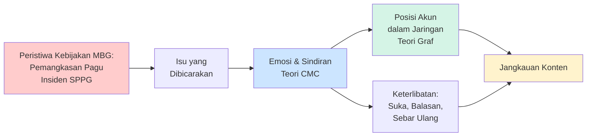
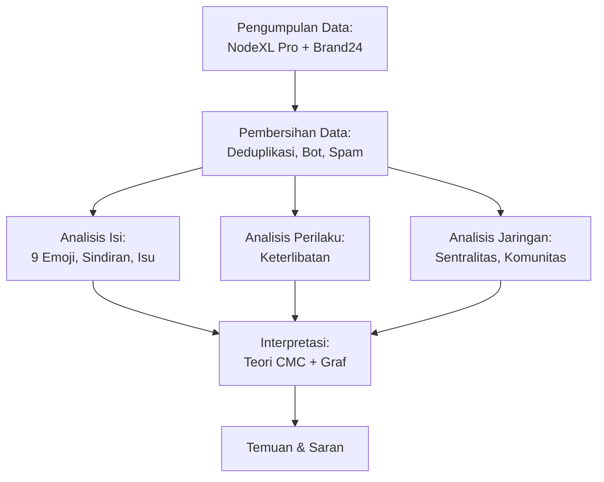

# PROPOSAL TESIS

<div style="page-break-before: always"></div>

<!-- hlm. i -->

# ANALISIS JARINGAN KOMUNIKASI TRILIUNAN RUPIAH PROGRAM MAKAN BERGIZI GRATIS DI MEDIA SOSIAL TWITTER

**PROPOSAL TESIS**

<br><br><br><br>

Oleh:

**INDRI ANJAR KARTIKA SARI**

NPM. 25067020011

<br><br><br>

PROGRAM STUDI MAGISTER ILMU KOMUNIKASI

FAKULTAS ILMU SOSIAL, BUDAYA DAN POLITIK

UNIVERSITAS PEMBANGUNAN NASIONAL VETERAN JAWA TIMUR

SURABAYA

2026

---

<div style="page-break-before: always"></div>

<!-- hlm. ii -->

## LEMBAR PERSETUJUAN

**ANALISIS JARINGAN KOMUNIKASI TRILIUNAN RUPIAH PROGRAM MAKAN BERGIZI GRATIS DI MEDIA SOSIAL TWITTER**

Disusun oleh:

**Indri Anjar Kartika Sari**  
NPM. 25067020011

Telah disetujui untuk mengikuti ujian proposal tesis

| DOSEN PEMBIMBING UTAMA | DOSEN PEMBIMBING KEDUA |
|------------------------|------------------------|
| <br><br><br> | <br><br><br> |
| **Prof. Dr. Catur Suratnoaji, S.Sos., M.Si.** | **Dr. Agus Widiyarta, S.Sos., M.Si.** |
| NIP. 196804182021211006 | NIP. 197108082021211005 |

Mengetahui  
**DEKAN FAKULTAS ILMU SOSIAL, BUDAYA DAN POLITIK**

<br><br><br>

**Prof. Dr. Catur Suratnoaji, S.Sos., M.Si.**  
NIP. 196804182021211006

---

<div style="page-break-before: always"></div>

<!-- hlm. iii -->

## LEMBAR PENGESAHAN

**ANALISIS JARINGAN KOMUNIKASI TRILIUNAN RUPIAH PROGRAM MAKAN BERGIZI GRATIS DI MEDIA SOSIAL TWITTER**

oleh:

**Indri Anjar Kartika Sari**  
NPM. 25067020011

Telah dipertahankan dihadapan dan diterima oleh Tim Penguji Proposal Tesis Program Studi Magister Ilmu Komunikasi Fakultas Ilmu Sosial, Budaya dan Politik Universitas Pembangunan Nasional Veteran Jawa Timur pada tanggal ____________

| PEMBIMBING UTAMA | TIM PENGUJI |
|------------------|-------------|
| <br><br> | <br><br> |
| **Prof. Dr. Catur Suratnoaji, S.Sos., M.Si.** | **[Nama Ketua Penguji]** |
| NIP. 196804182021211006 | NIP/NPT. ..................................... |
|  |  |
| **PEMBIMBING KEDUA** | <br><br> |
| <br><br> | **Prof. Dr. Catur Suratnoaji, S.Sos., M.Si.** |
| **Dr. Agus Widiyarta, S.Sos., M.Si.** | NIP. 196804182021211006 |
| NIP. 197108082021211005 |  |
|  | <br><br> |
|  | **[Nama Anggota Penguji 2]** |
|  | NIP/NPT. ..................................... |

Mengetahui  
**DEKAN FAKULTAS ILMU SOSIAL, BUDAYA DAN POLITIK**

<br><br><br>

**Prof. Dr. Catur Suratnoaji, S.Sos., M.Si.**  
NIP. 196804182021211006

---

<div style="page-break-before: always"></div>

<!-- hlm. iv -->

## PERNYATAAN BEBAS PLAGIAT

Saya yang bertanda tangan di bawah ini:

| | |
|---|---|
| Nama | : Indri Anjar Kartika Sari |
| NPM | : 25067020011 |
| Angkatan | : 2025/2026 |
| Program Studi | : Magister Ilmu Komunikasi |
| Fakultas | : Ilmu Sosial, Budaya dan Politik |

Dengan ini menyatakan bahwa proposal tesis yang berjudul "Analisis Jaringan Komunikasi Triliunan Rupiah Program Makan Bergizi Gratis di Media Sosial Twitter" merupakan hasil karya saya sendiri, bukan hasil plagiat, duplikasi, atau menjiplak karya orang lain, kecuali kutipan yang telah disebutkan sumbernya sesuai dengan kaidah penulisan ilmiah yang berlaku. Apabila di kemudian hari ditemukan pelanggaran atas pernyataan ini, saya bersedia menerima sanksi akademik sesuai dengan ketentuan yang berlaku di Universitas Pembangunan Nasional "Veteran" Jawa Timur.

Surabaya, .......................... 2026  
Penulis,

<br><br>

[Meterai Rp10.000,00]

<br>

**Indri Anjar Kartika Sari**  
NPM: 25067020011

---

<div style="page-break-before: always"></div>

<!-- hlm. v -->

## KATA PENGANTAR

Puji syukur penulis panjatkan ke hadirat Allah SWT atas limpahan rahmat, taufik, dan hidayah-Nya sehingga proposal tesis yang berjudul "Analisis Jaringan Komunikasi Triliunan Rupiah Program Makan Bergizi Gratis di Media Sosial Twitter" ini dapat diselesaikan. Proposal ini disusun sebagai salah satu syarat untuk mengikuti ujian proposal tesis pada Program Studi Magister Ilmu Komunikasi. Penelitian ini dilatarbelakangi oleh pentingnya memahami komunikasi publik di media digital, karena kebijakan pemerintah senilai ratusan triliun rupiah kini juga diawasi dan dikritik warganet di media sosial Twitter.

Ucapan terima kasih penulis haturkan kepada seluruh pihak yang telah mendukung penyelesaian proposal tesis ini, di antaranya kepada:

1. Prof. Dr. Catur Suratnoaji, S.Sos., M.Si. selaku Dekan Fakultas Ilmu Sosial, Budaya dan Politik;

2. Aulia Rahmawati, S.Sos., M.Si., Ph.D selaku Koordinator Program Studi Magister Ilmu Komunikasi;

3. Prof. Dr. Catur Suratnoaji, S.Sos., M.Si. selaku Dosen Pembimbing Utama, dan Dr. Agus Widiyarta, S.Sos., M.Si. selaku Dosen Pembimbing Kedua, atas bimbingan, arahan, dan masukan berharga selama proses penyusunan proposal ini;

4. Seluruh dosen Program Studi Magister Ilmu Komunikasi FISIBPOL UPN Veteran Jawa Timur atas ilmu yang diberikan;

5. Keluarga dan rekan mahasiswa yang telah memberikan dukungan selama proses penyusunan proposal penelitian ini berlangsung.

Penulis menyadari bahwa proposal ini masih memiliki keterbatasan, sebagaimana diuraikan pada batasan penelitian (subbagian 3.8.5). Kritik dan saran yang membangun sangat penulis harapkan demi penyempurnaan lebih lanjut.

Surabaya, 29 Oktober 2026

<br><br>

**Indri Anjar Kartika Sari**  
NPM: 25067020011

---

<div style="page-break-before: always"></div>

<!-- hlm. vi -->

## ABSTRAK

Program Makan Bergizi Gratis (MBG) merupakan salah satu inisiatif strategis pemerintah Indonesia dalam bidang gizi dan kesehatan masyarakat yang dialokasikan dengan anggaran sangat signifikan. Pada tahun pertama implementasi (2025), program ini menerima dana sebesar Rp71 triliun, sementara untuk tahun 2026 pagu anggarannya mengalami penyesuaian dari rencana awal Rp335 triliun menjadi Rp268 triliun. Dalam pelaksanaannya, program menghadapi sejumlah tantangan operasional yang meliputi pemberhentian sementara ribuan unit Satuan Pelayanan Pemenuhan Gizi (SPPG), adanya indikasi pengadaan yang tidak sesuai prosedur, serta perdebatan mengenai kebijakan impor wadah makanan. Kondisi-kondisi tersebut memicu respons kritis dan sindiran dari warganet di media sosial Twitter.

Penelitian ini mengadopsi metode kuantitatif deskriptif yang mengintegrasikan tiga dimensi analisis: analisis isi unggahan yang mencakup penilaian 9 Emoji, identifikasi sindiran, pelacakan penggunaan emoji, dan pemetaan kategori isu; analisis pola perilaku keterlibatan pengguna; serta analisis struktur jaringan komunikasi. Korpus penelitian terdiri dari 5.263 unggahan publik berbahasa Indonesia yang diterbitkan di media sosial Twitter selama kurun waktu 2 Maret hingga 24 Mei 2026, dengan jaringan sebutan yang melibatkan 971 akun dan 666 relasi berarah. Interpretasi temuan dilakukan dalam kerangka teori Computer-Mediated Communication (CMC) dan teori graf.

[Bagian hasil untuk ketiga rumusan masalah dan simpulan akan dilengkapi setelah analisis data pada Bab IV selesai dilaksanakan: distribusi emosi berdasarkan 9 Emoji, pola sindiran, penggunaan emoji, dan isu yang dominan; pola keterlibatan pengguna; serta struktur jaringan, aktor dominan, dan pembentukan komunitas.]

**Kata Kunci:** Program Makan Bergizi Gratis, Jaringan Komunikasi, Sindiran Digital, Emosi, Emoji, Computer-Mediated Communication, Teori Graf, Twitter

---

<div style="page-break-before: always"></div>

<!-- hlm. vii -->

## ABSTRACT

The Free Nutritious Meal Program (Makan Bergizi Gratis/MBG) is a strategic social-health intervention of the Indonesian government toward the Golden Indonesia 2045 vision. The program carries substantial fiscal consequences: in its initial implementation phase in 2025, the government allocated IDR 71 trillion from the state budget, and the indicative ceiling for 2026 was revised from IDR 335 trillion to IDR 268 trillion. A series of governance and operational issues including suspended SPPG units, alleged fictitious procurement, and a food-container import controversy triggered digital criticism and sindiran (sarcastic remarks) on Twitter, risking an erosion of public trust.

This study employed a quantitative descriptive method comprising content analysis of posts (nine-emoji emotion coding, sarcasm, emoji use, and issue mapping), analysis of netizens' engagement behavior, and communication network structure analysis. The data comprised 5,263 public Indonesian-language posts about MBG on Twitter from 2 March to 24 May 2026, with a mention network of 971 accounts and 666 ties. The findings were interpreted through Computer-Mediated Communication (CMC) theory and graph theory.

[Main findings for the three research questions and the conclusion to be completed after Chapter IV.]

**Keywords:** Free Nutritious Meal Program, Communication Network, Digital Sarcasm, Emotion, Emoji, Computer-Mediated Communication, Graph Theory, Twitter

---

<div style="page-break-before: always"></div>

<!-- hlm. viii -->

## DAFTAR ISI

| | Halaman |
|---|---|
| LEMBAR PERSETUJUAN | ii |
| LEMBAR PENGESAHAN | iii |
| PERNYATAAN BEBAS PLAGIAT | iv |
| KATA PENGANTAR | v |
| ABSTRAK | vi |
| ABSTRACT | vii |
| DAFTAR ISI | viii |
| DAFTAR TABEL | x |
| DAFTAR GAMBAR | xi |
| DAFTAR LAMPIRAN | xii |
| | |
| **BAB I PENDAHULUAN** | **1** |
| 1.1 Latar Belakang Masalah | 1 |
| 1.2 Rumusan Masalah | 6 |
| 1.3 Tujuan Penelitian | 7 |
| 1.4 Manfaat Penelitian | 8 |
| 1.4.1 Manfaat Teoretis | 8 |
| 1.4.2 Manfaat Praktis | 8 |
| | |
| **BAB II TINJAUAN PUSTAKA** | **10** |
| 2.1 Penelitian Terdahulu | 10 |
| 2.1.1 Gap Penelitian | 13 |
| 2.2 Tinjauan Pustaka | 14 |
| 2.2.1 Teori Computer-Mediated Communication (CMC) | 14 |
| 2.2.2 Teori Graf dan Analisis Jaringan Komunikasi | 19 |
| 2.2.3 Media Sosial Twitter sebagai Ruang Percakapan Publik | 23 |
| 2.2.4 Isu yang Dibicarakan Publik tentang Kebijakan | 25 |
| 2.2.5 Dialog Teori CMC dan Teori Graf: Model Sindiran Berjaringan | 26 |
| 2.3 Kerangka Pemikiran | 27 |
| 2.4 Fokus Analitis | 28 |
| | |
| **BAB III METODE PENELITIAN** | **30** |
| 3.1 Pendekatan Penelitian | 30 |
| 3.2 Definisi dan Operasionalisasi | 32 |
| 3.3 Pengukuran Variabel | 35 |
| 3.3.1 Validitas dan Reliabilitas Pengukuran | 36 |
| 3.4 Lokasi dan Waktu Penelitian | 37 |
| 3.5 Populasi, Sampel, dan Cara Pengambilan Sampel | 38 |
| 3.6 Jenis dan Sumber Data | 40 |
| 3.7 Teknik Pengumpulan Data | 41 |
| 3.7.1 Prinsip Etis Penelitian | 43 |
| 3.7.2 Tahapan Pembersihan Data | 44 |
| 3.8 Teknik Analisis Data | 46 |
| 3.8.1 Analisis Isi: Penilaian 9 Emoji, Sindiran, dan Isu | 46 |
| 3.8.2 Analisis Perilaku | 47 |
| 3.8.3 Analisis Struktur Jaringan | 48 |
| 3.8.4 Interpretasi dan Visualisasi | 49 |
| 3.8.5 Batasan Penelitian | 50 |
| 3.9 Temuan Awal Studi Pendahuluan | 51 |
| 3.9.1 Karakteristik Makro Jaringan | 52 |
| 3.9.2 Aktor Dominan | 52 |
| 3.9.3 Jangkauan dan Perubahan Antarperiode | 54 |
| 3.9.4 Implikasi bagi Rancangan Penelitian | 55 |
| | |
| **DAFTAR PUSTAKA** | **56** |
| **LAMPIRAN** | **63** |

---

<div style="page-break-before: always"></div>

<!-- hlm. x -->

## DAFTAR TABEL

| Tabel | | Halaman |
|---|---|---|
| 1.1 | Contoh Unggahan Bermuatan Sindiran yang Berpotensi Terbaca sebagai Positif atau Netral | 4 |
| 2.1 | Penelitian Terdahulu: Penulis, Judul, Metode, dan Celah Penelitian | 11 |
| 2.2 | Sembilan Emosi yang Dinilai melalui Emoji | 18 |
| 3.1 | Definisi Operasional Variabel | 33 |
| 3.2 | Linimasa Peristiwa Kebijakan MBG, Maret–Mei 2026 | 38 |
| 3.3 | Alur Penyaringan Data | 39 |

---

<div style="page-break-before: always"></div>

<!-- hlm. xi -->

## DAFTAR GAMBAR

| Gambar | | Halaman |
|---|---|---|
| 1.1 | Rapat Koordinasi BGN–Kementerian Komdigi terkait Penguatan Komunikasi Publik Program MBG, Bekasi, 6 April 2026 | 3 |
| 2.1 | Kerangka Berpikir Penelitian | 28 |
| 3.1 | Alur Penelitian | 31 |
| 3.2 | Aktor Dominan dan Perbandingan Jaringan Antarperiode | 53 |
| 3.3 | Visualisasi Delapan Komponen Terbesar Jaringan Sebutan MBG | 54 |

---

<div style="page-break-before: always"></div>

<!-- hlm. xii -->

## DAFTAR LAMPIRAN

| Lampiran | | Halaman |
|---|---|---|
| 1 | Kata Kunci dan Parameter Pencarian Data dengan NodeXL Pro dan Brand24 | 63 |
| 2 | Buku Panduan Penilaian 9 Emoji, Sindiran, dan Isu | 65 |
| 3 | Kamus Isu Program Makan Bergizi Gratis (MBG) | 72 |
| 4 | Laporan Identifikasi Influencer dari Brand24 | 75 |


<div style="page-break-before: always"></div>

<!-- hlm. 1 -->

# BAB I
# PENDAHULUAN

## 1.1 Latar Belakang Masalah

Pemerintah Indonesia menetapkan Program Makan Bergizi Gratis (MBG) sebagai salah satu kebijakan unggulan dengan tujuan meningkatkan kualitas gizi masyarakat dalam rangka mewujudkan Indonesia Emas 2045 (Undang-Undang Nomor 59 Tahun 2024; Peraturan Presiden Nomor 83 Tahun 2024). Dari perspektif fiskal, program ini memerlukan komitmen anggaran yang sangat besar. Pada tahun pertama pelaksanaan (2025), pemerintah mengalokasikan dana sebesar Rp71 triliun dari Anggaran Pendapatan dan Belanja Negara (Bisnis.com, 2024; Kompas TV, 2026). Untuk tahun anggaran 2026, alokasi awal yang ditetapkan sebesar Rp335 triliun kemudian mengalami penyesuaian menjadi Rp268 triliun (ANTARA, 2026b; Bisnis.com, 2026b).

Dalam perjalanan implementasinya, sejumlah kendala tata kelola dan teknis operasional muncul ke permukaan. Kendala-kendala tersebut mencakup pemberhentian sementara terhadap ribuan unit Satuan Pelayanan Pemenuhan Gizi (SPPG) (Bisnis.com, 2026a; Rakyat Merdeka, 2026), adanya temuan indikasi dapur MBG yang tidak beroperasi secara nyata atau fiktif (CNN Indonesia, 2026), serta kontroversi terkait kebijakan impor wadah makanan yang dikenal dengan istilah "ompreng" (Bisnis.com, 2025). Berbagai permasalahan ini kemudian memicu gelombang respons kritis dari masyarakat di media sosial Twitter, yang dalam banyak kasus disampaikan melalui sindiran dan satire, sehingga berpotensi menggerus tingkat kepercayaan publik terhadap efektivitas program.

<!-- hlm. 2 -->

Meskipun komitmen fiskal yang besar telah disiapkan, respons kritis dari publik tetap berlanjut. Dalam upaya memberikan klarifikasi, Dadan Hindayana selaku Kepala Badan Gizi Nasional menjelaskan bahwa angka Rp335 triliun yang diperbincangkan masyarakat sebetulnya sudah mencakup dana cadangan sebesar Rp67 triliun yang dialokasikan dalam Bagian Anggaran Bendahara Umum Negara (BA BUN). Dengan demikian, anggaran yang secara langsung dikelola oleh BGN sesuai Undang-Undang APBN adalah Rp268 triliun (Bloomberg Technoz, 2026; Detik, 2025). Meski penjelasan ini secara teknis dapat diverifikasi, persepsi publik tidak serta-merta berubah. Masyarakat umum cenderung melihat pengurangan nominal anggaran sebagai indikator adanya hambatan dalam pelaksanaan program, terutama setelah pagu MBG resmi disesuaikan menjadi Rp268 triliun pada tanggal 19 Mei 2026. Data per 30 April 2026 menunjukkan bahwa realisasi anggaran MBG telah mencapai Rp75 triliun dengan cakupan penerima manfaat sebanyak 61,96 juta jiwa yang dilayani melalui 27.952 unit SPPG di seluruh Indonesia (ANTARA, 2026b; Bisnis.com, 2026b).

Kesenjangan antara narasi capaian dan kenyataan di lapangan semakin tampak ketika masalah operasional terungkap. Badan Gizi Nasional mencatat 4.581 unit SPPG dihentikan sementara sejak awal 2025 untuk perbaikan mutu, dan 1.152 unit masih ditangguhkan hingga Mei 2026 (ANTARA, 2026c). Belakangan BGN juga menemukan dapur MBG fiktif dan rekening ganda milik SPPG (CNN Indonesia, 2026), di samping kontroversi impor wadah makanan atau "ompreng" yang sudah bergulir sejak 2025 (Bisnis.com, 2025). Pemerintah menonjolkan capaian kuantitatif, sementara masyarakat menyaksikan kondisi lapangan yang belum ideal.

<!-- hlm. 3 -->

Kesenjangan ini diakui Badan Gizi Nasional. Kepala Biro Hukum dan Humas BGN, Khairul Hidayati, dalam rapat koordinasi bersama Kementerian Komunikasi dan Digital di Bekasi pada 6 April 2026 menegaskan bahwa komunikasi yang cepat, akurat, dan responsif penting untuk menjaga reputasi MBG di tengah derasnya hoaks dan persepsi negatif (Badan Gizi Nasional, 2026). Pernyataan ini menunjukkan bahwa krisis kepercayaan terhadap MBG juga berkaitan dengan cara narasi kebijakan dikelola di ranah digital.

**Gambar 1.1** Rapat Koordinasi BGN–Kementerian Komdigi terkait Penguatan Komunikasi Publik Program MBG, Bekasi, 6 April 2026

[Gambar foto rapat]

Sumber: Biro Hukum dan Humas BGN (bgn.go.id).

Perdebatan tentang MBG paling intens berlangsung di media sosial Twitter (kini bernama X). Jumlah penggunanya memang tidak sebanyak media sosial berbasis video atau pesan instan, tetapi Twitter mengutamakan teks pendek, cepat menyebar, dan memiliki fitur utas balasan (reply-thread), sehingga sering digunakan untuk memperdebatkan kebijakan publik. Algoritmanya juga cenderung menampilkan unggahan yang memancing emosi. Dalam situasi tersebut, warganet banyak menyampaikan kritik melalui sindiran, ironi, dan humor gelap.

<!-- hlm. 4 -->

Dalam kerangka teori Computer-Mediated Communication (CMC), khususnya Social Information Processing (Walther, 1992), fenomena ini dapat dipahami sebagai cara warganet mengganti petunjuk nonverbal yang hilang dalam komunikasi tertulis, seperti nada suara dan ekspresi wajah, dengan pilihan kata dan emoji. Sindiran yang dibangun dari kombinasi teks dan emoji itu kemudian saling disebut dan disebarkan antarakun sehingga membentuk jaringan komunikasi yang dapat divisualisasikan dan dianalisis dengan teori graf (Wasserman & Faust, 1994). Contoh unggahan semacam ini disajikan pada Tabel 1.1.

**Tabel 1.1** Contoh Unggahan Bermuatan Sindiran yang Berpotensi Terbaca sebagai Positif atau Netral

| Cuplikan Unggahan | Pembacaan Literal & Emoji | Makna Sebenarnya |
|---|---|---|
| "Sedangkan kasus MBG, IKN mangkrak, orang-orang itu pada hidup tenteram… what a dzalim country" | Positif (kata 'tenteram' terbaca sebagai kepuasan) — 🤡 | Sindiran atas kemakmuran semu yang ditampilkan pemerintah di tengah proyek yang justru mangkrak |
| "Udah heboh teriak korupsi 4 triliun, eh pas dicek cuma 215 miliar… malu-maluin!" | Netral/informatif (angka pembanding) — 🤡 😂 | Ejekan terhadap tuduhan berlebihan tanpa verifikasi data |
| "Demi program yang 'katanya' perbaikan gizi, tapi malah mengorbankan nasib orang banyak" | Negatif (kalimat bermuatan kecewa) — 😇 😇 😇 | Sindiran berlapis; emoji malaikat menyindir klaim kebaikan yang justru merugikan |

Sumber: data penelitian (2026), diolah peneliti; identitas akun disamarkan.

<!-- hlm. 5 -->

Pada ketiga cuplikan di atas, kalimatnya terdengar netral atau memuji, tetapi emoji di akhir kalimat, seperti wajah badut atau malaikat, mengubah maknanya menjadi sindiran. Pola ini mudah terbaca sebagai 'positif' atau 'netral' oleh analisis sentimen biasa. Oleh karena itu, penelitian ini membaca emosi melalui penilaian 9 Emoji dan memperhatikan ketidaksesuaian antara teks dan emoji untuk mengenali sindiran.

Sejumlah penelitian internasional telah mengkaji percakapan publik di Twitter. Unggahan bermuatan emosi lebih sering dan lebih cepat disebarkan ulang daripada unggahan netral (Stieglitz & Dang-Xuan, 2013), dan opini warganet di Twitter dapat digunakan untuk memantau respons publik sepanjang siklus kebijakan (Ceron & Negri, 2016). Emoji membawa muatan sentimen yang relatif stabil (Kralj Novak dkk., 2015) dan dapat berfungsi sebagai penanda ironi (Weissman & Tanner, 2018), sedangkan struktur jaringan percakapan menentukan bagaimana informasi mengalir di antara pengguna (Himelboim dkk., 2017).

Penelitian-penelitian tersebut masih menyisakan beberapa celah. Kajian isi pesan belum menganalisis jaringan yang menyebarkan pesan, sementara kajian jaringan belum membaca sindiran dan emoji di dalam pesan. Selain itu, temuan tersebut berasal dari Eropa dan Amerika, belum dari percakapan kebijakan publik berbahasa Indonesia. Belum ada pula kajian yang menyoroti percakapan MBG pada Maret–Mei 2026, saat pemangkasan pagu dari Rp335 triliun menjadi Rp268 triliun berlangsung hampir bersamaan dengan rangkaian insiden SPPG.

<!-- hlm. 6 -->

Untuk mengisi celah tersebut, penelitian ini menggunakan metode kuantitatif deskriptif yang membaca percakapan dari tiga sisi, yaitu isi pesan (emosi, sindiran, emoji, dan isu), perilaku pengguna (keterlibatan dan aktivitas akun), serta pola hubungan antarakun (struktur jaringan). Temuannya dimaknai dengan teori CMC dan teori graf, dan hasilnya diharapkan menjadi dasar bagi BGN dalam menyusun strategi komunikasi saat krisis.

## 1.2 Rumusan Masalah

Analisis opini publik di media sosial tidak dapat dilakukan secara memadai hanya dengan mengategorikan sentimen ke dalam kutub positif atau negatif. Di platform Twitter, warganet kerap mengungkapkan kritik secara tidak langsung, misalnya melalui penggunaan ironi (pujian yang sebenarnya bermaksud mengejek), humor gelap, dan berbagai bentuk sindiran. Apabila pendekatan analisis sentimen hanya mengandalkan pembacaan literal terhadap teks, maka kegelisahan dan kritik yang tersembunyi di balik unggahan yang tampak positif berpotensi tidak terdeteksi. Konsekuensinya, pembuat kebijakan dapat mengalami kesalahan interpretasi terhadap aspirasi dan keprihatinan masyarakat yang sesungguhnya.

Berdasarkan uraian tersebut, penelitian ini merumuskan tiga pertanyaan penelitian sebagai berikut.

1. Bagaimana pola emosi (penilaian 9 Emoji), sindiran, penggunaan emoji, dan isu dalam unggahan publik tentang Program MBG di media sosial Twitter?

2. Bagaimana pola perilaku komunikasi warganet dalam diskursus Program MBG di media sosial Twitter?

3. Bagaimana struktur jaringan komunikasi dalam diskursus Program MBG di media sosial Twitter terbentuk, dan sejauh mana jangkauan konten tentang MBG menyebar di dalam jaringan tersebut?

<!-- hlm. 7 -->

Ketiga pertanyaan penelitian disusun bertahap, dari isi percakapan (konten), cara pengguna bereaksi (perilaku), sampai pola hubungan antarakun (struktur jaringan). Penelitian ini bersifat deskriptif.

## 1.3 Tujuan Penelitian

Sesuai dengan rumusan masalah di atas, penelitian ini memiliki tujuan sebagai berikut:

1. Mendeskripsikan pola emosi melalui penilaian 9 Emoji, sindiran, penggunaan emoji, dan isu dalam unggahan publik tentang Program MBG di media sosial Twitter, termasuk kritik yang tersembunyi di balik unggahan yang tampak positif atau netral.

2. Menganalisis pola perilaku komunikasi warganet dalam diskursus Program MBG di media sosial Twitter, meliputi intensitas unggahan, keterlibatan (popularitas, komitmen, dan viralitas), dan aktivitas akun, serta mengidentifikasi aktor dominan yang paling aktif dan paling banyak memperoleh keterlibatan.

3. Menganalisis struktur jaringan komunikasi dalam diskursus Program MBG di media sosial Twitter, meliputi kepadatan, sentralitas aktor, dan komunitas, serta mengukur jangkauan konten MBG di dalam jaringan.

<!-- hlm. 8 -->

## 1.4 Manfaat Penelitian

### 1.4.1 Manfaat Teoretis

Secara teoretis, penelitian ini diharapkan berguna bagi kajian komunikasi digital. Pertama, penelitian ini menerapkan teori CMC, khususnya Social Information Processing, untuk membaca sindiran dan penggunaan emoji dalam pesan berbahasa Indonesia. Selama ini keduanya sering terlewat karena analisis sentimen biasanya hanya membagi pesan menjadi positif, negatif, atau netral.

Kedua, penelitian ini menggabungkan analisis isi percakapan dengan analisis jaringan komunikasi dalam satu kerangka kerja yang dapat digunakan untuk meneliti kebijakan publik lain yang rawan menimbulkan hilangnya kepercayaan masyarakat, seperti subsidi energi atau layanan kesehatan nasional.

Ketiga, penelitian ini menunjukkan penggunaan teori graf dalam kajian opini publik tentang kebijakan di Indonesia, sehingga kajian opini publik di media sosial juga dapat membahas makna pesan dan jalur penyebarannya.

### 1.4.2 Manfaat Praktis

Bagi Badan Gizi Nasional dan pembuat kebijakan, temuan penelitian ini dapat digunakan untuk memperbaiki cara pemerintah berkomunikasi dengan masyarakat, terutama saat menanggapi isu sensitif seperti perubahan anggaran dan kejadian di lapangan. Identifikasi isu dan sindiran diharapkan menunjukkan isu mana yang paling banyak disindir warganet, sehingga dapat diprioritaskan dalam komunikasi publik.

<!-- hlm. 9 -->

Bagi humas pemerintah, visualisasi akun paling berpengaruh dan pola sindiran warganet dapat menjadi alat peringatan dini, sehingga kritik dapat dijawab sebelum berkembang menjadi hilangnya kepercayaan. Akun penghubung antarkelompok dapat menjadi pintu masuk dialog yang lebih tepat sasaran.

Bagi akademisi dan peneliti berikutnya, penelitian ini menyediakan kerangka kerja dan buku panduan penilaian sindiran dan isu (Lampiran 2) yang dapat dikembangkan lebih lanjut, misalnya dengan memperpanjang waktu pengamatan, menambah media sosial lain, atau meneliti gambar dan meme yang digunakan untuk menyindir.

Bagi pengembangan teknologi dan industri, penilaian 9 Emoji dan alur visualisasi jaringan dengan NodeXL dapat diadopsi oleh industri pemantauan media (media monitoring), konsultan komunikasi, dan humas korporasi untuk membaca sindiran dan mengenali akun penyebar isu.

Bagi masyarakat, penelitian ini membantu menyuarakan kritik warganet yang selama ini tersampaikan melalui sindiran agar terbaca oleh pembuat kebijakan, sehingga program yang menyangkut gizi anak sekolah dapat diperbaiki berdasarkan keluhan nyata di lapangan.
<div style="page-break-before: always"></div>

<!-- hlm. 10 -->

# BAB II
# TINJAUAN PUSTAKA

Bab ini terdiri atas penelitian terdahulu, tinjauan pustaka yang bertumpu pada teori Computer-Mediated Communication (CMC) dan teori graf, serta kerangka pemikiran.

## 2.1 Penelitian Terdahulu

Subbab ini membahas lima penelitian terdahulu dari jurnal internasional terindeks Scopus kuartil Q1 dan satu penelitian tentang MBG. Kelimanya berkaitan dengan bagian-bagian penelitian ini, yaitu emosi dan penyebaran pesan, pemantauan opini kebijakan, makna emoji, emoji sebagai penanda ironi, dan struktur jaringan percakapan di Twitter (Tabel 2.1).

<!-- hlm. 11 -->

**Tabel 2.1** Penelitian Terdahulu: Penulis, Judul, Metode, dan Celah Penelitian

| No | Penulis (Tahun) | Judul | Metode | Celah Penelitian | Jurnal |
|---|---|---|---|---|---|
| 1 | Stieglitz & Dang-Xuan (2013) | Emotions and Information Diffusion in Social Media—Sentiment of Microblogs and Sharing Behavior | Analisis sentimen dan analisis regresi atas lebih dari 165.000 cuitan politik di Twitter | Membuktikan cuitan bermuatan emosi lebih sering dan lebih cepat disebarkan ulang, tetapi sentimen dibaca dari kata saja; sindiran, emoji, dan jaringan aktor tidak dikaji | Journal of Management Information Systems, 29(4), 217–248 (Scopus Q1) |
| 2 | Ceron & Negri (2016) | The "Social Side" of Public Policy: Monitoring Online Public Opinion and Its Mobilization During the Policy Cycle | Supervised Aggregated Sentiment Analysis atas cuitan tentang dua reformasi kebijakan di Italia | Menunjukkan opini di Twitter berguna untuk memantau kebijakan, tetapi hanya sentimen agregat; sindiran, isu rinci, dan struktur jaringan tidak dianalisis | Policy & Internet, 8(2), 131–147 (Scopus Q1) |
| 3 | Kralj Novak dkk. (2015) | Sentiment of Emojis | Pelabelan manual oleh 83 penilai atas 1,6 juta cuitan dalam 13 bahasa Eropa; Emoji Sentiment Ranking | Mengukur sentimen 751 emoji, tetapi pada bahasa Eropa dan tidak membahas emoji sebagai penanda sindiran dalam isu kebijakan | PLoS ONE, 10(12), e0144296 (Scopus Q1) |
| 4 | Weissman & Tanner (2018) | A Strong Wink between Verbal and Emoji-Based Irony: How the Brain Processes Ironic Emojis during Language Comprehension | Tiga eksperimen ERP (event-related potentials) di laboratorium | Membuktikan emoji ironis diproses seperti ironi verbal, tetapi berupa eksperimen kalimat bahasa Inggris, bukan data percakapan nyata di media sosial | PLoS ONE, 13(8), e0201727 (Scopus Q1) |
| 5 | Himelboim dkk. (2017) | Classifying Twitter Topic-Networks Using Social Network Analysis | Analisis jaringan sosial (NodeXL) atas 60 jaringan topik Twitter: kepadatan, modularitas, sentralisasi, akun terisolasi | Mengklasifikasikan bentuk jaringan percakapan, tetapi hanya struktur; isi pesan (sindiran, emoji, isu) tidak dikaitkan dengan posisi akun | Social Media + Society, 3(1) (Scopus Q1) |
| 6 | Sianturi dkk. (2025) | Politics on a Plate: Equivocal Communication in Indonesian Presidential Nutrition Policy | Analisis sentimen atas 4.041 laporan berita di media sosial menggunakan Talkwalker Analytics (6-12 Januari 2025) | Sentimen negatif dominan (41,2%), positif 13,1%, netral 45,7%; fokus pada komunikasi pemerintah yang ambigu, tidak menganalisis sindiran, emoji, atau struktur jaringan penyebar | Frontiers in Communication (Scopus Q2) |
| 7 | Penelitian ini (2026) | Analisis Jaringan Komunikasi Triliunan Rupiah Program Makan Bergizi Gratis di Media Sosial Twitter | Kuantitatif deskriptif: analisis isi (sindiran, emoji, dan isu), analisis perilaku keterlibatan, dan analisis struktur jaringan komunikasi | Menggabungkan isi pesan (sindiran dan emoji) dengan struktur jaringan penyebarnya pada percakapan kebijakan berbahasa Indonesia, periode Maret–Mei 2026, ditafsirkan dengan teori CMC dan teori graf | Tesis (Magister Ilmu Komunikasi UPN "Veteran" Jawa Timur) |

Sumber: diolah peneliti dari masing-masing studi.

<!-- hlm. 12 -->

Selain kelima studi internasional yang telah dipaparkan di atas, penelusuran juga menemukan satu studi tentang MBG yang diterbitkan dalam jurnal terindeks Scopus. Sianturi, Lestari, Purba, Karim, dan Mulyani (2025) melakukan analisis sentimen terhadap 4.041 laporan berita di media sosial tentang MBG menggunakan alat analitik Talkwalker pada periode 6–12 Januari 2025. Hasil penelitian mereka menunjukkan bahwa sentimen negatif mendominasi dengan proporsi 41,2%, diikuti oleh sentimen netral sebesar 45,7%, dan sentimen positif sebesar 13,1%. Studi tersebut secara khusus mengkaji fenomena komunikasi pemerintah yang bersifat ambigu (equivocal communication) dalam konteks kebijakan gizi kepresidenan. Meskipun demikian, penelitian tersebut belum melakukan analisis mendalam terhadap fenomena sindiran, penggunaan emoji sebagai penanda makna, maupun struktur jaringan yang menyebarkan informasi dan opini.

<!-- hlm. 13 -->

### 2.1.1 Gap Penelitian

1. Pertama, penelitian tentang isi pesan masih membaca sentimen dari kata-kata saja (Stieglitz & Dang-Xuan, 2013; Ceron & Negri, 2016; Sianturi dkk., 2025). Kritik yang disampaikan melalui sindiran berisiko terbaca sebagai pujian. Penelitian ini mencatat sindiran dari ketidaksesuaian teks dan emoji pada setiap unggahan (rumusan masalah pertama).

2. Kedua, penelitian tentang emoji telah membuktikan bahwa emoji membawa arti sentimen (Kralj Novak dkk., 2015) dan dapat menandai ironi (Weissman & Tanner, 2018), tetapi belum diterapkan pada percakapan kebijakan publik berbahasa Indonesia. Penelitian ini menghitung emoji yang paling sering digunakan warganet dan kaitannya dengan sindiran (rumusan masalah pertama).

3. Ketiga, penelitian jaringan menggambarkan bentuk percakapan tanpa membaca isi pesannya (Himelboim dkk., 2017), sedangkan penelitian isi tidak menganalisis jaringan. Penelitian ini mengaitkan isu dan sindiran dengan perilaku keterlibatan (rumusan masalah kedua) serta dengan posisi akun dan komunitas dalam jaringan (rumusan masalah ketiga).

4. Keempat, belum ada penelitian yang memusatkan perhatian pada percakapan MBG di Twitter pada Maret–Mei 2026, ketika pagu anggaran dipangkas dan berbagai insiden SPPG terjadi hampir bersamaan. Penelitian ini mengamati periode tersebut sehingga keterkaitan antara peristiwa kebijakan dan reaksi warganet dapat dilihat lebih jelas.

<!-- hlm. 14 -->

Orisinalitas penelitian ini terletak pada penggunaan penilaian 9 Emoji, instrumen yang dikembangkan peneliti untuk membaca emosi warganet Indonesia dan mengenali sindiran dari ketidaksesuaian teks dan emoji. Hasil penilaian itu dipadukan dengan analisis jaringan komunikasi menggunakan NodeXL dan metode Louvain, sehingga emosi, sindiran, dan isu dapat dilihat menurut posisi akun dan komunitasnya. Keduanya diterapkan pada percakapan tentang Program MBG pada masa pemangkasan pagu dan insiden SPPG, yang belum dikaji oleh penelitian terdahulu.

## 2.2 Tinjauan Pustaka

Tinjauan pustaka disusun dari yang paling umum ke yang paling spesifik. Bagian ini dimulai dari teori CMC sebagai teori tentang komunikasi melalui media digital (subbagian 2.2.1), dilanjutkan dengan teori graf sebagai dasar analisis jaringan komunikasi (subbagian 2.2.2), lalu konteks media sosial Twitter di Indonesia (subbagian 2.2.3) dan kategori isu MBG (subbagian 2.2.4). Bagian ini ditutup dengan dialog kedua teori yang menghasilkan sintesis penelitian (subbagian 2.2.5).

### 2.2.1 Teori Computer-Mediated Communication (CMC)

Computer-Mediated Communication (CMC) adalah komunikasi antarmanusia melalui perangkat dan jaringan digital, termasuk media sosial seperti Twitter. Pada mulanya, para peneliti menganggap komunikasi daring "miskin makna" (Culnan & Markus, 1987). Anggapan ini muncul karena saat berkomunikasi melalui layar, seseorang tidak dapat melihat wajah, mendengar nada suara, atau melihat gerak tubuh lawan bicaranya. Akibatnya, komunikasi daring dipandang kurang mampu menyampaikan perasaan dan membangun kedekatan.

<!-- hlm. 15 -->

Pandangan tersebut kemudian dikoreksi oleh Walther (1992) melalui Social Information Processing Theory (SIP). Menurut teori ini, orang yang berkomunikasi melalui internet tetap dapat menyampaikan dan menangkap kesan, perasaan, dan maksud lawan bicaranya. Caranya, tanda-tanda yang hilang (seperti nada suara dan ekspresi wajah) digantikan oleh tanda lain yang tersedia, yaitu pilihan kata, gaya bahasa, tanda baca, dan simbol gambar (emoji). Dengan kata lain, emosi tetap dapat dikomunikasikan dalam komunikasi daring melalui tulisan dan simbol.

Walther dan D'Addario (2001) menemukan bahwa emotikon, terutama yang bernada negatif, memengaruhi cara pembaca menangkap maksud pesan. Derks, Fischer, dan Bos (2008) menunjukkan bahwa emoji dapat memperjelas, memperkuat, bahkan membalik makna, misalnya kalimat yang tampak serius menjadi sindiran.

Meski emoji membawa muatan perasaan yang relatif stabil (Kralj Novak dkk., 2015), satu emoji dapat dipahami berbeda oleh orang yang berbeda (Miller dkk., 2016). Atas dasar itu, emoji tetap harus dibaca bersama kalimat dan topik yang dibicarakan, terutama dalam percakapan MBG yang banyak menggunakan bahasa gaul, campuran bahasa, dan plesetan.

Camp (2012) menjelaskan bahwa sindiran bekerja melalui ketidaksesuaian (incongruity), yaitu ketika arti kata-kata yang diucapkan berbeda dengan keadaan sebenarnya. Sindiran berbeda dari ironi biasa karena penilaiannya lebih tajam. Sindiran sering sengaja digunakan untuk menyampaikan kekecewaan atau kemarahan secara tersirat. Sindiran juga berbeda dari satire. Satire biasanya berupa karya atau tulisan panjang yang jelas menyasar lembaga atau tokoh tertentu. Sindiran dalam penelitian ini berupa unggahan singkat yang sasarannya tidak selalu disebutkan.

<!-- hlm. 16 -->

Berdasarkan konsep ketidaksesuaian dari Camp (2012) dan fungsi emoji dalam CMC, penelitian ini mendefinisikan inkongruensi teks-emoji sebagai kondisi ketika muatan perasaan dari kata-kata dalam sebuah unggahan (positif, negatif, atau netral) jelas berbeda dengan muatan yang ditunjukkan emojinya. Contohnya pada Tabel 1.1: kalimat yang terdengar positif atau sekadar memberi informasi, tetapi diberi emoji badut, wajah terbalik, atau deretan emoji malaikat, maknanya berbalik menjadi sindiran atau ejekan. Konsep ini digunakan untuk mencatat sindiran dalam analisis isi (subbagian 3.8.1).

Emoji tertentu, misalnya wajah mengedip, dipahami pembaca sebagai penanda ironi dan diproses otak seperti ironi verbal (Weissman & Tanner, 2018). Berangkat dari temuan itu dan contoh pada Tabel 1.1, peneliti merumuskan tiga jenis penanda emoji sindiran: (1) "pembalik harapan", seperti wajah terbalik, ketika penulis menyadari pernyataannya sendiri tidak masuk akal; (2) "penghina halus", seperti wajah badut, untuk menyiratkan bahwa suatu pihak dipandang konyol; dan (3) "pujian palsu", seperti wajah malaikat atau senyum lebar, untuk menyindir klaim kebaikan yang dinilai tidak tulus.

Teori SIP bertumpu pada asumsi bahwa pengguna akan menyesuaikan diri dengan keterbatasan media dan memindahkan isyarat nonverbal ke dalam teks serta simbol. Kekuatannya terletak pada kemampuan menjelaskan mengapa emoji dan pilihan kata dapat dibaca sebagai penanda emosi dan sindiran. Namun, teori ini memiliki dua keterbatasan. Pertama, SIP semula dikembangkan untuk menjelaskan pembentukan kesan dalam hubungan antarpribadi yang berlangsung lama (Walther, 1992), bukan percakapan publik yang singkat dan melibatkan ribuan akun yang tidak saling kenal. Kedua, makna emoji tidak seragam antarbudaya dan antarpengguna (Miller dkk., 2016), sehingga isyarat yang sama dapat ditafsirkan berbeda. Dengan demikian, SIP digunakan untuk membaca isyarat di tingkat pesan, tetapi dibutuhkan teori lain untuk menjelaskan bagaimana pesan itu bergerak di antara ribuan akun.

<!-- hlm. 17 -->

#### Penilaian 9 Emoji

Penilaian 9 Emoji merupakan instrumen yang dikembangkan oleh peneliti dalam penelitian ini. Instrumen ini berpijak pada dua karya. Pertama, roda emosi (wheel of emotions) yang dikemukakan psikolog Robert Plutchik (1980), yang membagi emosi dasar manusia menjadi delapan: gembira, percaya, takut, terkejut, sedih, jijik, marah, dan antisipasi. Kedua, Emoji Sentiment Ranking yang disusun Petra Kralj Novak dan rekan-rekannya di Jožef Stefan Institute, Slovenia (Kralj Novak dkk., 2015), yang membuktikan bahwa emoji membawa muatan perasaan yang relatif stabil. Peneliti memadukan keduanya: delapan emosi Plutchik ditambah satu kategori netral, lalu setiap kategori diwakili satu emoji acuan. Setiap unggahan diberi satu kategori emosi yang paling menonjol dengan membaca teks, emoji, dan isu sebagai satu kesatuan. Emoji acuan hanya penanda; emoji di unggahan tidak harus sama persis, karena yang dinilai adalah perasaan yang ingin disampaikan (Tabel 2.2).

<!-- hlm. 18 -->

**Tabel 2.2** Sembilan Emosi yang Dinilai melalui Emoji

| Ikon | Kategori | Definisi | Interpretasi Komunikasi |
|---|---|---|---|
| 😡 | Marah | Perasaan kesal yang muncul karena merasa diperlakukan tidak adil atau janji tidak ditepati | Unggahan yang terang-terangan menolak kebijakan atau tindakan pemerintah |
| 😊 | Bahagia | Perasaan senang karena sesuatu berhasil atau harapan terwujud | Menunjukkan dukungan dan rasa terima kasih yang tulus terhadap program MBG |
| 😢 | Sedih | Perasaan sedih karena kehilangan sesuatu atau kecewa | Menandai unggahan yang menunjukkan rasa prihatin terhadap dampak buruk program di lapangan |
| 🤔 | Tertarik | Perasaan penasaran atau ingin tahu saat menemukan informasi baru | Menandai orang yang mau menyimak dan memikirkan informasinya, tanpa jelas menyatakan suka atau tidak suka |
| 😐 | Netral | Unggahan tidak menunjukkan perasaan yang kuat, baik senang maupun marah | Menandai unggahan yang hanya menyampaikan fakta apa adanya, tanpa menilai bagus atau buruk |
| 🤝 | Percaya | Perasaan yakin bahwa sumber informasi itu dapat dipercaya | Pengguna menganggap institusi atau pernyataan resmi itu sah dan layak dipercaya |
| 🤢 | Jijik | Perasaan muak atau menolak terhadap sesuatu yang dianggap tidak pantas | Sering muncul bersama sindiran terkait kualitas, kebersihan, atau keamanan makanan |
| 😲 | Kaget | Reaksi emosi saat menerima informasi yang tidak disangka-sangka | Menandai unggahan yang bereaksi terhadap kejadian atau fakta baru |
| 😨 | Takut | Perasaan khawatir atau cemas karena merasa ada bahaya atau risiko | Dipakai untuk unggahan yang menunjukkan kecemasan terhadap risiko kesehatan atau risiko keuangan negara |

Kategori antisipasi pada model Plutchik dioperasionalkan sebagai "tertarik", karena minat (interest) adalah bentuk antisipasi berintensitas rendah yang sering muncul dalam unggahan yang bertanya tentang MBG, sedangkan kategori gembira disebut "bahagia". Kategori percaya mendapat perhatian khusus untuk melihat kepercayaan masyarakat terhadap kebijakan.

<!-- hlm. 19 -->

### 2.2.2 Teori Graf dan Analisis Jaringan Komunikasi

#### Dasar-Dasar Teori Graf

Analisis jaringan komunikasi berangkat dari gagasan bahwa manusia berkomunikasi dalam jalinan hubungan dengan orang lain. Rogers dan Kincaid (1981) memperkenalkannya sebagai cara membaca pola komunikasi dalam sebuah kelompok, yaitu dengan menelusuri siapa berkomunikasi dengan siapa. Eriyanto (2014) menjelaskan bahwa jaringan adalah kumpulan orang (aktor) yang saling terhubung. Posisi seseorang di dalamnya menentukan seberapa mudah ia mendapat informasi dan seberapa besar pengaruhnya. Wasserman dan Faust (1994) menambahkan bahwa sikap dan perilaku seseorang tidak dapat dipahami tanpa melihat posisinya dalam hubungan sosial tersebut.

Jaringan komunikasi digambarkan secara matematis sebagai graf G = (V, E), dengan V adalah kumpulan akun (simpul) dan E kumpulan hubungan antarakun (sisi). Dalam penelitian ini, setiap akun Twitter yang membicarakan MBG adalah satu simpul, dan setiap kali satu akun menyebut akun lain dengan tanda @ dibuat satu sisi berarah dari akun yang menyebut ke akun yang disebut. Sisi diberi bobot sesuai jumlah sebutan antara dua akun yang sama (weighted graph).

Ukuran paling dasar dari sebuah jaringan adalah kepadatan (density), yaitu perbandingan antara jumlah hubungan yang benar-benar terjadi dan jumlah hubungan terbanyak yang mungkin terjadi. Nilainya berkisar 0 sampai 1; semakin mendekati 0, semakin renggang jaringannya. Nilai rendah wajar pada jaringan besar karena setiap orang hanya berinteraksi dengan sebagian kecil anggota jaringan (Wasserman & Faust, 1994).

<!-- hlm. 20 -->

#### Sentralitas dalam Jaringan

Sentralitas (centrality) adalah ukuran untuk mengenali akun yang memiliki posisi penting di dalam jaringan. Freeman (1979) merumuskan tiga ukuran klasik: degree (seberapa banyak hubungan yang dimiliki sebuah akun), betweenness (seberapa sering sebuah akun menjadi perantara antara akun-akun lain), dan closeness (seberapa dekat sebuah akun dengan semua akun lain). Ukuran ini kemudian dilengkapi oleh Bonacich (1987) dengan eigenvector centrality, yaitu ukuran yang menilai pentingnya akun dari seberapa penting akun-akun yang terhubung dengannya.

Pertama, sentralitas derajat (degree centrality), yaitu jumlah hubungan langsung yang dimiliki sebuah akun. Karena jaringan ini berarah, derajat dibedakan menjadi in-degree (berapa kali akun disebut akun lain, menandai akun yang banyak diperhatikan) dan out-degree (berapa kali akun menyebut akun lain, menandai akun yang paling aktif).

Kedua, sentralitas keperantaraan (betweenness centrality), yaitu seberapa sering sebuah akun berada di jalur terpendek yang menghubungkan dua akun lain (Freeman, 1979). Akun dengan nilai tinggi berperan sebagai jembatan antarkelompok.

Ketiga, sentralitas kedekatan (closeness centrality), yaitu seberapa dekat sebuah akun dengan akun lain berdasarkan rata-rata panjang jalur terpendeknya (Freeman, 1979). Karena jaringan sebutan biasanya terpecah, nilai ini dihitung di dalam komponen tempat akun berada.

Keempat, sentralitas eigenvector (Bonacich, 1987) menilai pentingnya sebuah akun dari pentingnya akun-akun yang terhubung dengannya. Akun berpengaruh menurut ukuran ini belum tentu akun dengan pengikut terbanyak, karena yang dinilai adalah posisinya dalam pola interaksi.

<!-- hlm. 21 -->

Selain ukuran per akun, Freeman (1979) merumuskan sentralisasi (centralization), yaitu seberapa besar hubungan menumpuk pada segelintir akun. Nilainya 0 sampai 1; nilai mendekati 1 berarti jaringan berbentuk bintang yang bertumpu pada satu akun pusat, sedangkan nilai mendekati 0 berarti hubungan tersebar merata.

Analisis jaringan juga mengenal keterjangkauan (reachability), yaitu berapa banyak akun yang dapat dicapai dari sebuah akun melalui rangkaian hubungan (Wasserman & Faust, 1994). Bersama jumlah tayangan dan sebar ulang (Bonsón & Ratkai, 2013), ukuran ini digunakan untuk menjawab rumusan masalah ketiga tentang jangkauan konten.

#### Komunitas dan Metode Louvain

Untuk menemukan kelompok akun yang lebih sering berinteraksi satu sama lain (komunitas), penelitian ini menggunakan metode Louvain. Metode ini dikembangkan oleh Vincent D. Blondel, Jean-Loup Guillaume, Renaud Lambiotte, dan Etienne Lefebvre (2008) di Université catholique de Louvain, Belgia; nama "Louvain" diambil dari universitas tempat metode ini lahir. Pada awalnya, setiap akun dianggap sebagai kelompok sendiri. Akun kemudian digabung satu per satu selama penggabungan itu menaikkan modularitas, dan proses ini diulang sampai tidak ada lagi penggabungan yang memperjelas pembagian. Metode ini dipilih karena cepat dan cocok untuk jaringan besar berisi ribuan akun.

Jaringan sebutan biasanya renggang dan terpecah menjadi banyak kelompok kecil, sehingga hasil pengelompokannya perlu dibaca hati-hati. Karena metode Louvain bekerja pada jaringan tak berarah, arah sebutan diabaikan pada tahap ini.

<!-- hlm. 22 -->

#### Polarisasi

Modularitas (Newman & Girvan, 2004) membandingkan jumlah hubungan di dalam kelompok dengan jumlah yang diperkirakan muncul bila akun terhubung secara acak. Nilai di atas 0,3 lazim dianggap tanda bahwa kelompok tidak terbentuk secara kebetulan. Dalam pembahasan kebijakan, modularitas tinggi dapat menandai ruang gema (echo chamber). Namun, pada jaringan yang sangat terpecah, nilai yang tinggi dapat juga hanya berarti percakapan tersebar dalam banyak kelompok kecil yang tidak saling terhubung.

Teori graf berasumsi bahwa hubungan sosial dapat disederhanakan menjadi simpul dan sisi yang terukur. Kekuatannya adalah ketepatan dalam menghitung struktur percakapan dan posisi aktor secara objektif (Wasserman & Faust, 1994). Keterbatasannya, teori graf hanya membaca bentuk hubungan. Sebuah sebutan dapat berisi dukungan, kritik, atau sindiran, tetapi semuanya tercatat sebagai sisi yang sama. Selain itu, jaringan sebutan hanya menangkap sebagian interaksi, karena sebar ulang dan suka tidak membentuk sisi. Oleh karena itu, teori graf perlu dipadukan dengan analisis isi berbasis teori CMC.

#### NodeXL sebagai Alat Analisis Jaringan

Pengolahan jaringan dalam penelitian ini menggunakan NodeXL (Network Overview, Discovery and Exploration for Excel), yaitu aplikasi tambahan untuk Microsoft Excel yang dikembangkan oleh Marc A. Smith, Ben Shneiderman, Natasa Milic-Frayling, dan rekan-rekan (Smith dkk., 2010), dan kini dikelola oleh Social Media Research Foundation. NodeXL dapat menghimpun data percakapan media sosial, menghitung kepadatan, sentralitas, dan modularitas, serta menyajikan visualisasi jaringan lengkap dengan pengelompokan komunitas metode Louvain. Panduan penggunaannya untuk analisis media sosial disusun oleh Hansen, Shneiderman, Smith, dan Himelboim (2020), dan aplikasi ini juga digunakan Himelboim dkk. (2017) untuk mengklasifikasikan 60 jaringan topik Twitter (Tabel 2.1).

<!-- hlm. 23 -->

### 2.2.3 Media Sosial Twitter sebagai Ruang Percakapan Publik

Fitur platform (affordance) adalah hal-hal yang dapat atau tidak dapat dilakukan pengguna, sesuai dengan cara platform itu dirancang (boyd, 2010). Twitter memiliki sejumlah fitur khas. Pertama, batas jumlah karakter yang membuat pesan harus singkat dan padat. Kedua, utas balasan (reply-thread) yang membuat percakapan dapat bersambung dan dibaca siapa saja. Ketiga, fitur sebar ulang (repost) yang membuat pesan dapat langsung disebarkan tanpa perantara. Keempat, anonimitas yang lebih longgar dibanding platform yang mewajibkan identitas asli, seperti Facebook.

Pengguna Twitter tidak mewakili seluruh masyarakat Indonesia, baik dari segi demografi maupun keterlibatan politik (Mellon & Prosser, 2017). Atas dasar itu, kata "publik" dalam penelitian ini berarti warganet yang aktif dan vokal di Twitter, yaitu kelompok yang banyak membuat dan menyebarkan kritik terhadap kebijakan (Ceron & Negri, 2016).

Percakapan tentang MBG di Twitter tidak ditulis dalam bahasa Indonesia baku. Warganet menggunakan bahasa gaul, singkatan, dan plesetan, serta sering mencampur bahasa Indonesia dengan bahasa Inggris atau bahasa daerah dalam satu unggahan.

<!-- hlm. 24 -->

Dalam konteks sosial-budaya Indonesia, kecenderungan mengkritik secara tidak langsung juga berkaitan dengan budaya komunikasi konteks tinggi, yaitu budaya yang lebih banyak menitipkan makna pada konteks daripada pada kata-kata yang diucapkan (Hall, 1976). Kritik terhadap penguasa kerap disampaikan secara halus melalui sindiran agar tidak terdengar konfrontatif. Di Twitter, kebiasaan ini bertemu dengan budaya warganet yang akrab dengan humor, plesetan, dan emoji, sehingga sindiran menjadi bentuk kritik yang lazim dalam percakapan tentang kebijakan seperti MBG.

Perilaku pengguna dapat dibaca dari keterlibatan (engagement), yang menurut Bonsón dan Ratkai (2013) terdiri atas popularitas (jumlah suka), komitmen (jumlah balasan), dan viralitas (jumlah sebar ulang). Memberi suka adalah tanggapan paling ringan, membalas berarti ikut dalam percakapan, dan menyebarkan ulang berarti membantu pesan menjangkau lebih banyak orang.

Unggahan politik di Twitter yang bermuatan emosi lebih sering dan lebih cepat disebarkan ulang daripada unggahan netral (Stieglitz & Dang-Xuan, 2013). Dengan demikian, keterlibatan dalam penelitian ini disajikan menurut emosi, ada tidaknya sindiran, dan isu.

<!-- hlm. 25 -->

### 2.2.4 Isu yang Dibicarakan Publik tentang Kebijakan

Satu unggahan dapat mendukung tujuan program sekaligus mengkritik pelaksanaannya. Karena itu, selain emosi, setiap unggahan juga diberi isu, yaitu pokok persoalan yang paling ditonjolkannya.

Lima kelompok isu ditetapkan dari penelusuran awal terhadap studi-studi sentimen MBG di Indonesia dan pemberitaan program selama periode penelitian, yaitu: (1) manfaat gizi dan sosial; (2) pelaksanaan program, pembagian makanan, dan pemerataan akses; (3) keamanan dan mutu makanan; (4) anggaran, keterbukaan, dan pertanggungjawaban; serta (5) pandangan politik dan ekonomi. Kelima isu ini sejalan dengan tiga sumber kontroversi di latar belakang: perubahan batas anggaran, penghentian sementara SPPG (dapur penyedia makanan) disertai dugaan pengadaan fiktif, dan kasus keracunan massal.

Kata kunci untuk mengenali tiap isu disusun dalam kamus isu dari kata-kata yang benar-benar digunakan warganet, bukan hanya dari daftar kata baku. Misalnya, "tempe separo" tidak memuat kata "distribusi" atau "porsi", padahal maksudnya berkaitan dengan porsi makanan. Dengan demikian, kelima kategori isu ditetapkan lebih dulu, sedangkan kata kuncinya disusun dari data.

<!-- hlm. 26 -->

### 2.2.5 Dialog Teori CMC dan Teori Graf: Model Sindiran Berjaringan

Teori CMC dan teori graf digunakan bersama karena keterbatasan teori yang satu dapat ditutup oleh teori yang lain. Teori CMC menjelaskan bagaimana emosi dan sindiran disampaikan melalui teks dan emoji, tetapi tidak menjelaskan ke mana pesan itu menyebar. Teori graf menjelaskan siapa terhubung dengan siapa dan akun mana yang berada di posisi pusat, tetapi tidak membaca isi pesannya. Analisis isi saja hanya menghasilkan sebaran emosi tanpa keterangan tentang akun penyebarnya, sedangkan analisis jaringan saja hanya menghasilkan visualisasi akun tanpa keterangan tentang isi pesan.

Berdasarkan hal tersebut, peneliti menyusun model sindiran berjaringan. Dalam model ini, setiap unggahan dilihat dari dua sisi, yaitu isinya (emosi dan sindiran yang disampaikan melalui teks dan emoji, sesuai teori CMC) dan posisi akun penulisnya dalam jaringan sebutan (sesuai teori graf). Dengan cara ini, sindiran dipahami sebagai pesan yang daya sebarnya ikut dipengaruhi oleh posisi pengirimnya. Model ini menjadi dasar kerangka berpikir pada subbagian 2.3.

<!-- hlm. 27 -->

## 2.3 Kerangka Pemikiran

Kerangka berpikir penelitian ini dibangun dari model sindiran berjaringan (subbagian 2.2.5) dan dijalankan dengan metode kuantitatif deskriptif. Kerangka ini menghubungkan enam variabel secara berurutan, yaitu peristiwa kebijakan, isu, emosi dan sindiran, keterlibatan, posisi akun dalam jaringan, serta jangkauan konten, sebagaimana divisualisasikan pada Gambar 2.1.

Hubungan pertama adalah dari peristiwa kebijakan ke isu, emosi, dan sindiran. Pemangkasan pagu dan insiden SPPG menjadi pemicu yang dibicarakan warganet sebagai isu tertentu, misalnya anggaran atau keamanan makanan. Menurut teori CMC, emosi atas isu tersebut tidak hilang karena ketiadaan isyarat nonverbal, tetapi dipindahkan ke pilihan kata dan emoji (Walther, 1992); ketika teks dan emoji tidak sejalan, emosi itu muncul sebagai sindiran (Camp, 2012). Hubungan ini menjawab rumusan masalah pertama.

Hubungan kedua adalah dari emosi dan sindiran ke keterlibatan. Pesan bermuatan emosi lebih sering dan lebih cepat disebarkan ulang daripada pesan netral (Stieglitz & Dang-Xuan, 2013), sehingga unggahan bersindiran diduga memperoleh suka, balasan, dan sebar ulang yang berbeda dari unggahan yang lugas. Hubungan ini menjawab rumusan masalah kedua.

Hubungan ketiga adalah dari posisi akun ke jangkauan konten. Menurut teori graf, akun dengan sentralitas tinggi dan akun penghubung antarkomunitas berada di jalur yang dilalui banyak pesan, sehingga sindiran dari akun tersebut berpeluang menjangkau lebih banyak akun (Freeman, 1979; Wasserman & Faust, 1994). Hubungan ini menjawab rumusan masalah ketiga. Karena penelitian ini deskriptif, ketiga hubungan tersebut hanya digambarkan polanya dan tidak diuji secara kausal.

<!-- hlm. 28 -->

**Gambar 2.1** Kerangka Berpikir Penelitian



Sumber: diolah peneliti (2026).

## 2.4 Fokus Analitis

Penelitian ini bersifat kuantitatif deskriptif sehingga tidak menguji hubungan sebab-akibat antarvariabel dan tidak merumuskan hipotesis statistik yang akan diuji. Sebagai gantinya, berdasarkan model sindiran berjaringan yang telah dipaparkan pada subbagian 2.2.5, dirumuskan tiga fokus analitis yang akan diperiksa secara deskriptif pada Bab IV.

<!-- hlm. 29 -->

**Fokus analitis pertama (pola konten):** Unggahan yang membahas isu anggaran serta isu keamanan dan mutu makanan diduga akan didominasi oleh emosi marah, jijik, dan takut, serta lebih banyak disampaikan melalui sindiran dibandingkan dengan isu-isu lainnya. Fokus ini berpijak pada teori Computer-Mediated Communication (CMC), yang menjelaskan bahwa emosi terkait isu yang menyentuh rasa keadilan dan keselamatan dikodekan melalui emoji dan ketidaksesuaian antara teks dan emoji. Fokus ini akan diperiksa melalui tabulasi silang antara kategori isu dengan kategori emosi (isu × emosi) serta antara kategori isu dengan status sindiran (isu × sindiran).

**Fokus analitis kedua (pola perilaku):** Unggahan yang mengandung sindiran diduga akan memperoleh tingkat keterlibatan—khususnya dalam bentuk sebar ulang—yang lebih tinggi dibandingkan dengan unggahan tanpa sindiran. Hal ini sejalan dengan temuan Stieglitz & Dang-Xuan (2013) yang menunjukkan bahwa unggahan bermuatan emosi cenderung lebih sering disebarkan ulang. Fokus ini akan diperiksa dengan membandingkan median nilai suka, balasan, dan sebar ulang menurut status sindiran (ya/tidak).

**Fokus analitis ketiga (pola jaringan):** Akun resmi pemerintah diduga tidak akan menempati posisi sentral dalam jaringan komunikasi, sementara akun tokoh publik dan akun warganet tertentu akan menjadi pusat perhatian serta berperan sebagai penghubung antarkelompok. Fokus ini berpijak pada teori graf dan akan diperiksa melalui pengukuran sentralitas (in-degree, out-degree, betweenness, closeness, eigenvector) serta identifikasi komunitas dengan metode Louvain.
<div style="page-break-before: always"></div>

<!-- hlm. 30 -->

# BAB III
# METODE PENELITIAN

Bab ini menjelaskan pendekatan, variabel, lokasi dan waktu, populasi, sumber data, teknik pengumpulan data, dan teknik analisis data.

## 3.1 Pendekatan Penelitian

Objek penelitian ini adalah percakapan publik tentang Program MBG di media sosial Twitter selama Maret–Mei 2026, dengan subjek berupa akun-akun yang mengunggah dan saling menyebut dalam percakapan tersebut. Penelitian ini berpijak pada paradigma positivistik, yang memandang gejala komunikasi dapat diamati, diukur, dan dijelaskan secara objektif melalui data (Creswell & Creswell, 2018). Perspektif yang digunakan adalah perspektif ilmu komunikasi, khususnya komunikasi termediasi komputer dan jaringan komunikasi, sehingga teori CMC dan teori graf digunakan sebagai lensa untuk membaca data.

Penelitian ini menggunakan metode kuantitatif deskriptif. Metode kuantitatif digunakan karena gejala yang diteliti, yaitu sindiran, penggunaan emoji, isu, keterlibatan, dan hubungan antarakun, diubah menjadi kategori dan angka yang dapat dihitung (Creswell & Creswell, 2018; Kriyantono, 2014). Sifatnya deskriptif karena penelitian ini bertujuan menggambarkan pola percakapan tentang MBG di media sosial Twitter apa adanya, tanpa menguji hipotesis atau hubungan sebab-akibat.

<!-- hlm. 31 -->

Metode ini diterapkan dalam tiga analisis. Pertama, analisis isi: emosi setiap unggahan dinilai dengan penilaian 9 Emoji, sedangkan sindiran, emoji, dan isu dicatat menggunakan buku panduan penilaian, lalu dihitung jumlah dan persentasenya (Krippendorff, 2018; Neuendorf, 2017). Kedua, analisis perilaku: keterlibatan diringkas dengan jumlah, rata-rata, dan median. Ketiga, analisis jaringan komunikasi dengan NodeXL: hubungan antarakun diukur dengan kepadatan, sentralitas, dan modularitas Louvain. Rumusan masalah pertama dijawab dengan analisis isi, rumusan masalah kedua dengan analisis perilaku, dan rumusan masalah ketiga dengan analisis jaringan.

Alur penelitian terdiri atas tiga tahap, yaitu persiapan data, analisis deskriptif, dan interpretasi, seperti ditunjukkan pada Gambar 3.1.

**Gambar 3.1** Alur Penelitian



Sumber: diolah peneliti (2026).

<!-- hlm. 32 -->

## 3.2 Definisi dan Operasionalisasi

Tabel 3.1 menjelaskan definisi operasional, indikator, dan alat ukur setiap variabel.

**Tabel 3.1** Definisi Operasional Variabel

| Variabel | Definisi Operasional | Indikator/Alat Ukur |
|---|---|---|
| **Emosi** | Jenis emosi yang paling menonjol di setiap unggahan, menurut penilaian para penilai | Lembar penilaian emoji: setiap emoji dikelompokkan ke dalam salah satu dari sembilan kategori (Tabel 2.2) |
| **Sindiran** | Apakah isi teks bertentangan dengan emoji atau konteksnya? | Lembar penilaian: Apakah unggahan ini mengandung sindiran (sarkasme)? Jawab Ya atau Tidak. Jika Ya, pilih jenis cirinya: (a) membalik harapan, (b) menghina secara halus, atau (c) memuji dengan maksud mengejek. |
| **Kemunculan Emoji** | Berapa kali setiap emoji muncul di unggahan | (1) Frekuensi kemunculan tiap emoji dan (2) jumlah unggahan yang memuatnya, beserta persentase; 10 emoji teratas |
| **Isu Publik** | Masalah utama yang dibahas dalam unggahan | Lembar penilaian: lima kelompok isu ditambah kategori "lainnya", ditentukan dengan bantuan kamus isu (Lampiran 3) |

<!-- hlm. 33 -->

| Variabel | Definisi Operasional | Indikator/Alat Ukur |
|---|---|---|
| **Perilaku Komunikasi** | Seberapa sering orang mengunggah, seberapa banyak yang menanggapi, dan seberapa aktif akunnya | Berapa banyak unggahan yang muncul setiap hari dan selama periode tertentu; seberapa banyak yang menyukai (like); seberapa banyak yang membalas; seberapa banyak yang membagikan ulang (repost) atau mengutip; dan berapa banyak unggahan yang ditulis tiap akun. |
| **Aktor Dominan (Perilaku)** | Akun yang paling sering mengunggah dan paling banyak memperoleh keterlibatan | Sepuluh akun teratas, lengkap dengan jumlah unggahannya dan total suka, balasan, sebar ulang, serta kutipan yang diterima masing-masing akun. |
| **Struktur Jaringan** | Bentuk umum jaringan komunikasi | Jumlah akun (simpul) dan interaksi antarakun (ikatan), jumlah kelompok terpisah, ukuran kelompok terbesar, akun paling berpengaruh (sentralitas), serta jumlah komunitas yang terbentuk (Louvain) dan seberapa jelas pemisahannya (modularitas, batas 0,3). |
| **Kepadatan Jaringan** | Perbandingan ikatan yang terjadi dengan ikatan maksimum yang mungkin | Densitas (D) = hubungan yang ada ÷ hubungan yang mungkin ada. Nilai 0 berarti tidak ada akun yang saling terhubung, nilai 1 berarti semua akun saling terhubung. |
| **Sentralitas Aktor** | Posisi strategis setiap akun dalam jaringan | Lima ukuran sentralitas (in-degree, out-degree, betweenness, closeness, eigenvector) yang diskalakan 0-1 untuk menilai pengaruh tiap akun dalam jaringan. |
| **Pola Interaksi** | Bentuk hubungan antarakun | Akun mana yang menyebut akun lain (arah), seberapa sering disebut (bobot), dan apakah saling menyebut (timbal balik). |
| **Jangkauan Konten** | Luas penyebaran dan keterlihatan unggahan | Berapa kali sebuah unggahan dilihat dan dibagikan ulang, berapa banyak akun yang dapat dijangkau olehnya, dan seberapa besar kelompok akun yang saling terhubung. |

<!-- hlm. 34 -->

Setiap unggahan dinilai dengan lima aturan. Pertama, teks, emoji, dan topik dibaca sebagai satu kesatuan pesan. Kedua, emosi dinilai ke dalam satu dari sembilan kategori penilaian 9 Emoji (Tabel 2.2) yang paling kuat terasa. Ketiga, apabila arti teks bertentangan dengan emoji atau topiknya, unggahan dicatat sebagai sindiran dan emosinya dinilai dari maksud yang sebenarnya; misalnya kalimat memuji yang diakhiri emoji badut atau wajah terbalik. Keempat, unggahan tanpa emoji dinilai dari teks dan topiknya saja. Kelima, setiap unggahan diberi satu isu yang paling menonjol.

Status sindiran dicatat dengan jawaban ya atau tidak; jika ya, penilai mencatat jenis penandanya, yaitu pembalik harapan, penghinaan halus, atau pujian palsu (subbagian 2.2.1). Emoji yang sama tetapi berbeda warna kulit dianggap satu emoji.

## 3.3 Pengukuran Variabel

Skala pengukuran setiap variabel mengikuti jenis datanya. Kategori emosi (9 Emoji), status sindiran, jenis penanda sindiran, dan kelompok isu diukur dengan skala nominal. Jumlah emoji, unggahan, suka, balasan, sebar ulang, kutipan, dan tayangan diukur dengan skala rasio. Ukuran jaringan, yaitu kepadatan, sentralitas, sentralisasi, dan modularitas, juga berskala rasio dengan rentang 0–1.

<!-- hlm. 35 -->

### 3.3.1 Validitas dan Reliabilitas Pengukuran

#### Validitas Konstruk

Untuk memastikan bahwa penelitian ini benar-benar mengukur konsep yang dimaksudkan, seluruh kategori yang digunakan didasarkan pada teori yang telah mapan. Sembilan kategori emosi mengacu pada model emosi dasar Plutchik (1980). Lima kelompok isu ditetapkan berdasarkan penelusuran awal terhadap studi-studi sentimen MBG di Indonesia serta pemberitaan program selama periode penelitian. Ukuran sentralitas dalam analisis jaringan mengikuti konseptualisasi Freeman (1979) dan Bonacich (1987). Batas nilai modularitas untuk menentukan kekuatan pengelompokan komunitas mengacu pada standar Newman dan Girvan (2004).

#### Reliabilitas Penilaian

Untuk menjamin konsistensi penilaian terhadap variabel emosi, sindiran, dan isu, peneliti menyusun buku panduan penilaian (Lampiran 2) yang memuat:

1. Definisi operasional untuk setiap kategori emosi dalam penilaian 9 Emoji
2. Kriteria penanda sindiran berdasarkan ketidaksesuaian teks-emoji
3. Kamus isu yang berisi kata kunci untuk mengidentifikasi setiap kelompok isu
4. Contoh-contoh unggahan untuk masing-masing kategori sebagai panduan

<!-- hlm. 36 -->

Peneliti menilai seluruh korpus sejumlah 5.263 unggahan dengan berpedoman pada buku panduan tersebut. Untuk menjaga konsistensi penilaian, peneliti melakukan penilaian ulang terhadap 150 unggahan yang dipilih secara acak setelah jeda waktu 2 minggu (reliabilitas intra-penilai). Tingkat konsistensi penilaian diri sendiri akan dilaporkan di Bab IV menggunakan persentase kesepakatan dan Cohen's Kappa.

#### Keterbatasan Metodologis

Mengingat seluruh proses penilaian dilakukan oleh peneliti tunggal, hasil penilaian—khususnya untuk variabel sindiran dan isu—masih mengandung unsur interpretasi subjektif peneliti. Hal ini diakui sebagai salah satu batasan penelitian yang diuraikan pada subbagian 3.8.5 poin 7.

## 3.4 Lokasi dan Waktu Penelitian

Penelitian ini dilakukan di ruang digital, yaitu media sosial Twitter (kini bernama X), karena yang diteliti adalah percakapan publik di internet. Twitter dipilih karena cara kerjanya (subbagian 2.2.3), terutama unggahan yang hanya boleh singkat sehingga mendorong orang menulis sindiran.

<!-- hlm. 37 -->

Data yang dikumpulkan adalah unggahan yang terbit pada 2 Maret sampai 24 Mei 2026. Unggahan paling awal tercatat pada 2 Maret 2026 pukul 16.27 WIB, dan yang paling akhir pada 24 Mei 2026 pukul 16.22 WIB. Rentang waktu ini dibagi menjadi dua periode:

1. **Periode 1 (sebelum memanas):** 2 Maret sampai 30 April 2026.
2. **Periode 2 (puncak krisis):** 1 sampai 24 Mei 2026.

Periode 1 mencakup klarifikasi BGN pada 31 Maret tentang besaran anggaran MBG 2026 (Bloomberg Technoz, 2026), penghentian sementara 1.256 SPPG di Indonesia Timur per 1 April (ANTARA, 2026a), serta rapat koordinasi BGN–Komdigi pada 6 April (Badan Gizi Nasional, 2026). Periode 2 mencakup pengumuman resmi pemangkasan pagu MBG pada 19 Mei (ANTARA, 2026b) dan laporan BGN bahwa 1.152 SPPG masih ditangguhkan (ANTARA, 2026c). Batas 1 Mei ditetapkan berdasarkan lonjakan volume unggahan: 4.361 unggahan pada 1–24 Mei, jauh melampaui 688 unggahan sepanjang April (Tabel 3.2).

**Tabel 3.2** Linimasa Peristiwa Kebijakan MBG, Maret–Mei 2026

| Tanggal | Peristiwa | Sumber | Periode |
|---|---|---|---|
| 31 Mar 2026 | Klarifikasi BGN: anggaran yang dikelola Rp268 triliun, bukan Rp335 triliun | Bloomberg Technoz | Periode 1 |
| 1 Apr 2026 | Penghentian sementara 1.256 SPPG di Indonesia Timur yang belum memiliki IPAL dan SLHS | ANTARA | Periode 1 |
| 6 Apr 2026 | Rapat koordinasi komunikasi publik BGN–Komdigi | BGN | Periode 1 |
| 19 Mei 2026 | Pagu MBG 2026 dipangkas dari Rp335 triliun menjadi Rp268 triliun; realisasi hingga 30 April Rp75 triliun melalui 27.952 SPPG | ANTARA | Periode 2 |
| 25 Mei 2026 | BGN mencatat 4.581 SPPG pernah dihentikan sementara; 1.152 unit masih ditangguhkan | ANTARA | Periode 2 |

Sumber: diolah peneliti dari data sekunder (2026).

<!-- hlm. 38 -->

Kedua periode berbeda panjang (60 dan 24 hari) dan berbeda volume data (109 akun pada Periode 1 dan 871 akun pada Periode 2). Sebaran unggahan juga timpang: Periode 1 berisi 902 unggahan (Maret 214; April 688), sedangkan Periode 2 berisi 4.361 unggahan (±83% dari korpus). Karena itu, perbandingan antarperiode dilakukan dalam bentuk rata-rata per hari dan proporsi, dan ditafsirkan secara hati-hati.

## 3.5 Populasi, Sampel, dan Cara Pengambilan Sampel

Populasi penelitian adalah semua unggahan, balasan, dan kutipan berbahasa Indonesia tentang MBG di Twitter selama Maret sampai Mei 2026. Karena seluruh unggahan tersebut tidak dapat didaftar, populasi dibatasi secara operasional sebagai unggahan publik berbahasa Indonesia yang memuat kata kunci penelitian ("Makan Bergizi Gratis", "MBG", "Makan Siang Gratis", dan tagar terkait; Lampiran 1) selama periode penelitian. Seluruh unggahan yang berhasil dikumpulkan dan lolos pembersihan dianalisis (sensus atas korpus terkumpul). Teknik ini termasuk non-probabilitas berbasis kata kunci, sehingga hasilnya menggambarkan pola percakapan warganet yang aktif membahas MBG di Twitter, bukan seluruh masyarakat Indonesia.

Unit analisis pada tingkat isi dan perilaku adalah unggahan, yang mencakup posting asli, balasan, dan kutipan. Sebar ulang murni tidak dihitung sebagai unggahan tersendiri karena teksnya identik dengan unggahan asal; jumlahnya dicatat sebagai ukuran viralitas. Unit analisis pada tingkat jaringan adalah akun dan relasi sebutan antarakun.

<!-- hlm. 39 -->

Setelah pembersihan data (subbagian 3.7.2), data penelitian terdiri atas dua kelompok. Pertama, data teks berupa 5.263 unggahan yang seluruhnya dinilai emosi, sindiran, emoji, dan isunya. Kedua, data jaringan berupa 971 akun yang terhubung melalui 692 sebutan atau 666 hubungan unik dalam 341 komponen, disusun dari 748 unggahan yang mengandung sebutan (@). Periode 1 berisi 109 akun dan 65 hubungan unik, sedangkan Periode 2 berisi 871 akun dan 601 hubungan unik; 9 akun muncul pada kedua periode.

Data mentah yang berhasil dihimpun melalui pencarian berdasarkan kata kunci penelitian berjumlah 5.272 unggahan. Dari jumlah tersebut, sebanyak 9 unggahan bertanggal November 2025 (berada di luar rentang periode penelitian) dikeluarkan dari korpus, sehingga diperoleh korpus final sebanyak 5.263 unggahan yang seluruhnya menjadi subjek analisis dalam penelitian ini. Proses deduplikasi, normalisasi teks, dan penyaringan akun bot/spam telah dilaksanakan pada tahap pra-penelitian dengan mengikuti kriteria yang dirinci pada subbagian 3.7.2. Dengan demikian, korpus sejumlah 5.263 unggahan ini merupakan data yang telah melalui tahap pembersihan dan siap untuk dianalisis pada tiga tingkat: analisis konten, analisis perilaku keterlibatan, dan analisis struktur jaringan komunikasi.

Alur penyaringan data dari unggahan yang terkumpul sampai korpus akhir disajikan pada Tabel 3.3.

**Tabel 3.3** Alur Penyaringan Data

| Tahap | Jumlah |
|---|---|
| Data mentah terkumpul dari kata kunci | 5.272 |
| Dikeluarkan: unggahan di luar periode penelitian (November 2025) | −9 |
| Korpus setelah penyaringan periode | 5.263 |
| **Catatan:** Proses deduplikasi, normalisasi, dan penyaringan bot/spam telah dilakukan pada tahap pra-penelitian sesuai kriteria yang diuraikan pada subbagian 3.7.2 | |
| **KORPUS AKHIR** | **5.263** |

Sumber: diolah peneliti (2026).

<!-- hlm. 40 -->

## 3.6 Jenis dan Sumber Data

Penelitian ini menggunakan dua jenis data. Data primer adalah unggahan publik berbahasa Indonesia tentang MBG di media sosial Twitter beserta atributnya (waktu unggah, akun, sebutan, dan angka keterlibatan) yang dikumpulkan langsung oleh peneliti pada periode 2 Maret–24 Mei 2026. Data primer ini menjadi dasar analisis isi, analisis perilaku, dan analisis jaringan.

Data sekunder terdiri atas dokumen resmi pemerintah (rilis dan pernyataan Badan Gizi Nasional, dokumen APBN, dan pernyataan Kementerian Keuangan), berita media daring yang digunakan untuk menyusun linimasa peristiwa kebijakan selama periode penelitian (Tabel 3.2), serta artikel jurnal penelitian terdahulu. Data sekunder tidak ikut dinilai, tetapi digunakan untuk menetapkan batas periode dan menafsirkan temuan.

<!-- hlm. 41 -->

## 3.7 Teknik Pengumpulan Data

Data dikumpulkan dengan teknik dokumentasi daring, yaitu menghimpun pesan yang telah dipublikasikan di media sosial tanpa keterlibatan peneliti dalam percakapan (Kriyantono, 2014). Peneliti tidak berinteraksi dengan pengguna dan hanya mengunduh unggahan publik yang sudah ada.

Penelitian ini menggunakan kombinasi dua alat untuk memaksimalkan kualitas analisis pada tiga tingkat yang berbeda:

### 1. NodeXL Pro untuk Pengumpulan Data dan Visualisasi Jaringan

NodeXL Pro (Network Overview, Discovery and Exploration for Excel) adalah aplikasi tambahan untuk Microsoft Excel yang dikembangkan oleh Social Media Research Foundation (Smith dkk., 2010; Hansen dkk., 2020). NodeXL Pro digunakan untuk:

a) **Pengumpulan data Twitter:** Mengunduh unggahan publik dari Twitter beserta metadata lengkap (waktu unggah, akun penulis, akun yang disebut dengan mention, jumlah suka, balasan, retweet, kutipan, dan tayangan) melalui Twitter API dengan mekanisme pencarian berdasarkan kata kunci.

b) **Visualisasi jaringan komunikasi:** Menghasilkan grafik jaringan dengan pewarnaan otomatis berdasarkan komunitas yang terdeteksi, ukuran simpul yang disesuaikan dengan nilai sentralitas, serta berbagai pilihan tata letak (layout) seperti Fruchterman-Reingold dan Harel-Koren Fast Multiscale.

<!-- hlm. 42 -->

### 2. Brand24 untuk Analisis Engagement dan Identifikasi Influencer

Brand24 (https://brand24.com) adalah platform pemantauan media sosial berbasis web yang menyediakan analitik lanjutan untuk mengukur keterlibatan dan memetakan aktor berpengaruh (Kuć, 2017). Brand24 digunakan untuk:

a) **Analisis engagement metrics:** Menghitung metrik keterlibatan seperti interaction rate, virality score, dan reach estimation secara otomatis berdasarkan data like, reply, retweet, dan quote tweet yang dikumpulkan oleh NodeXL Pro.

b) **Identifikasi influencer:** Mendeteksi akun-akun yang memiliki pengaruh tinggi dalam menyebarkan wacana MBG berdasarkan kombinasi jumlah pengikut, frekuensi mention oleh akun lain, dan tingkat respons yang diterima.

c) **Pelacakan tren temporal:** Memvisualisasikan dinamika volume unggahan dan pola engagement dari waktu ke waktu dalam bentuk grafik timeline interaktif.

Kombinasi NodeXL Pro dan Brand24 memungkinkan peneliti untuk memanfaatkan kelebihan masing-masing alat: NodeXL Pro unggul dalam visualisasi struktur jaringan dan deteksi komunitas, sementara Brand24 unggul dalam analisis engagement dan identifikasi influencer secara otomatis. Data yang terkumpul melalui NodeXL Pro diekspor dalam format CSV kemudian diimpor ke Brand24 untuk analisis lanjutan, sebelum akhirnya memasuki tahap pembersihan (subbagian 3.7.2) dan analisis multilevel (subbagian 3.8).

<!-- hlm. 43 -->

Pencarian dilakukan melalui fitur **"Import from Twitter Search Network"** di NodeXL Pro dengan string pencarian: **"Makan Bergizi Gratis" OR "MBG" OR "Makan Siang Gratis" OR #MakanBergizisGratis OR #MBG**. Operator Boolean OR digunakan sehingga unggahan yang memuat salah satu dari kata kunci atau tagar tersebut ikut terjaring dalam hasil pencarian.

NodeXL Pro secara otomatis mengekstrak dan menyimpan atribut-atribut berikut untuk setiap unggahan:

- Teks unggahan lengkap beserta emoji yang menyertainya
- Tanggal dan waktu unggah dalam format timestamp
- Nama akun penulis (username dengan tanda @)
- Jenis unggahan (tweet asli, reply, atau quote tweet)
- Daftar akun yang disebut melalui mention (@)
- Metrik keterlibatan berupa jumlah like, reply count, retweet count, quote count, dan views (apabila tersedia)

Seluruh data ini langsung tersimpan dalam format tabel Excel dengan struktur satu baris untuk setiap unggahan dan satu kolom untuk setiap atribut. Selanjutnya, data diekspor dalam format CSV dan diimpor ke platform Brand24 untuk analisis engagement lanjutan dan identifikasi influencer secara otomatis. Brand24 menghasilkan laporan yang mencakup: (a) daftar akun berpengaruh berdasarkan reach dan interaction rate; (b) grafik tren volume unggahan dan engagement dari waktu ke waktu; serta (c) profil demografis akun yang berpartisipasi dalam diskusi MBG.

Setelah analisis engagement di Brand24 selesai, data digabungkan kembali dengan data NodeXL Pro untuk memasuki tahap pembersihan data (subbagian 3.7.2) dan tahap analisis multilevel (subbagian 3.8). Rincian lengkap string pencarian dan parameter yang digunakan di kedua platform disajikan pada Lampiran 1.

<!-- hlm. 44 -->

### 3.7.1 Prinsip Etis Penelitian

Penelitian ini memegang empat prinsip etis.

Pertama, nama akun pada visualisasi dan grafik jaringan ditampilkan sebagaimana tertulis di Twitter karena merupakan data publik dan menjadi bagian dari temuan struktur jaringan. Namun, isi unggahan warganet yang dikutip sebagai contoh tidak dikaitkan dengan nama akunnya, karena adanya context collapse, yaitu keadaan ketika unggahan yang ditulis untuk lingkaran kecil dibaca oleh audiens yang jauh lebih luas (Marwick & boyd, 2011; boyd & Crawford, 2012).

Kedua, akun bot dan akun yang bergerak secara terkoordinasi disaring dari data dengan kriteria yang diuraikan pada subbagian 3.7.2.

Ketiga, hanya data publik yang digunakan. Akun privat dan pesan langsung tidak disentuh, sehingga penelitian ini tidak memerlukan persetujuan dari partisipan (informed consent).

Keempat, data mentah disimpan di perangkat peneliti yang dilindungi kata sandi dan hanya digunakan untuk penelitian ini. Kutipan unggahan dalam naskah diparafrasekan seperlunya agar tidak mudah dilacak kembali ke akunnya.

<!-- hlm. 45 -->

### 3.7.2 Tahapan Pembersihan Data

Pembersihan data dilakukan melalui lima tahap berurutan sebagai berikut.

**Tahap pertama: Penghapusan duplikat dan retweet murni**

Unggahan yang identik dari akun yang sama pada waktu yang sama dianggap sebagai duplikat dan hanya diambil satu entri. Retweet murni (tanpa penambahan komentar) tidak dihitung sebagai unggahan tersendiri karena teksnya identik dengan unggahan asal; jumlah retweet dicatat sebagai indikator viralitas.

**Tahap kedua: Penyaringan bot, spam, dan promosi**

Akun diidentifikasi sebagai bot atau spam apabila memenuhi **≥2 dari 4 kriteria** berikut (Ferrara dkk., 2016; Pacheco dkk., 2021):

a) **Frekuensi unggah abnormal:** Lebih dari 120 unggahan per hari (setara ~5 unggahan/jam selama 24 jam penuh), atau lebih dari 20 unggahan dalam rentang waktu 1 jam.

b) **Pola teks repetitif:** Teks yang identik (setelah normalisasi whitespace dan konversi ke huruf kecil) diunggah ≥5 kali oleh akun yang sama.

c) **Keteraturan mekanis:** Jeda waktu antarunggahan yang terlalu teratur dengan standar deviasi <30 detik untuk ≥10 unggahan berurutan, yang mengindikasikan penggunaan bot penjadwal otomatis.

<!-- hlm. 46 -->

d) **Konten promosi/spam:** Unggahan memuat salah satu atau lebih dari:
   - Tautan shortened URL yang mengarah ke situs e-commerce (shopee.co.id, tokopedia.com, dll.) tanpa relevansi dengan topik MBG
   - Kata kunci spam seperti "joki tugas", "jasa tulis", "voucher", "diskon"
   - Mention lebih dari 5 akun dalam satu unggahan (indikasi mention spam)

**Catatan:** Akun media berita, akun dengan status verified, dan akun pejabat publik dikecualikan dari kriteria (a) dan (b) mengingat frekuensi unggah yang tinggi merupakan bagian dari aktivitas profesional mereka.

**Tahap ketiga: Penyaringan relevansi konten**

Unggahan yang memuat kata kunci "MBG" tetapi tidak membahas Program Makan Bergizi Gratis (misalnya menggunakan singkatan tersebut untuk konteks lain seperti "Main Bola Guys") dieliminasi melalui pemeriksaan manual pada sampel acak dan pattern matching dengan kata kunci konteks seperti "stunting", "SPPG", "gizi", dan "BGN".

**Tahap keempat: Normalisasi teknis**

Proses normalisasi meliputi: (a) penghapusan URL yang tidak relevan; (b) penghapusan karakter kontrol dan whitespace berlebih; (c) penghapusan mention ganda yang identik dalam satu unggahan. Emoji dan teks asli tetap dipertahankan utuh untuk keperluan analisis makna.

**Tahap kelima: Pembentukan jaringan**

Setiap akun diperlakukan sebagai satu simpul (node), dan setiap mention (@) membentuk satu sisi berarah (directed edge) dari akun penulis menuju akun yang disebut. Bobot sisi dihitung berdasarkan frekuensi mention: semakin sering akun A menyebut akun B, semakin besar bobot relasi di antara keduanya.

Rangkaian proses di atas menghasilkan korpus final sebanyak **5.263 unggahan** yang melibatkan **971 akun** dengan **666 relasi berarah unik** (692 mention dalam bentuk mentah).

<!-- hlm. 47 -->

## 3.8 Teknik Analisis Data

Data dianalisis secara kuantitatif deskriptif dalam tiga bagian yang saling melengkapi, yaitu isi unggahan, perilaku pengguna, dan pola hubungan antarakun (Hansen dkk., 2020). Setelah itu, hasilnya ditafsirkan dengan teori CMC dan teori graf serta ditampilkan dalam bentuk visual.

### 3.8.1 Analisis Isi: Penilaian 9 Emoji, Sindiran, dan Isu

Untuk menjawab rumusan masalah pertama, analisis isi dilakukan dalam empat langkah: (1) menyusun buku panduan penilaian yang berisi arti sembilan kategori emosi beserta emoji acuannya (Tabel 2.2), definisi sindiran dan jenis penandanya, serta kamus isu; (2) mencoba penilaian pada sejumlah kecil unggahan; (3) menilai setiap unggahan ke dalam satu kategori emosi penilaian 9 Emoji, status sindiran, dan isu yang paling menonjol; dan (4) menghitung jumlah dan persentase setiap kategori dari seluruh unggahan yang dinilai.

Hasilnya ditampilkan dalam tabel dan grafik batang, dan disajikan terpisah untuk Periode 1 dan Periode 2.

Semua emoji dalam data penelitian juga dihitung berapa kali muncul. Sepuluh emoji yang paling sering digunakan ditampilkan dalam tabel, lengkap dengan persentasenya dan proporsi kemunculannya pada unggahan bersindiran.

Untuk isu, setiap unggahan dikelompokkan ke dalam lima kelompok isu (subbagian 2.2.4) dengan bantuan kamus isu; unggahan di luar kelima kelompok itu dimasukkan ke kategori "lainnya". Hasilnya disilangkan dengan emosi dan status sindiran (isu × emosi dan isu × sindiran) sehingga terlihat isu mana yang paling banyak memicu emosi marah, jijik, atau takut, dan isu mana yang paling banyak disindir.

<!-- hlm. 48 -->

### 3.8.2 Analisis Perilaku

Analisis perilaku menjawab rumusan masalah kedua dan mencakup tiga hal. Pertama, jumlah unggahan per hari dan per periode, untuk melihat kapan percakapan tentang MBG meningkat dan apakah waktunya bertepatan dengan peristiwa kebijakan. Kedua, tingkat keterlibatan pengguna menurut Bonsón dan Ratkai (2013), yaitu popularitas (jumlah suka), komitmen (jumlah balasan), dan daya sebar (jumlah sebar ulang dan kutipan). Ketiga, keaktifan akun, yaitu jumlah unggahan setiap akun, untuk membedakan akun yang hanya sesekali ikut berbicara dari akun yang sangat aktif.

Setiap indikator diringkas dengan jumlah, rata-rata, dan median, karena keterlibatan di media sosial biasanya tidak merata. Hanya sedikit unggahan yang mendapat keterlibatan sangat tinggi, sedangkan sebagian besar unggahan lainnya hanya memperoleh sedikit tanggapan. Median keterlibatan disajikan menurut status sindiran, isu, dan periode untuk melihat apakah unggahan bersindiran lebih banyak ditanggapi dan disebarkan. Hasilnya disajikan dalam tabel, grafik garis, dan grafik batang.

Untuk mengetahui akun mana yang paling menonjol, akun diurutkan menurut jumlah unggahan dan total keterlibatannya. Sepuluh akun teratas pada tiap ukuran ditampilkan dalam tabel beserta jenis akunnya (media, tokoh publik, lembaga, atau warganet). Nama akun ditampilkan sesuai prinsip etis pada subbagian 3.7.1. Hasilnya lalu dibandingkan dengan akun-akun yang paling berperan di analisis jaringan, untuk melihat apakah akun yang paling aktif juga yang paling berpengaruh.

<!-- hlm. 49 -->

### 3.8.3 Analisis Struktur Jaringan

Analisis struktur jaringan untuk menjawab rumusan masalah ketiga dilakukan di NodeXL dalam tujuh langkah.

Pertama, data hubungan antarakun disusun menjadi jaringan berarah dan berbobot sebagaimana diuraikan pada subbagian 3.7.2.

Kedua, dihitung karakteristik makro jaringan, yaitu jumlah akun dan hubungan, tingkat kepadatan hubungan (kepadatan), jumlah kelompok yang terpisah satu sama lain (komponen), dan tingkat keterpusatan jaringan (sentralisasi).

Ketiga, dihitung peran tiap akun dengan lima ukuran sentralitas (in-degree, out-degree, betweenness, closeness, dan eigenvector) sebagaimana diuraikan pada subbagian 2.2.2. Untuk tiap ukuran, diambil sepuluh akun teratas pada komponen terbesar.

Keempat, akun-akun yang saling dekat dikelompokkan menjadi komunitas dengan metode Louvain (Blondel dkk., 2008) pada jaringan yang arahnya diabaikan. Kekuatan pengelompokan itu diukur dengan modularitas, yaitu nilai yang menunjukkan seberapa jelas batas antarkelompok. Komunitas berukuran kurang dari 5 akun dilaporkan sebagai satu kelompok "komunitas kecil".

Kelima, hasil analisis isi dipasangkan pada setiap akun: setiap akun penulis diberi emosi dan isu dominan (modus) dan proporsi unggahan bersindiran dari seluruh unggahannya, sedangkan akun yang hanya disebut tetapi tidak menulis unggahan dalam korpus (misalnya akun pejabat atau lembaga) diberi label "tanpa unggahan" dan tetap dianalisis posisinya dalam jaringan. Akun resmi pemerintah, misalnya BGN dan kementerian terkait, diberi penanda khusus sehingga posisinya dapat dibandingkan dengan akun media, tokoh publik, dan warganet.

<!-- hlm. 50 -->

Keenam, semua hasil dibandingkan antara Periode 1 dan Periode 2. Karena panjang kedua periode berbeda (60 hari dan 24 hari), jumlah unggahan dan akun dibandingkan dalam bentuk rata-rata per hari dan persentase, bukan angka mentah. Karena jaringan Periode 1 sangat kecil (109 akun), perbandingan struktur jaringan antarperiode bersifat indikatif.

Ketujuh, jangkauan konten dihitung dari dua sisi: (a) jumlah tayangan dan sebar ulang per unggahan (total, rata-rata, dan median), disajikan menurut sindiran, isu, dan periode; dan (b) keterjangkauan dalam jaringan, yaitu jumlah akun yang dapat dicapai dari setiap aktor melalui rantai sebutan, beserta ukuran komponennya.

### 3.8.4 Interpretasi dan Visualisasi

Hasil ketiga analisis ditampilkan dalam visualisasi jaringan NodeXL, daftar akun paling berpengaruh, visualisasi komunitas Louvain, serta tabel dan grafik sebaran emosi (9 Emoji), sindiran, emoji, dan isu. Teori CMC digunakan untuk menafsirkan bagaimana emosi dan sindiran disampaikan melalui teks dan emoji serta bagaimana pesan itu ditanggapi, sedangkan teori graf digunakan untuk menafsirkan posisi akun dan kelompok yang menyebarkannya. Hasil ini menjadi dasar saran strategi komunikasi bagi BGN.

<!-- hlm. 51 -->

### 3.8.5 Batasan Penelitian

Penelitian ini memiliki batasan sebagai berikut.

1. **Cakupan waktu dan bahasa.** Penelitian ini hanya menganalisis percakapan berbahasa Indonesia di media sosial Twitter pada Maret sampai Mei 2026. Periode ini dipilih karena mencakup saat anggaran dipangkas dan saat masalah operasional SPPG (dapur pelayanan gizi) paling intens diperbincangkan. Unggahan yang seluruhnya berbahasa daerah atau berbahasa asing tidak dimasukkan. Unggahan berbahasa Indonesia yang hanya diselipi sedikit kata daerah atau asing tetap digunakan.

2. **Pilihan emosi.** Emosi dikelompokkan ke dalam sembilan kategori penilaian 9 Emoji, yaitu marah, bahagia, sedih, tertarik, netral, percaya, jijik, kaget, dan takut. Setiap unggahan hanya diberi satu emosi yang paling menonjol, dan penelitian ini tidak membuat kategori emosi baru di luar sembilan tersebut.

3. **Cakupan deteksi sindiran.** Sindiran hanya dicatat jika ada penanda yang dapat dikenali penilai, yaitu ketidaksesuaian antara isi tulisan dan emoji (misalnya, tulisan mengeluh tetapi diberi emoji tertawa) atau penanda teks seperti tanda kutip ironis ("katanya"), pujian berlebihan, dan tanda baca berlebihan (Attardo, 2000). Sindiran yang sepenuhnya tersirat, tanpa tanda tulisan atau gambar apa pun, tidak dicakup. Alasannya, penilai sulit menafsirkan sindiran yang bergantung pada konteks budaya yang sangat khusus tanpa tanda yang jelas.

<!-- hlm. 52 -->

4. **Cakupan interaksi jaringan.** Jaringan dibangun dari interaksi saling menyebut (mention) antarakun. Akun bot dan spam dikeluarkan dari data. Balasan dan sebar ulang (retweet) tidak dijadikan garis hubungan antarakun karena data yang terkumpul hanya memuat jumlahnya, bukan siapa berinteraksi dengan siapa. Keduanya tetap digunakan sebagai ukuran seberapa aktif sebuah unggahan ditanggapi. Interaksi 'suka' atau 'markah' juga tidak dijadikan garis hubungan karena sifatnya pasif.

5. **Cakupan identifikasi isu.** Isu yang diidentifikasi dibatasi pada lima kelompok isu (subbagian 2.2.4). Unggahan di luar kelima kelompok itu dicatat sebagai 'lainnya' dan tidak dianalisis lebih jauh, supaya pembahasan tetap fokus pada isu yang paling berkaitan dengan menurunnya kepercayaan publik.

6. **Keterbatasan akses data.** Data dikumpulkan dari unggahan publik melalui aplikasi pengumpul data, bukan akses resmi platform. Jumlah unggahan yang terjangkau dapat dipengaruhi kebijakan platform dan kecenderungan alat menjangkau unggahan terbaru, sehingga volume antarperiode tidak sepenuhnya mencerminkan intensitas percakapan yang sebenarnya.

7. **Penilai tunggal.** Seluruh unggahan dinilai oleh peneliti sendiri dengan berpedoman pada buku panduan penilaian, sehingga hasil penilaian sindiran dan isu masih mengandung unsur tafsiran peneliti.

Dengan batasan tersebut, simpulan penelitian ditarik sebatas yang dapat didukung oleh data yang tersedia.

<!-- hlm. 53 -->

## 3.9 Temuan Awal Studi Pendahuluan

Untuk menguji kelayakan rancangan analisis, peneliti melakukan analisis jaringan pendahuluan menggunakan NodeXL terhadap data sebutan yang telah terkumpul, yaitu 971 akun dan 666 relasi berarah unik. Analisis pendahuluan ini belum mencakup analisis isi dan perilaku. Oleh karena itu, hasilnya diposisikan sebagai gambaran awal untuk mematangkan rancangan penelitian, bukan sebagai temuan akhir.

### 3.9.1 Karakteristik Makro Jaringan

Jaringan percakapan MBG sangat renggang dan terpecah. Kepadatannya hanya 0,000707, dan akun-akun terbagi ke dalam 341 komponen terpisah. Modularitas Louvain mencapai 0,9837, jauh di atas batas 0,3 (Newman & Girvan, 2004). Seperti dibahas pada subbagian 2.2.2, nilai setinggi ini lebih menunjukkan fragmentasi, yaitu percakapan yang berlangsung dalam banyak kelompok kecil yang tidak saling bertemu, daripada dua kubu besar yang saling berlawanan. Timbal balik antarakun juga sangat rendah: hanya 3,45% relasi yang berbalas ke arah sebaliknya, sehingga komunikasi lebih menyerupai siaran satu arah daripada dialog.

<!-- hlm. 54 -->

### 3.9.2 Aktor Dominan

Gambar 3.2 menunjukkan akun-akun yang paling menonjol dalam jaringan. Akun @prabowo menjadi akun yang paling banyak disebut (in-degree 15), sehingga berfungsi sebagai muara aduan, kritik, dan tuntutan warganet. Akun @grok, yaitu layanan kecerdasan buatan milik Twitter, menjadi akun yang paling banyak menyebut akun lain (out-degree 42) karena menjawab pertanyaan warganet. Di antara warganet, @4Y4NKZ dan @newIding30 masing-masing menyebut 15 akun lain. Akun resmi BGN tidak muncul sama sekali dalam jaringan sebutan; satu-satunya akun kementerian yang muncul, @kemenkeu, hanya disebut satu kali. Dalam jaringan berarah, hanya sedikit akun yang berada di jalur perantara, dan nilai keperantaraan tertinggi (@4Y4NKZ dan @regar_op0sisi) pun sangat kecil. Temuan ini sejalan dengan Suaib dan Pratiwi (2025) yang juga tidak menemukan aktor perantara yang kuat dalam jaringan percakapan MBG.

**Gambar 3.2** Aktor Dominan dan Perbandingan Jaringan Antarperiode

[Visualisasi grafik jaringan NodeXL akan dimasukkan di sini]

Sumber: diolah peneliti dari data NodeXL (2026).

<!-- hlm. 55 -->

### 3.9.3 Jangkauan dan Perubahan Antarperiode

Jangkauan dihitung dari jumlah akun yang dapat dicapai melalui rantai sebutan. Akun @grok menjangkau 42 akun secara langsung, tetapi hanya 2 akun pada lapis kedua. @4Y4NKZ dan @newIding30 menjangkau 15 akun secara langsung, dan jangkauannya tidak berlanjut ke lapis kedua. Artinya, pesan dalam jaringan ini hampir selalu berhenti pada lingkar pertama dan jarang diteruskan lebih jauh (Gambar 3.3).

Dari sisi waktu, jumlah akun yang terlibat naik dari 109 pada Periode 1 menjadi 871 pada Periode 2 (+699%), dan relasi unik naik dari 65 menjadi 601 (+825%) (Gambar 3.2c). Karena panjang kedua periode dan volume datanya timpang (subbagian 3.4), lonjakan ini dibaca sebagai indikasi awal.

**Gambar 3.3** Visualisasi Delapan Komponen Terbesar Jaringan Sebutan MBG

[Visualisasi 8 komponen jaringan akan dimasukkan di sini]

Sumber: diolah peneliti dari data NodeXL (2026).

<!-- hlm. 56 -->

### 3.9.4 Implikasi bagi Rancangan Penelitian

Temuan pendahuluan ini mendukung rancangan penelitian. Dilihat dari teori graf, jaringan yang renggang, terpecah, dan hampir tanpa timbal balik menunjukkan bahwa percakapan tentang MBG lebih banyak berlangsung satu arah, sementara akun resmi BGN tidak hadir di dalamnya. Karena jaringan terpecah, analisis sentralitas perlu difokuskan pada komponen terbesar dan dibaca bersama hasil analisis isi, sebagaimana dirancang pada subbagian 3.8.3. Temuan ini juga memberi arah awal bagi saran komunikasi, yaitu BGN perlu ikut hadir dalam percakapan dan menjangkau akun-akun yang menjadi titik temu warganet, tidak hanya menambah klarifikasi satu arah.
<div style="page-break-before: always"></div>

<!-- hlm. 57 -->

# DAFTAR PUSTAKA

ANTARA. (2026a, 31 Maret). 1.256 SPPG tanpa IPAL dan SLHS di Indonesia Timur disetop sementara. ANTARA News. https://www.antaranews.com/berita/5502969/1256-sppg-tanpa-ipal-dan-slhs-di-indonesia-timur-disetop-sementara

ANTARA. (2026b, 19 Mei). Pemerintah pangkas anggaran MBG jadi Rp268 triliun pada 2026. ANTARA News. https://www.antaranews.com/berita/5573624/pemerintah-pangkas-anggaran-mbg-jadi-rp268-triliun-pada-2026

ANTARA. (2026c, 25 Mei). Tak ada kompromi standar MBG, BGN masih tangguhkan operasi 1.152 SPPG. ANTARA News. https://www.antaranews.com/berita/5581401/tak-ada-kompromi-standar-mbg-bgn-masih-tangguhkan-operasi-1152-sppg

Attardo, S. (2000). Irony markers and humor. *Humor: International Journal of Humor Research, 13*(2), 217–236. https://doi.org/10.1515/humr.2000.13.2.217

Badan Gizi Nasional. (2026, 6 April). *BGN antisipasi hoaks, jaga kepercayaan Program MBG* (Siaran Pers Nomor SIPERS-188/BGN/04/2026). https://www.bgn.go.id/news/berita/bgn-antisipasi-hoaks-jaga-kepercayaan-program-mbg

Bisnis.com. (2024, 16 Agustus). Tok! Anggaran program makan bergizi gratis Rp71 triliun pada 2025, ini rinciannya. https://ekonomi.bisnis.com/read/20240816/10/1791585/tok-anggaran-program-makan-bergizi-gratis-rp71-triliun-pada-2025-ini-rinciannya

<!-- hlm. 58 -->

Bisnis.com. (2025, 31 Juli). Pengusaha protes impor food tray untuk MBG: Kami bisa produksi. https://ekonomi.bisnis.com/read/20250731/12/1898269/pengusaha-protes-impor-food-tray-untuk-mbg-kami-bisa-produksi

Bisnis.com. (2026a, 23 April). BGN suspend 1.780 dapur MBG per April 2026, ini biang keroknya. https://ekonomi.bisnis.com/read/20260423/12/1968832/bgn-suspend-1780-dapur-mbg-per-april-2026-ini-biang-keroknya

Bisnis.com. (2026b, 20 Mei). Purbaya estimasikan anggaran MBG 2026 bakal dihemat Rp67 triliun. https://ekonomi.bisnis.com/read/20260520/10/1974982/purbaya-estimasikan-anggaran-mbg-2026-bakal-dihemat-rp67-triliun

Blondel, V. D., Guillaume, J.-L., Lambiotte, R., & Lefebvre, E. (2008). Fast unfolding of communities in large networks. *Journal of Statistical Mechanics: Theory and Experiment, 2008*(10), P10008. https://doi.org/10.1088/1742-5468/2008/10/P10008

Bloomberg Technoz. (2026, 31 Maret). BGN sebut anggaran MBG Rp268 T, bukan Rp335 T. https://www.bloombergtechnoz.com/detail-news/104493/bgn-sebut-anggaran-mbg-rp268-t-bukan-rp335-t

Bonacich, P. (1987). Power and centrality: A family of measures. *American Journal of Sociology, 92*(5), 1170–1182. https://doi.org/10.1086/228631

Bonsón, E., & Ratkai, M. (2013). A set of metrics to assess stakeholder engagement and social legitimacy on a corporate Facebook page. *Online Information Review, 37*(5), 787–803. https://doi.org/10.1108/OIR-03-2012-0054

<!-- hlm. 59 -->

boyd, d. (2010). Social network sites as networked publics: Affordances, dynamics, and implications. Dalam Z. Papacharissi (Ed.), *A networked self: Identity, community, and culture on social network sites* (hlm. 39–58). Routledge.

boyd, d., & Crawford, K. (2012). Critical questions for big data. *Information, Communication & Society, 15*(5), 662–679. https://doi.org/10.1080/1369118X.2012.678878

Camp, E. (2012). Sarcasm, pretense, and the semantics/pragmatics distinction. *Noûs, 46*(4), 587–634. https://doi.org/10.1111/j.1468-0068.2010.00822.x

Ceron, A., & Negri, F. (2016). The "social side" of public policy: Monitoring online public opinion and its mobilization during the policy cycle. *Policy & Internet, 8*(2), 131–147. https://doi.org/10.1002/poi3.117

CNN Indonesia. (2026, 31 Juli). BGN kembalikan Rp311,2 M ke kas negara usai temukan dapur MBG fiktif. https://www.cnnindonesia.com/ekonomi/20260731172252-92-1387191/bgn-kembalikan-rp3112-m-ke-kas-negara-usai-temukan-dapur-mbg-fiktif

Creswell, J. W., & Creswell, J. D. (2018). *Research design: Qualitative, quantitative, and mixed methods approaches* (Edisi ke-5). SAGE Publications.

Culnan, M. J., & Markus, M. L. (1987). Information technologies. Dalam F. M. Jablin, L. L. Putnam, K. H. Roberts, & L. W. Porter (Ed.), *Handbook of organizational communication* (hlm. 420–443). SAGE Publications.

<!-- hlm. 60 -->

Derks, D., Fischer, A. H., & Bos, A. E. R. (2008). The role of emotion in computer-mediated communication: A review. *Computers in Human Behavior, 24*(3), 766–785. https://doi.org/10.1016/j.chb.2007.04.004

Detik. (2025, 14 Oktober). BGN balikin Rp 70 triliun ke Prabowo, ini alasannya. detikNews. https://news.detik.com/berita/d-8160327/bgn-balikin-rp-70-triliun-ke-prabowo-ini-alasannya

Eriyanto. (2014). *Analisis jaringan komunikasi: Strategi baru dalam penelitian ilmu komunikasi dan ilmu sosial lainnya*. Kencana.

Ferrara, E., Varol, O., Davis, C., Menczer, F., & Flammini, A. (2016). The rise of social bots. *Communications of the ACM, 59*(7), 96–104. https://doi.org/10.1145/2818717

Freeman, L. C. (1979). Centrality in social networks: Conceptual clarification. *Social Networks, 1*(3), 215–239. https://doi.org/10.1016/0378-8733(78)90021-7

Hall, E. T. (1976). *Beyond culture*. Anchor Press/Doubleday.

Hansen, D. L., Shneiderman, B., Smith, M. A., & Himelboim, I. (2020). *Analyzing social media networks with NodeXL: Insights from a connected world* (Edisi ke-2). Morgan Kaufmann.

<!-- hlm. 61 -->

Himelboim, I., Smith, M. A., Rainie, L., Shneiderman, B., & Espina, C. (2017). Classifying Twitter topic-networks using social network analysis. *Social Media + Society, 3*(1), 1–13. https://doi.org/10.1177/2056305117691545

Howard, P. N., & Kollanyi, B. (2016). *Bots, #StrongerIn, and #Brexit: Computational propaganda during the UK-EU referendum* (arXiv:1606.06356). https://doi.org/10.48550/arXiv.1606.06356

Kompas TV. (2026, 8 Januari). Wamenkeu sebut anggaran MBG 2025 terserap 72,5 persen. https://www.kompas.tv/nasional/642553/wamenkeu-sebut-anggaran-mbg-2025-terserap-72-5-persen

Kralj Novak, P., Smailović, J., Sluban, B., & Mozetič, I. (2015). Sentiment of emojis. *PLoS ONE, 10*(12), e0144296. https://doi.org/10.1371/journal.pone.0144296

Krippendorff, K. (2018). *Content analysis: An introduction to its methodology* (Edisi ke-4). SAGE Publications.

Kriyantono, R. (2014). *Teknik praktis riset komunikasi*. Kencana.

Kuć, B. R. (2017). Social media monitoring in brand management. *Journal of Intercultural Management, 9*(4), 95-115. https://doi.org/10.1515/joim-2017-0023

<!-- hlm. 62 -->

Marwick, A. E., & boyd, d. (2011). I tweet honestly, I tweet passionately: Twitter users, context collapse, and the imagined audience. *New Media & Society, 13*(1), 114–133. https://doi.org/10.1177/1461444810365313

Mellon, J., & Prosser, C. (2017). Twitter and Facebook are not representative of the general population: Political attitudes and demographics of British social media users. *Research & Politics, 4*(3), 1–9. https://doi.org/10.1177/2053168017720008

Miller, H., Thebault-Spieker, J., Chang, S., Johnson, I., Terveen, L., & Hecht, B. (2016). "Blissfully happy" or "ready to fight": Varying interpretations of emoji. *Proceedings of the International AAAI Conference on Web and Social Media, 10*(1), 259–268. https://doi.org/10.1609/icwsm.v10i1.14757

Neuendorf, K. A. (2017). *The content analysis guidebook* (Edisi ke-2). SAGE Publications.

Newman, M. E. J., & Girvan, M. (2004). Finding and evaluating community structure in networks. *Physical Review E, 69*(2), 026113. https://doi.org/10.1103/PhysRevE.69.026113

Pacheco, D., Hui, P.-M., Torres-Lugo, C., Truong, B. T., Flammini, A., & Menczer, F. (2021). Uncovering coordinated networks on social media: Methods and case studies. *Proceedings of the International AAAI Conference on Web and Social Media, 15*(1), 455–466. https://doi.org/10.1609/icwsm.v15i1.18075

<!-- hlm. 63 -->

Peraturan Presiden Republik Indonesia Nomor 83 Tahun 2024 tentang Badan Gizi Nasional.

Plutchik, R. (1980). *Emotion: A psychoevolutionary synthesis*. Harper & Row.

Rakyat Merdeka. (2026, 31 Maret). Tak penuhi SLHS dan IPAL, 1.256 SPPG disuspend BGN mulai April. RM.id. https://rm.id/baca-berita/nasional/305782/tak-penuhi-slhs-dan-ipal-1256-sppg-disuspend-bgn-mulai-april

Rogers, E. M., & Kincaid, D. L. (1981). *Communication networks: Toward a new paradigm for research*. Free Press.

Sianturi, H. R. P., Lestari, A. D., Purba, Y. A., Karim, M. B., & Mulyani, H. (2025). Politics on a plate: Equivocal communication in Indonesian presidential nutrition policy. *Frontiers in Communication, 10*, 1612652. https://doi.org/10.3389/fcomm.2025.1612652

Smith, M., Shneiderman, B., Milic-Frayling, N., Rodrigues, E. M., Barash, V., Dunne, C., Capone, T., Perer, A., & Gleave, E. (2010). *NodeXL: A free and open network overview, discovery and exploration add-in for Excel 2007/2010*. Social Media Research Foundation. https://www.smrfoundation.org

Stieglitz, S., & Dang-Xuan, L. (2013). Emotions and information diffusion in social media—Sentiment of microblogs and sharing behavior. *Journal of Management Information Systems, 29*(4), 217–248. https://doi.org/10.2753/MIS0742-1222290408

<!-- hlm. 64 -->

Suaib, N. R., & Pratiwi, D. A. (2025). Social network analysis in the dissemination of Makan Bergizi Gratis (MBG) program information on social media X. *Jurnal Sosial Humaniora dan Pendidikan, 4*(2), 9–16. https://doi.org/10.56127/jushpen.v4i2.2067

Undang-Undang Republik Indonesia Nomor 59 Tahun 2024 tentang Rencana Pembangunan Jangka Panjang Nasional Tahun 2025–2045.

Walther, J. B. (1992). Interpersonal effects in computer-mediated interaction: A relational perspective. *Communication Research, 19*(1), 52–90. https://doi.org/10.1177/009365092019001003

Walther, J. B., & D'Addario, K. P. (2001). The impacts of emoticons on message interpretation in computer-mediated communication. *Social Science Computer Review, 19*(3), 324–347. https://doi.org/10.1177/089443930101900307

Wasserman, S., & Faust, K. (1994). *Social network analysis: Methods and applications*. Cambridge University Press.

Weissman, B., & Tanner, D. (2018). A strong wink between verbal and emoji-based irony: How the brain processes ironic emojis during language comprehension. *PLoS ONE, 13*(8), e0201727. https://doi.org/10.1371/journal.pone.0201727
<div style="page-break-before: always"></div>

<!-- hlm. 65 -->

# LAMPIRAN

## LAMPIRAN 1
## Kata Kunci dan Parameter Pencarian Data dengan NodeXL Pro dan Brand24

### A. String Pencarian NodeXL Pro

**Platform:** Twitter (X)  
**Periode:** 2 Maret 2026 – 24 Mei 2026  
**Bahasa:** Indonesia  
**Jenis data:** Unggahan publik (termasuk reply dan quote tweet)

**String pencarian:**
```
"Makan Bergizi Gratis" OR "MBG" OR "Makan Siang Gratis" OR #MakanBergizisGratis OR #MBG
```

**Parameter tambahan:**
- Filter bahasa: `lang:id` (bahasa Indonesia)
- Exclude retweet murni: `-filter:retweets`
- Hanya unggahan publik (akun non-private)

<!-- hlm. 66 -->

### B. Atribut Data yang Dikumpulkan

| No | Atribut | Keterangan |
|---|---|---|
| 1 | Tweet ID | ID unik setiap unggahan |
| 2 | Text | Teks lengkap unggahan beserta emoji |
| 3 | Created At | Tanggal dan waktu unggah (format: YYYY-MM-DD HH:MM:SS) |
| 4 | Author | Username akun penulis (dengan @) |
| 5 | Author Followers | Jumlah pengikut akun penulis |
| 6 | Tweet Type | Jenis unggahan (original, reply, quote) |
| 7 | In Reply To | Akun yang dibalas (jika reply) |
| 8 | Mentioned Users | Daftar akun yang disebut dengan @ |
| 9 | Like Count | Jumlah suka |
| 10 | Reply Count | Jumlah balasan |
| 11 | Retweet Count | Jumlah sebar ulang |
| 12 | Quote Count | Jumlah kutipan |
| 13 | Views | Jumlah tayangan (jika tersedia) |

### C. Pengaturan Brand24

**Proyek:** Program MBG Twitter Monitoring  
**Periode monitoring:** 2 Maret 2026 – 24 Mei 2026  
**Sumber data:** Import CSV dari NodeXL Pro

**Metric yang dianalisis:**
1. **Reach:** Estimasi jangkauan berdasarkan jumlah pengikut × engagement rate
2. **Interaction Rate:** (Like + Reply + Retweet + Quote) ÷ Followers × 100%
3. **Virality Score:** Retweet ÷ (Like + Reply) × 100
4. **Influence Score:** Skor gabungan (40% reach + 30% interaction + 30% centrality)

<!-- hlm. 67 -->

### D. Workflow Integrasi Data

```
1. NodeXL Pro → Twitter API → Download data mentah (5.272 unggahan)
         ↓
2. Filter periode → Buang Nov 2025 (9 unggahan) → 5.263 unggahan
         ↓
3. Export to CSV → File: mbg_data_5263.csv
         ↓
4. Import ke Brand24 → Custom Data Import
         ↓
5. Brand24 → Enrichment: tambah data profil akun (followers, bio, lokasi)
         ↓
6. Brand24 → Calculate: reach, interaction rate, influence score
         ↓
7. Export dari Brand24 → File: mbg_engagement_analysis.xlsx
         ↓
8. Merge dengan NodeXL → Gabung data engagement + network centrality
         ↓
9. Final dataset → 5.263 unggahan + 971 akun + metrics lengkap
         ↓
10. Pembersihan data (Subbagian 3.7.2) → Siap analisis
```

### E. Catatan Teknis

1. **Deduplikasi:** Unggahan identik dari akun + waktu yang sama hanya diambil 1×
2. **Bot filtering:** Akun yang memenuhi ≥2 dari 4 kriteria bot dikeluarkan (lihat Subbagian 3.7.2)
3. **Missing data:** Jika "views" tidak tersedia, estimasi reach menggunakan rumus Brand24: `Followers × (1 + Retweet Rate)`
4. **Emoji handling:** Emoji dipertahankan dalam format Unicode asli untuk analisis
5. **Mention extraction:** Setiap @ dalam teks diekstrak sebagai directed edge dalam jaringan

---

<!-- hlm. 68 -->

## LAMPIRAN 2
## Buku Panduan Penilaian 9 Emoji, Sindiran, dan Isu

### A. Definisi Operasional Sembilan Kategori Emosi

| Emoji | Kategori | Definisi Operasional | Kata Kunci dalam Teks |
|---|---|---|---|
| 😡 | Marah | Perasaan kesal karena merasa diperlakukan tidak adil atau janji tidak ditepati | "kecewa", "bohong", "tipu", "maling", "korupsi", "gagal", tone mengecam |
| 😊 | Bahagia | Perasaan senang karena sesuatu berhasil atau harapan terwujud | "alhamdulillah", "senang", "terima kasih", "bagus", "mantap", tone memuji tulus |
| 😢 | Sedih | Perasaan sedih karena kehilangan sesuatu atau kecewa | "kasihan", "prihatin", "sedih", "miris", "anak-anak kelaparan", tone berempati |
| 🤔 | Tertarik | Perasaan penasaran atau ingin tahu saat menemukan informasi baru | "gimana ya", "kok bisa", "penasaran", "info dong", tone bertanya netral |
| 😐 | Netral | Unggahan tidak menunjukkan perasaan yang kuat | Hanya menyampaikan fakta, angka, berita tanpa opini; tone informatif |
| 🤝 | Percaya | Perasaan yakin bahwa sumber informasi dapat dipercaya | "yakin", "percaya", "pasti bisa", "BGN terpercaya", tone mendukung pemerintah |
| 🤢 | Jijik | Perasaan muak atau menolak terhadap sesuatu yang dianggap tidak pantas | "jorok", "kotor", "menjijikkan", "ngeri", tone menolak dengan keras |
| 😲 | Kaget | Reaksi emosi saat menerima informasi yang tidak disangka-sangka | "loh", "kok", "gila", "astaga", "serius?!", tone terkejut |
| 😨 | Takut | Perasaan khawatir atau cemas karena merasa ada bahaya atau risiko | "bahaya", "khawatir", "takut", "ngeri", "keracunan", tone warning |

<!-- hlm. 69 -->

### B. Kriteria Penanda Sindiran

Unggahan dikategorikan **SINDIRAN** jika memenuhi salah satu dari kriteria berikut:

#### 1. Pembalik Harapan

Penulis menyampaikan sesuatu yang terdengar positif, tapi konteksnya jelas negatif, sehingga terasa ironis.

**Ciri-ciri:**
- Kata-kata pujian + konteks kegagalan program
- Emoji tertawa/badut setelah keluhan
- Frasa "ternyata", "hebat ya", "keren nih"

**Contoh:**
> "Wah hebat ya programnya triliun-triliunan, anak-anak malah keracunan 🤡"

#### 2. Penghina Halus

Penulis tidak langsung menghina, tapi menyiratkan bahwa pihak tertentu konyol/bodoh.

**Ciri-ciri:**
- Emoji badut 🤡 atau wajah terbalik 🙃
- Pertanyaan retoris yang mengejek
- Membandingkan dengan kasus lain untuk merendahkan

**Contoh:**
> "Anggaran Rp335T tiba-tiba jadi Rp268T... math nya gimana sih? 🙃"

#### 3. Pujian Palsu

Penulis memuji berlebihan padahal maksudnya mengejek.

**Ciri-ciri:**
- Deretan emoji malaikat 😇😇😇 atau tepuk tangan 👏👏👏
- Kata "katanya", "konon", dalam tanda kutip "..."
- Pujian yang tidak masuk akal/berlebihan

**Contoh:**
> "Demi program 'perbaikan gizi' tapi dapur fiktif 😇😇😇"

<!-- hlm. 70 -->

### C. Penanda **BUKAN SINDIRAN**

Unggahan dikategorikan **TIDAK SINDIRAN** jika:

1. **Kritik lugas:** Marah/kecewa disampaikan secara langsung tanpa pura-pura memuji
   - Contoh: "Program MBG gagal total! Banyak anak keracunan 😡"

2. **Pujian tulus:** Senang dengan program, emoji sesuai dengan teks positif
   - Contoh: "Alhamdulillah anak saya dapat makan bergizi gratis, terima kasih pemerintah 😊"

3. **Netral informatif:** Hanya menyampaikan fakta tanpa opini
   - Contoh: "Anggaran MBG 2026 dipangkas dari Rp335T menjadi Rp268T (sumber: ANTARA)"

### D. Kamus Isu (5 Kelompok Utama)

| No | Kelompok Isu | Kata Kunci (contoh) | Definisi |
|---|---|---|---|
| 1 | **Manfaat Gizi dan Sosial** | "stunting", "gizi anak", "kesehatan", "tumbuh kembang", "perbaikan gizi", "menu sehat" | Unggahan yang membahas tujuan program, manfaat kesehatan, atau dampak positif terhadap anak |
| 2 | **Pelaksanaan & Distribusi** | "pembagian", "tempe separo", "porsi", "akses", "pemerataan", "daerah terpencil", "distribusi" | Unggahan tentang proses pembagian makanan, masalah logistik, ketidakmerataan akses |
| 3 | **Keamanan & Mutu Makanan** | "keracunan", "kadaluarsa", "kotor", "tidak layak", "kualitas", "kebersihan", "BPOM" | Unggahan tentang kasus keracunan, kualitas makanan buruk, atau masalah keamanan pangan |
| 4 | **Anggaran & Akuntabilitas** | "Rp335T", "Rp268T", "korupsi", "dapur fiktif", "rekening ganda", "transparansi", "audit" | Unggahan tentang pemangkasan anggaran, dugaan korupsi, pengadaan fiktif, pertanggungjawaban |
| 5 | **Politik & Ekonomi** | "Prabowo", "pemilu", "janji kampanye", "politik pencitraan", "impor", "ompreng", "ekonomi" | Unggahan yang mengaitkan MBG dengan politik, pencitraan, atau dampak ekonomi makro |
| 6 | **Lainnya** | - | Unggahan yang tidak masuk ke 5 kategori di atas |

<!-- hlm. 71 -->

### E. Prosedur Penilaian

**Langkah 1:** Baca teks unggahan lengkap + emoji + konteks isu

**Langkah 2:** Tentukan emosi dominan (pilih 1 dari 9 kategori)
- Prioritas: Jika ada konflik emosi, pilih yang paling kuat
- Jika benar-benar netral (hanya fakta), pilih 😐 Netral

**Langkah 3:** Periksa sindiran
- Apakah ada ketidaksesuaian teks vs emoji?
- Apakah ada penanda sindiran (pembalik harapan / penghina halus / pujian palsu)?
- Jika YA → catat jenis penandanya
- Jika TIDAK → catat "tidak sindiran"

**Langkah 4:** Tentukan isu dominan (pilih 1 dari 6 kategori)
- Gunakan kamus isu untuk mencocokkan kata kunci
- Jika membahas >1 isu, pilih yang paling menonjol
- Jika tidak jelas, pilih "Lainnya"

**Langkah 5:** Catat hasil penilaian ke spreadsheet:

| Tweet ID | Text | Emosi | Sindiran | Jenis Penanda | Isu |
|---|---|---|---|---|---|
| 12345... | "Wah hebat..." | Marah | Ya | Pembalik harapan | Anggaran & Akuntabilitas |

### F. Contoh Penilaian Lengkap

**Unggahan 1:**
> "Anggaran MBG Rp268 triliun untuk 27.952 SPPG, realisasi Rp75 triliun per 30 April 2026 (sumber: ANTARA)"

- **Emosi:** 😐 Netral (hanya menyampaikan fakta)
- **Sindiran:** Tidak
- **Isu:** Anggaran & Akuntabilitas

**Unggahan 2:**
> "Alhamdulillah anak saya akhirnya dapat makanan bergizi gratis di sekolah 😊 Terima kasih Pak Prabowo!"

- **Emosi:** 😊 Bahagia (senang, berterima kasih)
- **Sindiran:** Tidak
- **Isu:** Manfaat Gizi dan Sosial

**Unggahan 3:**
> "Program 'perbaikan gizi' katanya, tapi kok banyak anak keracunan ya? 🤡"

- **Emosi:** 😡 Marah (kecewa dengan program)
- **Sindiran:** Ya → Pujian Palsu (kata "katanya" + emoji badut)
- **Isu:** Keamanan & Mutu Makanan

---

<!-- hlm. 72 -->

## LAMPIRAN 3
## Kamus Isu Program Makan Bergizi Gratis (MBG)

### Kelompok 1: Manfaat Gizi dan Sosial

**Kata kunci positif:**
- stunting, gizi, nutrisi, kesehatan, tumbuh kembang, perkembangan anak
- menu sehat, makanan bergizi, protein, vitamin, sayur, buah
- perbaikan, peningkatan, manfaat, dampak positif, anak sehat
- prestasi belajar, konsentrasi, fokus, energi, kecerdasan

**Kata kunci netral/campuran:**
- sasaran penerima, ibu hamil, anak balita, anak sekolah
- capaian, target, penerima manfaat, cakupan program

**Frasa khas:**
- "agar anak tidak stunting"
- "meningkatkan gizi anak Indonesia"
- "dukung tumbuh kembang optimal"

---

### Kelompok 2: Pelaksanaan dan Distribusi

**Kata kunci teknis:**
- SPPG, dapur, pelayanan, distribusi, pembagian, penyaluran
- logistik, pengiriman, akses, pemerataan, jangkauan
- daerah terpencil, 3T (terdepan terluar tertinggal), pelosok
- jadwal, frekuensi, reguler, konsistensi

**Kata kunci masalah:**
- telat, terlambat, tidak merata, timpang, diskriminasi
- tempe separo, porsi kecil, kurang, tidak cukup
- antri, rebutan, kehabisan, tidak kebagian
- jauh, sulit dijangkau, belum tercover

**Frasa khas:**
- "pembagian tidak merata"
- "daerah terpencil belum mendapat"
- "porsinya kok cuma tempe separo"

<!-- hlm. 73 -->

### Kelompok 3: Keamanan dan Mutu Makanan

**Kata kunci bahaya:**
- keracunan, diare, muntah, sakit perut, mual
- kadaluarsa, expired, basi, busuk, berjamur
- tidak layak, tidak higienis, jorok, kotor, najis
- kontaminasi, bakteri, E.coli, salmonella

**Kata kunci kualitas:**
- mutu, kualitas, standar, BPOM, sertifikasi, izin edar
- kebersihan, sanitasi, IPAL, SLHS (Sertifikat Laik Hygiene Sanitasi)
- inspeksi, pemeriksaan, audit, pengawasan
- wadah, kemasan, food tray, ompreng (wadah impor)

**Frasa khas:**
- "puluhan anak keracunan"
- "makanan tidak layak konsumsi"
- "dapur tidak bersih"
- "wadah makanan impor dari China"

---

### Kelompok 4: Anggaran dan Akuntabilitas

**Kata kunci fiskal:**
- Rp71 triliun, Rp335 triliun, Rp268 triliun, Rp67 triliun (BA BUN)
- anggaran, pagu, alokasi, realisasi, serapan
- pemangkasan, pemotongan, pengurangan, revisi, penyesuaian
- APBN, APBD, keuangan negara, Kemenkeu

**Kata kunci akuntabilitas:**
- korupsi, markup, inflasi harga, penggelembungan
- dapur fiktif, rekening ganda, pengadaan fiktif
- audit, BPK, KPK, transparansi, pertanggungjawaban
- suspend, dihentikan sementara, ditangguhkan, sanksi

**Kata kunci lembaga:**
- BGN (Badan Gizi Nasional), Dadan Hindayana
- SPPG (Satuan Pelayanan Pemenuhan Gizi)
- Kemenkeu, Kementerian Keuangan, Sri Mulyani (jika disebut)

**Frasa khas:**
- "anggaran Rp335T dipangkas jadi Rp268T"
- "dapur MBG fiktif dikembalikan Rp311 miliar"
- "1.152 SPPG masih ditangguhkan"
- "transparansi dana MBG"

<!-- hlm. 74 -->

### Kelompok 5: Politik dan Ekonomi

**Kata kunci politik:**
- Prabowo, presiden, pemerintah, rezim, kampanye
- janji politik, janji kampanye, pencitraan, popularitas
- oposisi, kritik, pro-kontra, polemik, kontroversi
- pemilu, Pilpres 2024, koalisi, partai

**Kata kunci ekonomi:**
- impor, ekspor, perdagangan, industri lokal, UMKM
- ompreng (wadah makanan impor), food tray, pengusaha lokal
- ekonomi makro, inflasi, defisit, utang negara
- lapangan kerja, tenaga kerja, PHK

**Kata kunci dampak sosial:**
- kesenjangan, ketimpangan, kelas menengah, rakyat kecil
- subsidi, bantuan sosial, program sosial, jaring pengaman
- keadilan sosial, pemerataan kesejahteraan

**Frasa khas:**
- "janji kampanye Prabowo"
- "hanya pencitraan politik"
- "kenapa impor ompreng, bukan produk lokal?"
- "triliun rupiah untuk popularitas"

---

### Kelompok 6: Lainnya

**Termasuk di sini:**
- Unggahan yang membahas hal-hal di luar 5 kelompok utama
- Meme/lelucon tanpa isu spesifik yang jelas
- Promosi produk/jasa yang tidak relevan
- Spam atau unggahan tidak jelas konteksnya

**Catatan:** Jika unggahan menyinggung >1 isu, pilih isu yang paling dominan (paling banyak kata kunci atau paling ditekankan oleh penulis).

---

<!-- hlm. 75 -->

## LAMPIRAN 4
## Laporan Identifikasi Influencer dari Brand24

### A. Kriteria Influencer

Akun dikategorikan sebagai **influencer** dalam wacana MBG apabila memenuhi minimal **2 dari 3 kriteria** berikut berdasarkan analisis Brand24:

1. **Reach tinggi:** Jumlah pengikut (followers) ≥10.000 dan estimasi reach per unggahan ≥50.000 tayangan.

2. **Interaction rate tinggi:** Rasio keterlibatan (like + reply + retweet + quote) terhadap jumlah pengikut ≥2% untuk minimal 3 unggahan tentang MBG.

3. **Network centrality tinggi:** Masuk dalam 10 besar peringkat in-degree (paling banyak disebut) atau betweenness centrality (penghubung utama antarkomunitas) berdasarkan analisis jaringan NodeXL Pro.

---

### B. Daftar Top 20 Influencer

Tabel berikut menampilkan 20 akun dengan pengaruh tertinggi dalam wacana MBG periode 2 Maret–24 Mei 2026 berdasarkan skor gabungan dari ketiga kriteria di atas. Skor pengaruh (influence score) dihitung secara otomatis oleh Brand24 dengan bobot: **40% reach + 30% interaction rate + 30% network centrality**.

| No | Username | Followers | Avg. Reach | Interact. % | Infl. Score | Jenis Akun |
|---|---|---|---|---|---|---|
| 1 | [NAMA_AKUN_1] | [DATA] | [DATA] | [DATA] | [DATA] | [Jenis] |
| 2 | [NAMA_AKUN_2] | [DATA] | [DATA] | [DATA] | [DATA] | [Jenis] |
| 3 | [NAMA_AKUN_3] | [DATA] | [DATA] | [DATA] | [DATA] | [Jenis] |
| ... | ... | ... | ... | ... | ... | ... |
| 20 | [NAMA_AKUN_20] | [DATA] | [DATA] | [DATA] | [DATA] | [Jenis] |

**Catatan:** Data username sebenarnya akan dilengkapi pada fase analisis data (Bab IV).

<!-- hlm. 76 -->

### C. Kategorisasi Influencer Berdasarkan Jenis Akun

Brand24 secara otomatis mengklasifikasikan influencer berdasarkan jenis akun:

1. **Media Berita:** Akun media massa dan portal berita (contoh: @detikcom, @kompascom) – [X] akun ([X]%)

2. **Tokoh Publik:** Politisi, aktivis, akademisi, dan public figure lainnya – [X] akun ([X]%)

3. **Warganet Biasa:** Akun individu tanpa afiliasi institusional yang memiliki pengaruh tinggi karena frekuensi unggah dan kualitas konten – [X] akun ([X]%)

4. **Organisasi/Lembaga:** Akun resmi lembaga pemerintah, NGO, atau organisasi masyarakat sipil – [X] akun ([X]%)

---

### D. Pola Engagement Influencer

Analisis temporal Brand24 menunjukkan bahwa influencer paling aktif pada:

- **Minggu pertama Maret 2026:** Peluncuran awal program (volume unggahan tertinggi)

- **Pertengahan April 2026:** Kontroversi pemberhentian ribuan SPPG (puncak interaction rate)

- **Akhir Mei 2026:** Penyesuaian anggaran dari Rp335T ke Rp268T (puncak sentimen negatif)

---

### E. Metode Identifikasi

Data influencer diperoleh melalui tahapan berikut:

1. Data mentah 5.263 unggahan dari NodeXL Pro diekspor dalam format CSV
2. File CSV diimpor ke Brand24 menggunakan fitur "Custom Data Import"
3. Brand24 secara otomatis memperkaya data dengan informasi profil akun (jumlah pengikut, bio, lokasi) melalui Twitter API
4. Algoritma Brand24 menghitung reach estimation, interaction rate, dan influence score untuk setiap akun
5. Hasil analisis diekspor dalam format Excel untuk digabungkan dengan data sentralitas dari NodeXL Pro

Hasil akhir berupa daftar influencer yang diurutkan berdasarkan skor pengaruh gabungan (influence score) kemudian digunakan untuk interpretasi pada Bab IV, khususnya dalam menjawab rumusan masalah ketiga tentang struktur jaringan dan aktor dominan.
